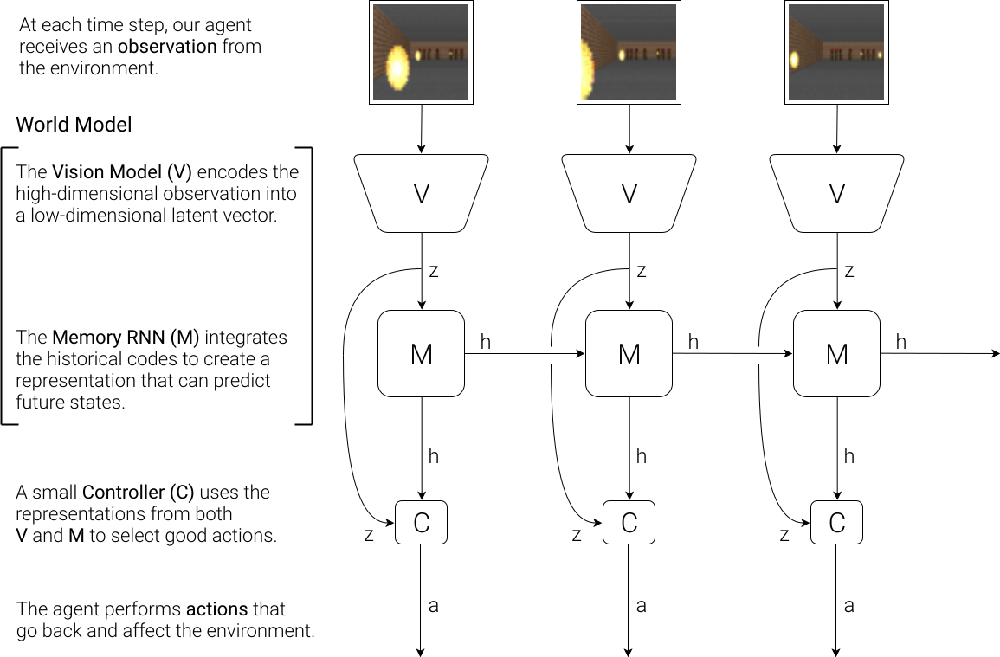
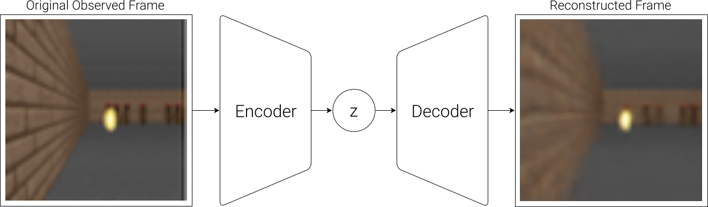
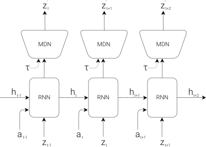
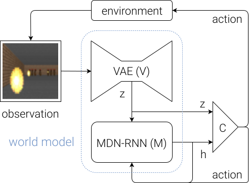
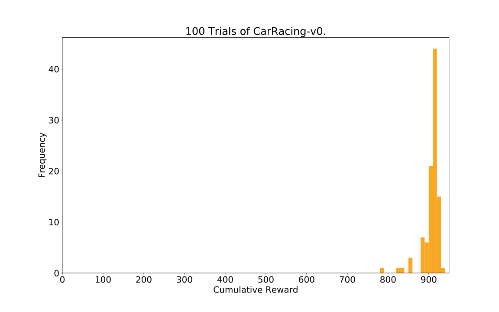
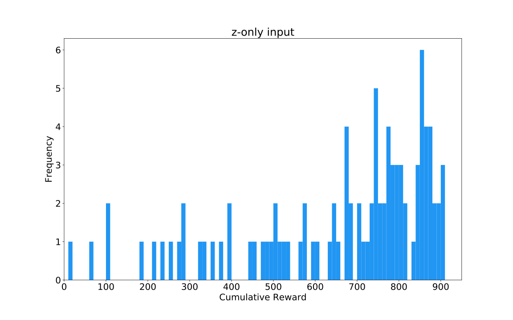
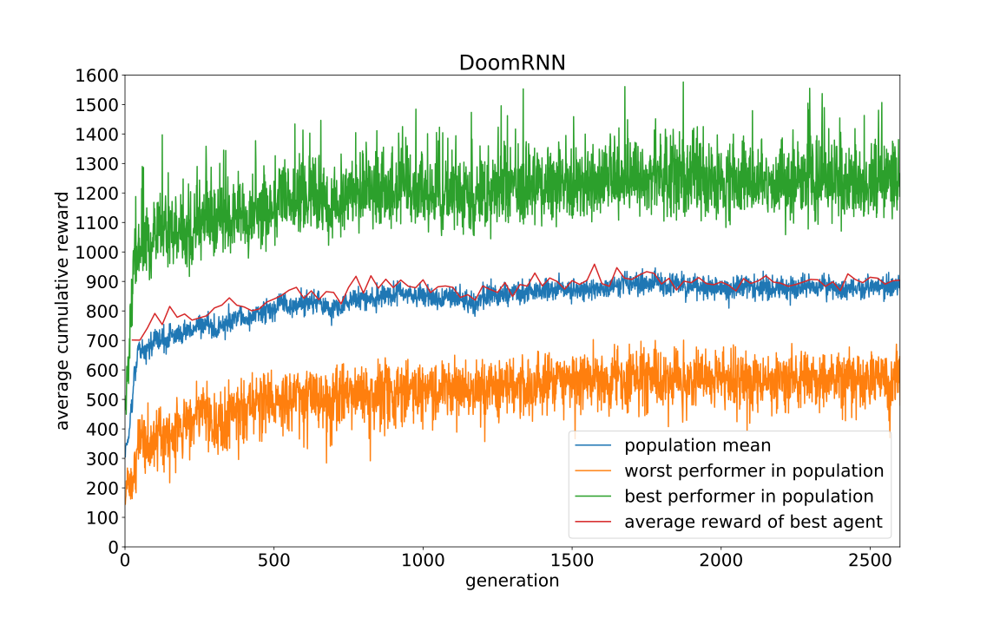
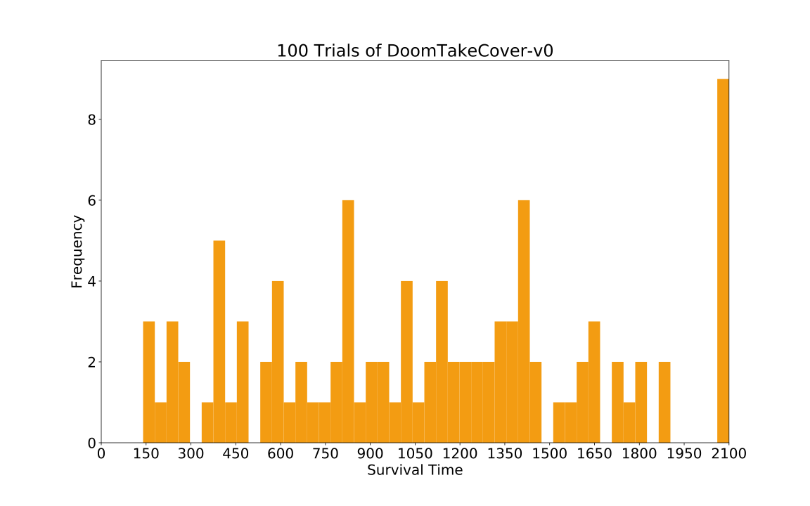

> **한 줄 요약:** 환경을 보고(V) 앞일을 예측하는(M) 큰 월드모델을 먼저 비지도로 학습하고, 그 위에 **파라미터 867개짜리 아주 작은 컨트롤러(C)**만 진화 전략으로 학습시켰더니 CarRacing을 처음으로 "해결"했다. 더 나아가 VizDoom에서는 **월드모델이 만든 꿈속에서만 학습한 정책**이 실제 게임에서도 통했다.

| 항목 | 내용 |
|---|---|
| 저자 | David Ha (Google Brain), Jürgen Schmidhuber (IDSIA) |
| 발표 | 2018.03 arXiv, NeurIPS 2018 (학회 버전 제목: *Recurrent World Models Facilitate Policy Evolution*) |
| 링크 | [arXiv 1803.10122](https://arxiv.org/abs/1803.10122) · [인터랙티브 웹 버전](https://worldmodels.github.io/) · [NeurIPS 버전](https://papers.nips.cc/paper/7512-recurrent-world-models-facilitate-policy-evolution) · [코드](https://github.com/hardmaru/WorldModelsExperiments) |
| 실험 환경 | CarRacing-v0 (OpenAI Gym), VizDoom Take Cover |

## 왜 이 논문을 읽나

요즘 로봇 분야의 [월드 액션 모델(WAM)](/posts/world-model-survey/)이나 Dreamer 계열, Genie 같은 연구는 모두 **"세상이 어떻게 변할지 예측하는 모델을 먼저 배우고, 그걸로 행동을 배운다"**는 생각에서 출발합니다. 이 논문은 그 생각을 딥러닝으로 깔끔하게 구현하고, "그 모델이 만든 가짜 세계에서만 학습해도 된다"는 걸 처음으로 설득력 있게 보여준 논문입니다.

구조가 단순해서 월드모델 입문용으로 읽기 좋습니다. 이 글에서는 필요한 배경 개념을 먼저 짚고, 논문 구조와 실험을 순서대로 정리합니다.

---

## 1. 먼저 알아둘 개념

### 1-1. 월드모델과 모델 기반 강화학습

강화학습은 크게 두 가지로 나뉩니다.

- **모델 프리(model-free):** 환경을 직접 수없이 겪어보면서 "이 상황에선 이 행동이 좋다"를 바로 배웁니다. DQN, A3C, PPO 등. 단순하지만 환경과의 상호작용이 아주 많이 필요합니다.
- **모델 기반(model-based):** 먼저 "이 상태에서 이 행동을 하면 다음에 어떻게 될까"를 예측하는 **환경 모델**을 배우고, 그 모델로 계획하거나 학습합니다.

이 환경 모델을 **월드모델(world model)**이라고 부릅니다. 수식으로 쓰면 다음 상태의 분포를 예측하는 모델입니다.

$$
s_{t+1} \sim P(s_{t+1} \mid s_t, a_t)
$$

사람도 비슷합니다. 공이 날아오면 우리는 눈에 보이는 걸 다 처리하지 않고, 머릿속 모델로 "공이 저기로 오겠구나"를 예측해서 몸이 먼저 반응합니다. 논문도 이 비유로 시작합니다.

### 1-2. VAE (Variational Autoencoder)

게임 화면 같은 이미지는 차원이 너무 큽니다(64×64×3 = 12,288개 숫자). 그래서 먼저 **이미지를 작은 벡터로 압축**해야 합니다.

**오토인코더**는 이미지 $$ x $$를 인코더로 작은 벡터 $$ z $$로 줄였다가, 디코더로 다시 복원한 $$ \hat{x} $$가 원본과 같아지도록 학습합니다. **VAE**는 여기서 $$ z $$를 하나의 값이 아니라 **분포(평균 $$ \mu $$, 표준편차 $$ \sigma $$)**로 뽑습니다.

$$
z = \mu + \sigma \odot \epsilon, \quad \epsilon \sim \mathcal{N}(0, I)
$$

학습 목표는 두 가지 항의 합입니다.

$$
\mathcal{L}_{\text{VAE}} = \underbrace{\lVert x - \hat{x} \rVert_2^2}_{\text{복원 오차}} + \underbrace{D_{\text{KL}}\big(\mathcal{N}(\mu, \sigma^2 I) \,\Vert\, \mathcal{N}(0, I)\big)}_{\text{잠재공간 정규화}}
$$

- **복원 오차:** 원본을 잘 복원하라.
- **KL 항:** 잠재 벡터들이 표준정규분포 근처에 고르게 퍼지게 하라. 덕분에 잠재공간이 매끄러워져서, 아무 $$ z $$를 뽑아도 그럴듯한 이미지가 나옵니다. 나중에 **꿈을 생성할 때** 이 성질이 중요해집니다.

### 1-3. RNN과 LSTM

시간 순서가 있는 데이터를 다루는 신경망입니다. 매 시점 입력을 받을 때마다 **은닉 상태 $$ h_t $$**를 갱신하면서 과거 정보를 요약해 들고 갑니다. LSTM은 RNN이 오래된 정보를 잘 잊는 문제를 게이트 구조로 보완한 버전입니다. 이 논문에서 $$ h_t $$는 "지금까지 본 것을 바탕으로 한 미래에 대한 감"의 역할을 합니다.

### 1-4. MDN (Mixture Density Network)

보통 신경망은 정답 하나를 예측합니다. 그런데 게임 속 다음 장면은 **여러 가능성**이 있습니다. 몬스터가 불덩이를 쏠 수도, 안 쏠 수도 있죠. 하나의 값만 예측하면 두 가능성의 **평균**, 즉 "반쯤 쏜 흐릿한 불덩이" 같은 이상한 답이 나옵니다.

**MDN**은 출력을 **가우시안 여러 개를 섞은 분포**로 냅니다.

$$
p(z) = \sum_{k=1}^{K} \pi_k \, \mathcal{N}(z \mid \mu_k, \sigma_k^2 I), \quad \sum_k \pi_k = 1
$$

신경망은 각 가우시안의 섞는 비율 $$ \pi_k $$, 평균 $$ \mu_k $$, 표준편차 $$ \sigma_k $$를 출력하고, 실제 값은 이 분포에서 **샘플링**합니다. RNN 위에 MDN을 얹은 것이 **MDN-RNN**이고, 손글씨나 스케치(SketchRNN) 생성에 쓰이던 구조입니다.

### 1-5. 온도 $$ \tau $$ (temperature)

샘플링할 때 **얼마나 무작위로 뽑을지** 조절하는 손잡이입니다. SketchRNN 방식에서는 섞는 비율의 로짓을 $$ \tau $$로 나누고, 분산에 $$ \tau $$를 곱합니다.

- $$ \tau $$가 작으면: 가장 가능성 높은 경우만 나옵니다(거의 결정론적).
- $$ \tau $$가 크면: 드문 경우도 자주 나오고, 결과가 더 예측하기 어려워집니다.

이 논문에서 $$ \tau $$는 뒤에서 **꿈속 세계의 난이도**를 조절하는 핵심 장치가 됩니다.

### 1-6. 진화 전략과 CMA-ES

신경망을 역전파로 학습하려면 미분 가능한 손실이 필요합니다. 그런데 강화학습에서는 "어떤 행동이 나중에 보상으로 이어졌는지" 따지는 **신용 할당(credit assignment)** 문제가 어렵습니다.

**진화 전략(Evolution Strategies, ES)**은 미분을 쓰지 않습니다.

1. 파라미터 후보를 여러 개(개체군) 뽑는다.
2. 각 후보로 게임을 해보고 **최종 누적 보상만** 받는다.
3. 점수 좋은 후보 쪽으로 분포를 옮기고 다시 뽑는다.

**CMA-ES**는 그중 대표적인 알고리즘으로, 후보 분포의 평균뿐 아니라 **공분산 행렬**도 같이 조정해서 탐색 방향을 스스로 찾습니다. 파라미터가 수천 개 이하일 때 잘 작동한다고 알려져 있습니다. 그래서 이 논문은 **컨트롤러를 일부러 아주 작게** 만듭니다.

---

## 2. 모델 구조: V, M, C


_에이전트 구조 개요. 보는 부분(V), 기억하고 예측하는 부분(M), 행동을 정하는 부분(C) (출처: worldmodels.github.io, CC-BY 4.0)_

에이전트는 사람의 인지 구조를 흉내 낸 세 부품으로 이뤄집니다. 핵심 설계 원칙은 **"복잡함은 전부 월드모델(V, M)에 몰아넣고, 컨트롤러(C)는 최대한 작게"**입니다.

### 2-1. V (Vision): 지금 보이는 것을 압축


_VAE 흐름도: 이미지를 잠재 벡터 z로 압축했다가 다시 복원 (출처: worldmodels.github.io, CC-BY 4.0)_

- 입력: 64×64 RGB 프레임
- 출력: 잠재 벡터 $$ z_t $$ (CarRacing 32차원, Doom 64차원)
- 구조: 합성곱 4층 인코더 + 역합성곱 4층 디코더를 쓰는 ConvVAE
- 학습: 무작위 정책으로 모은 화면으로 **보상 없이** 1 epoch 학습

V는 **한 장면**만 봅니다. 시간 흐름은 모릅니다.

### 2-2. M (Memory): 다음 장면을 예측


_MDN-RNN: LSTM이 다음 잠재 벡터의 혼합 가우시안 분포를 출력 (출처: worldmodels.github.io, CC-BY 4.0)_

M은 **시간에 따라 무슨 일이 일어날지**를 압축합니다. 현재 잠재 벡터, 행동, 은닉 상태를 받아서 **다음 잠재 벡터의 분포**를 예측합니다.

$$
P(z_{t+1} \mid a_t, z_t, h_t)
$$

- LSTM 은닉 유닛: CarRacing 256개, Doom 512개
- 혼합 가우시안 5개 ($$ K = 5 $$), 각 차원은 독립(대각 공분산)으로 가정
- 무작위 정책 데이터로 20 epoch 학습

결정론적 예측 대신 **확률 분포**를 출력하는 이유는 두 가지입니다. 실제 환경이 확률적이기도 하고, 뒤에서 보겠지만 **컨트롤러가 월드모델의 허점을 파고드는 것**을 막는 데도 도움이 됩니다.

### 2-3. C (Controller): 행동 결정

C는 놀라울 정도로 단순한 **선형 모델 한 층**입니다.

$$
a_t = W_c \, [z_t \; h_t] + b_c
$$

- 입력: 현재 장면의 요약 $$ z_t $$ + 미래에 대한 감 $$ h_t $$를 이어 붙인 벡터
- 출력: 행동 $$ a_t $$ (tanh로 범위를 맞춤)

CarRacing에서는 입력이 $$ 32 + 256 = 288 $$차원, 행동이 3차원(조향, 가속, 브레이크)이라 파라미터 수가 다음과 같습니다.

$$
288 \times 3 + 3 = 867
$$

M이 예측한 $$ z_{t+1} $$을 직접 넣지 않고 $$ h_t $$를 넣는 이유는, $$ h_t $$ 안에 다음 장면 분포를 만들 정보가 이미 다 들어 있기 때문입니다.

### 2-4. 전체 흐름


_매 시점 V가 z를 만들고, C가 z와 h로 행동을 정하고, M이 z와 행동으로 h를 갱신 (출처: worldmodels.github.io, CC-BY 4.0)_

논문에 나온 의사코드를 보면 흐름이 한눈에 들어옵니다.

```python
def rollout(controller):
    obs = env.reset()
    h = rnn.initial_state()
    done = False
    cumulative_reward = 0
    while not done:
        z = vae.encode(obs)              # V: 화면 압축
        a = controller.action([z, h])    # C: 행동 결정
        obs, reward, done = env.step(a)
        cumulative_reward += reward
        h = rnn.forward([a, z, h])       # M: 기억 갱신
    return cumulative_reward
```

이 함수가 돌려주는 **누적 보상 하나**가 CMA-ES가 받는 점수의 전부입니다.

### 2-5. 파라미터가 어디에 있나

| 모델 | CarRacing | Doom |
|---|---|---|
| V (VAE) | 4,348,547 | 4,446,915 |
| M (MDN-RNN) | 422,368 | 1,678,785 |
| C (Controller) | **867** | **1,088** |

파라미터의 99% 이상이 월드모델에 있습니다. V와 M은 **보상 없이** GPU에서 역전파로 효율적으로 학습하고, **보상을 보는 건 C뿐**입니다. C는 작으니까 CMA-ES처럼 미분이 필요 없는 방법으로 학습할 수 있습니다.

---

## 3. 실험 1: CarRacing, 월드모델로 운전 배우기

위에서 내려다보는 자동차 경주 게임입니다. 매번 무작위로 만들어진 트랙을 달리고, **100번 연속 평균 900점 이상**이면 "해결"로 봅니다. 대충 트랙을 따라가는 건 쉽지만 900점은 실수를 거의 안 해야 나오는 점수입니다.

### 학습 절차

1. 무작위 정책으로 10,000번 플레이한 데이터를 모은다.
2. V를 학습해 각 프레임을 $$ z \in \mathbb{R}^{32} $$로 압축한다.
3. M을 학습해 $$ P(z_{t+1} \mid a_t, z_t, h_t) $$를 모델링한다.
4. 실제 환경에서 C를 CMA-ES로 진화시킨다. (개체군 64개, 각 개체가 16번씩 플레이한 평균이 점수)

### 결과

| 방법 | 평균 점수 (100회) |
|---|---|
| DQN | 343 ± 18 |
| A3C (연속 행동) | 591 ± 45 |
| A3C (이산 행동) | 652 ± 10 |
| Gym 리더보드 최고 기록 | 838 ± 11 |
| **V만 사용** ($$ a_t = W_c z_t + b_c $$) | 632 ± 251 |
| **V만 사용 + 은닉층 추가** | 788 ± 141 |
| **V + M (전체 월드모델)** | **906 ± 21** |


_V와 M을 모두 쓴 에이전트의 100회 점수 분포. 평균 906 ± 21 (출처: worldmodels.github.io, CC-BY 4.0)_


_V만 쓴 에이전트의 점수 분포. 평균 632 ± 251로 편차가 매우 크다 (출처: worldmodels.github.io, CC-BY 4.0)_

**해석**

- V만 쓰면 에이전트가 **비틀거리고 급커브에서 트랙을 벗어납니다.** 현재 화면만 보고는 "곧 커브가 온다"를 모르기 때문입니다.
- M의 $$ h_t $$를 추가하면 **미래에 대한 감**이 생겨서 커브 전에 미리 반응합니다. 사람이 운전할 때 커브를 보고 생각하기 전에 몸이 먼저 핸들을 돌리는 것과 비슷합니다.
- 컨트롤러가 선형 모델 하나인데도 **처음으로 900점 기준을 넘었습니다.** 좋은 표현만 있으면 정책은 아주 단순해도 된다는 뜻입니다.
- 기존 딥RL은 엣지 검출이나 프레임 쌓기 같은 전처리를 썼지만, 이 방법은 **원본 RGB 픽셀을 그대로** 받습니다.

---

## 4. 실험 2: VizDoom, 꿈속에서만 학습하기

이 논문의 진짜 하이라이트입니다. CarRacing에서는 C를 **실제 환경**에서 학습했습니다. 그렇다면 **M이 만든 가짜 환경에서만 학습**해도 될까요?

### 환경: Take Cover

방 반대편 몬스터들이 불덩이를 쏘고, 에이전트는 좌우로 움직이며 피해야 합니다. 보상은 **살아남은 시간**입니다. 한 판은 최대 2,100 스텝(약 60초)이고, **100번 연속 평균 750 스텝 이상** 버티면 해결입니다.

### 꿈 환경 만들기

CarRacing과의 차이는 딱 하나입니다. M이 다음 장면뿐 아니라 **다음 스텝에 죽는지(done)**까지 예측합니다.

$$
P(z_{t+1}, d_{t+1} \mid a_t, z_t, h_t)
$$

다음 장면과 게임 종료 여부를 모두 예측할 수 있으면, **M 자체가 하나의 완전한 게임**이 됩니다. 저자들은 M을 Gym 환경 인터페이스로 감싸서 진짜 게임처럼 쓸 수 있게 만들었습니다. 이 가짜 환경에서는 V로 실제 화면을 인코딩할 필요도 없이 **잠재공간 안에서만** 게임이 돌아갑니다.

### 학습 절차

1. 무작위 정책으로 10,000번 플레이한 데이터를 모은다.
2. V를 학습해 프레임을 $$ z \in \mathbb{R}^{64} $$로 압축한다.
3. M을 학습해 $$ P(z_{t+1}, d_{t+1} \mid a_t, z_t, h_t) $$를 모델링한다.
4. **M이 만든 꿈속에서만** C를 진화시킨다.
5. 학습된 정책을 **실제 게임에 그대로** 투입한다.


_꿈 환경(DoomRNN)에서 세대별로 C를 진화시킨 학습 곡선 (출처: worldmodels.github.io, CC-BY 4.0)_


_꿈에서만 학습한 에이전트를 실제 게임에 넣었을 때 100회 생존 시간 분포. 평균 1092 ± 556 (출처: worldmodels.github.io, CC-BY 4.0)_

꿈에서만 학습한 에이전트가 실제 게임에서 **평균 약 1,100 스텝**을 버텼습니다. 해결 기준 750을 훌쩍 넘고, 당시 Gym 리더보드 최고 기록(820 ± 58)보다도 높습니다.

흥미로운 점은 V가 몬스터 **수**조차 정확히 복원하지 못했다는 것입니다. 꿈속 세계는 실제보다 더 흐릿하고 불확실한데, 오히려 그런 **악몽 같은 환경에서 살아남은 에이전트가 깨끗한 실제 환경에서는 더 잘 해냈습니다.**

### 월드모델 속이기 (Cheating the World Model)

초기 실험에서 문제가 생겼습니다. 에이전트가 **몬스터가 아예 불덩이를 쏘지 않게 만드는 이상한 움직임**을 찾아낸 겁니다. 실제 게임에는 없는 M의 허점을 파고든 것이죠. 어릴 때 게임 버그로 무한 목숨을 얻는 것과 같습니다. 점수는 높지만 실력은 늘지 않습니다.

왜 이런 일이 생길까요?

- M은 실제 환경을 **근사**한 것이라 실제 규칙을 벗어나는 궤적을 가끔 만듭니다.
- 게다가 C는 M의 **은닉 상태를 직접 입력으로 받습니다.** 게임 화면만 보는 플레이어가 아니라 **게임 엔진 내부 메모리를 들여다보는** 셈이라, 엔진을 조작하는 방법을 쉽게 찾아냅니다.

이게 이전 모델 기반 RL 연구들이 학습한 모델로 실제 환경을 **완전히 대체하지 못했던** 이유 중 하나라고 논문은 지적합니다.

**해결책: 온도 $$ \tau $$로 꿈을 더 어렵게 만들기**

M이 확률 분포를 출력하니까, 샘플링 온도 $$ \tau $$를 올리면 꿈속 세계가 더 무작위해집니다. 불덩이가 더 예측하기 어렵게 날아오고, 가끔은 이유 없이 죽기도 합니다. 이렇게 **현실보다 가혹한 꿈**에서 학습하면 허점을 파고들기 어려워집니다.

| 꿈의 온도 $$ \tau $$ | 꿈속 점수 | 실제 게임 점수 |
|---|---|---|
| 0.10 | 2086 ± 140 | 193 ± 58 |
| 0.50 | 2060 ± 277 | 196 ± 50 |
| 1.00 | 1145 ± 690 | 868 ± 511 |
| **1.15** | 918 ± 546 | **1092 ± 556** |
| 1.30 | 732 ± 269 | 753 ± 139 |
| 무작위 정책 | - | 210 ± 108 |
| Gym 리더보드 최고 기록 | - | 820 ± 58 |

**해석**

- $$ \tau $$가 낮으면(0.1, 0.5) 꿈속에선 거의 만점인데 **실제로는 무작위 정책보다 못합니다.** $$ \tau = 0.1 $$에서는 M이 거의 결정론적인 LSTM처럼 되어 **몬스터가 불덩이를 아예 안 쏩니다**(mode collapse). 불덩이를 쏘는 모드로 넘어가지 못하는 거죠.
- $$ \tau $$를 올리면 꿈속 점수는 떨어지지만 **실제 점수는 올라갑니다.** 꿈이 어려울수록 현실로 잘 옮겨집니다.
- 너무 올리면(1.30) 꿈이 너무 어려워서 배우기 힘들어집니다. 대신 점수 편차가 작은 **덜 위험한 전략**이 나왔습니다. 즉 $$ \tau $$는 현실성과 악용 가능성 사이를 조절하는 **하이퍼파라미터**입니다.

---

## 5. 반복 학습 절차

두 실험은 모두 **무작위 정책으로 한 번 모은 데이터**로 충분했습니다. 하지만 복잡한 환경에서는 무작위로 움직여서는 세상의 일부만 보게 됩니다. 그래서 논문은 반복 절차를 제안합니다.

1. M, C를 무작위로 초기화한다.
2. 실제 환경에서 $$ N $$번 플레이하며 행동과 관측을 모두 저장한다.
3. M을 학습시키고, M 안에서 C를 학습시킨다.
4. 작업이 해결되지 않았으면 2로 돌아간다.

이렇게 하면 C가 나아질수록 새로운 상황의 데이터가 모이고, M도 점점 정확해집니다. 논문은 여기서 두 가지 아이디어를 더 던집니다.

- **호기심:** M의 예측 오차가 크다는 건 에이전트가 **잘 모르는 곳**에 있다는 뜻입니다. M의 손실을 보상으로 뒤집어 쓰면 낯선 곳을 탐험하게 만들 수 있습니다.
- **기억 공고화:** 동물이 잠자는 동안 최근 경험을 되새기며 기억을 정리하는 **해마 재생(hippocampal replay)**과 연결해서 설명합니다.

---

## 6. 한계와 논의

논문 스스로 밝힌 한계들입니다.

- **과제와 무관한 것까지 압축한다.** V는 보상을 모르고 학습하니까 뭐가 중요한지 모릅니다. 실제로 Doom 벽의 벽돌 무늬 같은 쓸데없는 디테일은 복원하면서, CarRacing에서 **정작 중요한 도로 타일은 제대로 복원하지 못했습니다.** 보상을 함께 예측하게 하면 나아지겠지만, 그러면 V를 다른 과제에 재사용하기 어려워집니다.
- **용량 한계.** LSTM 하나에 세상 전체를 담기는 어렵고, 새로운 걸 배우면 옛것을 잊는 **파국적 망각**도 있습니다.
- **한 스텝씩만 상상한다.** 사람처럼 계층적으로, 추상적으로 계획하지 못하고 시간 순서대로 한 칸씩 굴려볼 뿐입니다.
- **환경이 단순하다.** 무작위 정책으로도 충분한 데이터를 모을 수 있는 쉬운 과제에서만 검증했습니다.

---

## 7. 이후 연구와의 연결

이 논문이 던진 질문들은 이후 월드모델 연구의 뼈대가 됐습니다.

| 이 논문의 한계 | 이어진 연구 방향 |
|---|---|
| V, M, C를 따로따로 학습 | **PlaNet**(2018.11), **Dreamer**(2019.12): 잠재 동역학 모델을 함께 학습하고, 상상 속 궤적으로 정책을 역전파 학습 |
| 단순한 환경에서만 검증 | **DreamerV3**(2023.01): 하나의 설정으로 다양한 도메인 해결 |
| 무관한 디테일까지 복원 | **DINO-WM** 등 사전학습 특징 공간에서 예측, **JEPA** 계열처럼 픽셀을 복원하지 않는 예측 |
| 작은 LSTM의 용량 한계 | 트랜스포머, 디퓨전 기반의 대규모 월드모델, 비디오 생성 모델 기반 **월드 액션 모델(WAM)** |
| 월드모델의 허점을 파고듦 | 불확실성 추정, 앙상블 등 모델 오차를 다루는 모델 기반 RL 연구 전반 |

특히 **"환경을 압축해 예측하는 큰 모델 + 그 위의 작은 정책"**이라는 분업 구조와 **"상상 속에서 학습한다"**는 발상은 지금의 [WAM 연구](/posts/world-model-survey/)까지 그대로 이어집니다.

---

## 8. 정리

- **V(VAE)**가 한 장면을 압축하고, **M(MDN-RNN)**이 다음 장면을 확률적으로 예측하고, **C(선형 모델)**가 둘의 출력으로 행동을 정한다.
- 복잡도는 월드모델에 몰아넣고 **보상 없이** 학습한다. 보상을 보는 건 파라미터 867개짜리 C뿐이고, CMA-ES로 학습한다.
- CarRacing에서 **처음으로 900점을 넘었다(906 ± 21).** M의 미래 예측이 핵심이었다.
- VizDoom에서는 **꿈속에서만 학습한 정책이 실제 게임에서 통했다.**
- 에이전트는 월드모델의 허점을 파고들 수 있고, **온도 $$ \tau $$로 꿈을 더 불확실하게 만들면** 이를 막을 수 있다.

---

## 참고 자료

- David Ha, Jürgen Schmidhuber. *World Models.* [arXiv 1803.10122](https://arxiv.org/abs/1803.10122), 2018.
- [인터랙티브 웹 버전 (worldmodels.github.io)](https://worldmodels.github.io/): 꿈속 환경을 직접 조작해볼 수 있는 데모가 있어서 꼭 한번 보는 걸 추천합니다.
- [공식 실험 코드 (hardmaru/WorldModelsExperiments)](https://github.com/hardmaru/WorldModelsExperiments)
- Hafner et al. *Learning Latent Dynamics for Planning from Pixels (PlaNet).* [arXiv 1811.04551](https://arxiv.org/abs/1811.04551)
- Hafner et al. *Dream to Control (Dreamer).* [arXiv 1912.01603](https://arxiv.org/abs/1912.01603)
- Hafner et al. *Mastering Diverse Domains through World Models (DreamerV3).* [arXiv 2301.04104](https://arxiv.org/abs/2301.04104)

> 이 글의 그림은 [worldmodels.github.io](https://worldmodels.github.io/)의 그림(CC-BY 4.0)에 다크 모드용 흰 배경만 추가한 것입니다. 대표 이미지는 직접 만든 지형도 일러스트입니다.
{: .prompt-info }
