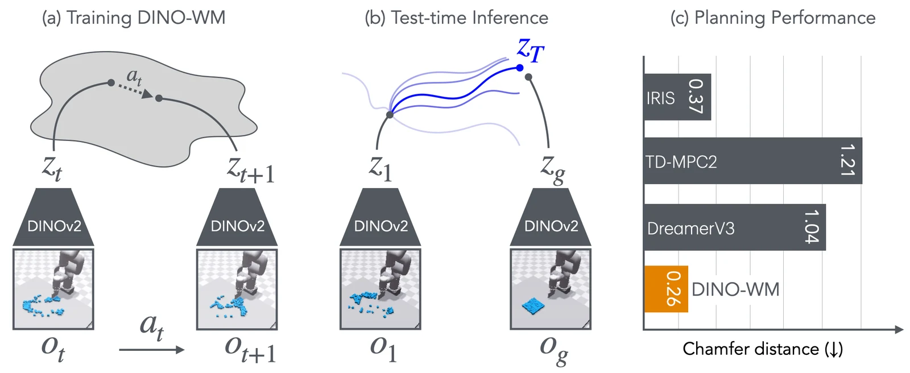
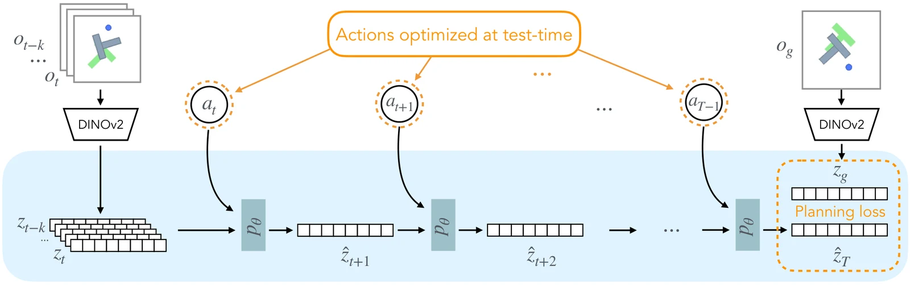
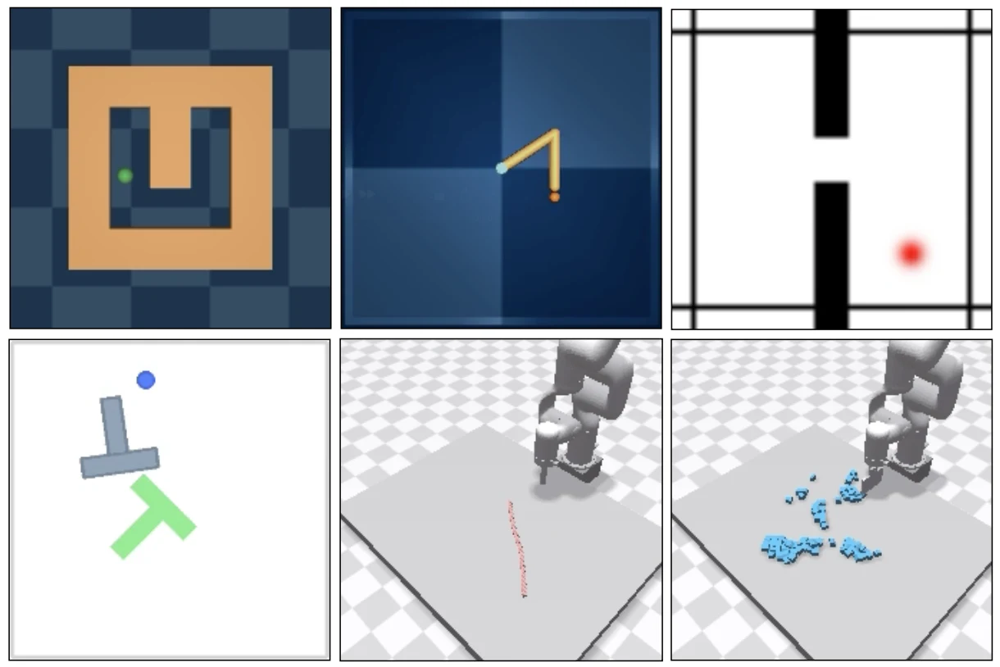
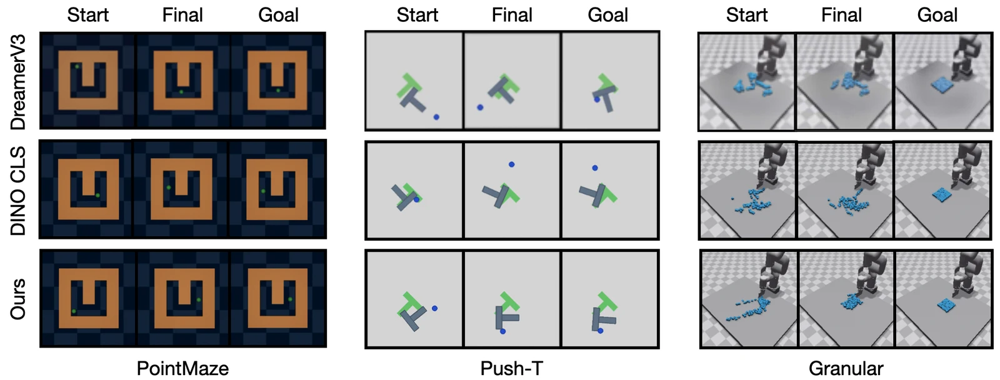
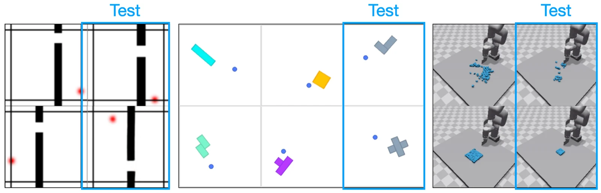
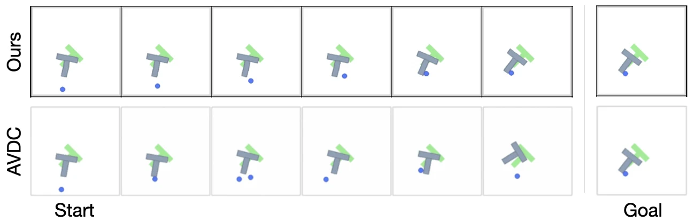
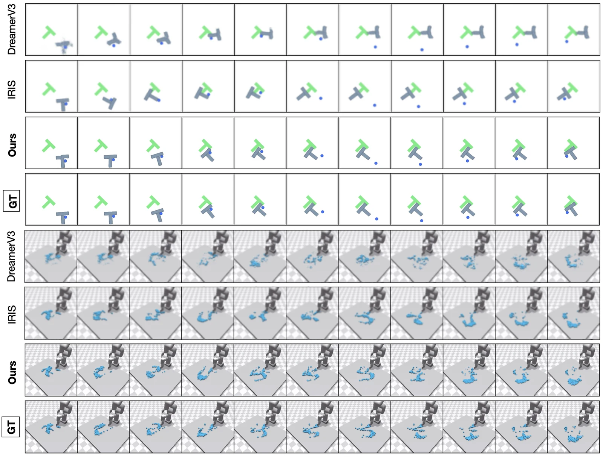

> **한 줄 요약:** 이미지를 **고정된 DINOv2의 패치 특징**으로 바꾸고, 그 특징 공간에서 "이 행동을 하면 다음 특징이 어떻게 될까"만 예측하는 ViT를 **보상 없이 오프라인 궤적**으로 학습합니다. 테스트 때는 목표 이미지의 특징과 예측 특징 사이의 거리를 비용으로 삼아 CEM 기반 MPC로 행동을 찾습니다. 전문가 시연, 보상 모델, 역모델 없이 6개 환경에서 DreamerV3, IRIS, TD-MPC2보다 좋거나 비슷한 계획 성능을 냈습니다.

| 항목 | 내용 |
|---|---|
| 저자 | Gaoyue Zhou, Hengkai Pan, Yann LeCun, Lerrel Pinto |
| 소속 | Courant Institute, New York University (Yann LeCun은 Meta AI 소속 병기) |
| 발표 | 2024.11 arXiv (v2: 2025.02), ICML 2025 |
| 링크 | [arXiv 2411.04983](https://arxiv.org/abs/2411.04983) · [프로젝트 페이지](https://dino-wm.github.io) · [코드](https://github.com/gaoyuezhou/dino_wm) |
| 실험 환경 | PointMaze, Wall, Reacher, Push-T, Rope, Granular (+ 일반화용 WallRandom, PushObj, GranularRandom) |

> **읽는 법:** 본문은 논문에 적힌 내용을 그대로 옮긴 것이고, 가능한 곳에는 근거(섹션, 그림, 표 번호)를 달았습니다. 초록색 **AI 해석** 박스는 논문에 없는 해석, 비유, 평가, 다른 연구와의 연결입니다. "먼저 알아둘 개념"은 논문 밖의 일반 배경 설명입니다.
{: .prompt-info }

_(a) DINOv2 특징 공간에서 행동에 따른 다음 특징을 예측하도록 학습하고, (b) 테스트 때 목표 관측의 특징 $$ z_g $$에 도달하도록 행동을 최적화합니다. (c) Granular 환경의 Chamfer distance(낮을수록 좋음) 비교 (출처: DINO-WM, Figure 1)_

## 왜 이 논문을 읽나

[월드 액션 모델 계보 지도](/posts/world-model-survey/)에서 월드모델 기반 로봇 연구를 세 갈래로 나눴는데, 그중 **"잠재공간 예측(C 갈래)"**, 즉 미래를 픽셀로 그리지 않고 사전학습 인코더의 특징 공간에서만 예측하는 흐름의 뿌리가 이 논문입니다. 앞서 읽은 [World Models 리뷰](/posts/world-model/)의 V-M-C 구조와 비교하면, DINO-WM은 V(인코더)를 **직접 학습하지 않고 DINOv2를 얼려서 가져다 쓰고**, C(정책)를 **아예 학습하지 않고 테스트 시점 최적화(MPC)로 대체**합니다.

이 글에서는 필요한 배경 개념을 먼저 짚고, 논문의 문제 설정, 방법, 실험, 한계를 순서대로 정리합니다. 같은 갈래의 후속 연구는 다음 글에서 이어집니다: [FLARE](/posts/flare/), [DreamVLA](/posts/dreamvla/), [VLA-JEPA](/posts/vla-jepa/), [LiLa-WAM](/posts/lila-wam/).

---

## 1. 먼저 알아둘 개념

> 이 절은 논문 밖의 일반 배경 설명입니다. 논문의 주장은 2절부터 나옵니다.
{: .prompt-info }

### 1-1. 월드모델과 오프라인 학습

**월드모델(world model)**은 "지금 상태에서 이 행동을 하면 다음에 어떻게 될까"를 예측하는 모델입니다.

$$
s_{t+1} \sim p(s_{t+1} \mid s_t, a_t)
$$

학습 방식은 크게 두 가지입니다.

- **온라인:** 에이전트가 환경과 계속 상호작용하며 데이터를 모으고, 월드모델과 정책을 번갈아 개선합니다. Dreamer 계열, TD-MPC 계열이 대표적입니다.
- **오프라인:** 미리 모아 둔 궤적 데이터 $$ (o_0, a_0, o_1, a_1, \dots) $$만으로 학습합니다. 학습 중 환경에 다시 접근하지 않습니다.

### 1-2. 자기지도 학습과 DINO / DINOv2

**자기지도 학습(self-supervised learning)**은 사람이 붙인 라벨 없이 데이터 자체에서 학습 신호를 만들어 표현을 배우는 방법입니다.

**DINO**는 **자기 증류(self-distillation)** 방식입니다. 같은 이미지를 서로 다르게 자르고 변형한 두 장을 만들어, 학생(student) 네트워크의 출력이 교사(teacher) 네트워크의 출력과 같아지도록 학습합니다. 교사는 별도로 학습하지 않고 학생 가중치의 지수이동평균(EMA)으로 갱신합니다.

$$
\theta_{\text{teacher}} \leftarrow \lambda \, \theta_{\text{teacher}} + (1 - \lambda) \, \theta_{\text{student}}
$$

**DINOv2**는 이를 대규모로 확장한 모델로, 라벨 없이 학습했는데도 물체 검출, 분할, 깊이 추정 같은 과제에 바로 쓸 수 있는 특징을 뽑아 주는 것으로 알려져 있습니다.

### 1-3. ViT와 패치 특징, CLS 토큰

**ViT(Vision Transformer)**는 이미지를 작은 정사각형 **패치**로 잘라 각각을 벡터(토큰)로 만든 뒤 트랜스포머로 처리합니다. 예를 들어 한 변 14픽셀짜리 패치로 196×196 이미지를 자르면 가로세로 14개씩, 총 $$ 14 \times 14 = 196 $$개의 패치가 나옵니다.

ViT의 출력에는 두 종류가 있습니다.

- **패치 특징:** 패치마다 하나씩 나오는 벡터. 전체를 모으면 $$ z \in \mathbb{R}^{N \times E} $$ ($$ N $$: 패치 수, $$ E $$: 특징 차원). **어느 위치에 무엇이 있는지** 공간 정보가 남아 있습니다.
- **CLS 토큰:** 이미지 전체를 요약한 벡터 하나. 분류 같은 과제에는 편하지만 공간 정보는 뭉개집니다.

DINO-WM의 핵심 실험 중 하나가 바로 이 둘(패치 vs CLS)의 비교입니다.

### 1-4. 트랜스포머의 인과적(causal) 어텐션 마스크

트랜스포머의 어텐션은 기본적으로 모든 토큰이 모든 토큰을 봅니다. **인과적 마스크**는 "시점 $$ t $$의 토큰은 $$ t $$ 이전의 토큰만 볼 수 있다"는 제약을 겁니다. 이게 없으면 학습 중에 모델이 미래 정답을 훔쳐보고 맞히는 **치팅**이 가능해지는데, 테스트 때는 미래가 없으니 성능이 무너집니다.

### 1-5. Teacher forcing

순차 예측 모델을 학습할 때, 다음 스텝 입력으로 **모델이 방금 예측한 값 대신 실제 정답 값**을 넣어 주는 방식입니다. 학습이 안정적이고 병렬화가 쉽지만, 테스트 때는 자기 예측을 다시 입력으로 써야 하므로 오차가 누적될 수 있습니다.

### 1-6. MPC와 CEM

**MPC(Model Predictive Control, 모델 예측 제어)**는 다음 과정을 반복하는 제어 방식입니다.

1. 모델로 앞으로 $$ T $$스텝의 행동 시퀀스를 최적화한다.
2. 그중 **앞부분 몇 개만** 실제로 실행한다.
3. 새 관측을 받아 1번부터 다시 한다(receding horizon).

이렇게 하면 모델 오차가 있어도 매번 새 관측으로 계획을 고칠 수 있습니다.

**CEM(Cross-Entropy Method)**은 미분 없이 쓰는 샘플링 기반 최적화입니다.

1. 가우시안 분포 $$ \mathcal{N}(\mu, \Sigma) $$에서 행동 시퀀스 후보 $$ N $$개를 뽑는다.
2. 각 후보의 비용을 계산한다.
3. 비용이 가장 낮은 상위 $$ K $$개(elite)로 $$ \mu, \Sigma $$를 다시 추정한다.
4. 반복한다.

$$
\mu \leftarrow \frac{1}{K} \sum_{k \in \text{elite}} a^{(k)}, \qquad \Sigma \leftarrow \text{Cov}\big(\{ a^{(k)} \}_{k \in \text{elite}}\big)
$$

### 1-7. 평가 지표: Chamfer Distance, LPIPS, SSIM

- **Chamfer Distance(CD):** 두 점 집합이 얼마나 가까운지 재는 거리. 각 점에서 상대 집합의 가장 가까운 점까지 거리를 양방향으로 평균냅니다. 낮을수록 좋습니다.

$$
d_{\text{CD}}(P, Q) = \frac{1}{\lvert P \rvert} \sum_{p \in P} \min_{q \in Q} \lVert p - q \rVert^2 + \frac{1}{\lvert Q \rvert} \sum_{q \in Q} \min_{p \in P} \lVert p - q \rVert^2
$$

- **LPIPS:** 두 이미지를 딥넷 특징으로 비교한 지각적 거리. 낮을수록 비슷합니다.
- **SSIM:** 구조, 밝기, 대비의 일치를 보는 이미지 유사도. 높을수록 비슷합니다.

---

## 2. 문제 설정과 기존 연구의 한계

### 2-1. 논문이 지적하는 문제

논문은 Introduction에서 다음과 같이 문제를 정리합니다 (Sec. 1).

- **피드포워드 정책의 일반화 한계:** 기존 방법은 학습이 끝난 정책이 관측을 곧바로 행동으로 바꾸는 방식이라, 일반화하려면 학습 중에 비슷한 상황을 이미 봤어야 합니다. 모든 과제와 환경의 해법을 미리 배우는 것은 불가능하고 비효율적이라고 봅니다.
- **대안:** 데이터로 동역학 모델(월드모델)을 학습해 두고, **실행 시점에 과제별 행동을 최적화**하는 것.
- **온라인 월드모델의 한계:** 최적화 중인 정책이 다니는 영역에서만 정확하므로, 같은 환경이라도 새 과제마다 재학습이 필요합니다.
- **오프라인 월드모델의 한계:** 과제 의존성은 줄지만, 실제로 과제를 풀 때는 전문가 시연, 구조화된 키포인트, 사전학습된 역모델, 조밀한 보상 함수 같은 **강한 보조 정보**가 필요해 범용성이 떨어집니다.

그래서 논문이 던지는 중심 질문은 **"범용성을 해치지 않는 다른 보조 정보는 없을까?"**이고, 답으로 제시하는 것이 **사전학습된 시각 표현(DINOv2 패치 특징)**입니다.

논문은 월드모델이 갖춰야 할 조건으로 세 가지를 듭니다 (Abstract).

1. 미리 모은 **오프라인 궤적**으로 학습할 수 있어야 한다.
2. **테스트 시점 행동 최적화**를 지원해야 한다.
3. **과제와 무관한(task-agnostic) 추론**이 가능해야 한다.

### 2-2. 관련 연구에 대한 논문의 정리

Related Work (Sec. 2)에서 논문은 기존 월드모델을 다음처럼 구분합니다.

| 방식 | 논문이 지적한 문제 |
|---|---|
| **픽셀 공간 예측** (Visual Foresight, AVDC, UniPi 등) | 이미지 복원과 디퓨전 모델 때문에 계산 비용이 큼 |
| **잠재공간 예측 + 복원 목표** (PlaNet, IRIS, DreamerV3) | 복원 목표에 묶여 있어 학습된 특징이 과제에 필요한 정보를 충분히 담는지 의문 |
| **보상 예측 포함** (IRIS, DreamerV3, TD-MPC 계열) | 보상 예측이 목표나 보조 목표로 들어가 모델이 본질적으로 과제 특화됨 |
| **대규모 생성형 비디오 월드모델** (GAIA-1, UniSim, Genie, Sora 등) | 언어 조건에 의존해 정밀한 시각적 목표 도달에 한계, 디퓨전은 MPC 같은 테스트 시점 최적화에 쓰기엔 계산 비용이 큼 |

또 ImageNet ResNet, R3M, MVP 같은 사전학습 표현은 이미지를 **하나의 전역 벡터**로 표현하는 경우가 많은 반면, ViT 기반 DINO는 **패치 특징**을 제공한다는 점을 강조합니다.

### 2-3. 형식적 문제 정의

논문은 환경을 POMDP $$ (\mathcal{O}, \mathcal{A}, p) $$로 둡니다 (Sec. 3). $$ \mathcal{O} $$는 관측 공간, $$ \mathcal{A} $$는 행동 공간이고, 동역학은

$$
p(o_{t+1} \mid o_{\leq t}, a_{\leq t})
$$

입니다. 테스트 때 시스템은 **임의의 초기 상태**에서 시작하고, **RGB 이미지로 된 목표 관측**을 받아 그 상태에 도달하는 행동 시퀀스 $$ a_0, \dots, a_T $$를 내야 합니다. 논문은 이것이 고정된 과제의 보상을 최적화하는 온라인 RL 월드모델이나, 텍스트로 목표를 주는 텍스트 조건 월드모델과 다르다고 설명합니다.

> **AI 해석**  
> 이 설정의 핵심은 "목표를 **이미지 한 장**으로 준다"는 점입니다. 보상 함수를 설계할 필요가 없는 대신, 목표 상태의 모습을 미리 알고 있어야 합니다. "컵을 들어 올려라"처럼 목표 장면을 그리기 어려운 과제나, 목표까지 가는 과정 자체가 중요한 과제에는 바로 적용하기 어려운 설정이기도 합니다.
{: .prompt-tip }

---

## 3. 방법: DINO-WM

_DINO-WM 구조. 과거 관측을 DINOv2로 인코딩한 뒤, 예측기 $$ p_\theta $$로 잠재 상태를 굴려 $$ \hat{z}_T $$를 얻고, 목표 $$ z_g $$와의 거리(planning loss)를 줄이도록 행동 $$ a_{t:T-1} $$을 테스트 시점에 최적화합니다. 모든 계산은 잠재공간에서 일어납니다 (출처: DINO-WM, Figure 2)_

### 3-1. 세 가지 구성요소

논문은 각 시점 $$ t $$에서 월드모델을 다음 세 부분으로 정의합니다 (Sec. 3.1).

$$
\begin{aligned}
&\text{관측 모델:} && z_t \sim \text{enc}_\theta(z_t \mid o_t) \\
&\text{전이 모델:} && z_{t+1} \sim p_\theta(z_{t+1} \mid z_{t-H:t}, a_{t-H:t}) \\
&\text{디코더 (시각화용, 선택):} && \hat{o}_t \sim q_\theta(o_t \mid z_t)
\end{aligned}
$$

- 관측 모델은 이미지를 잠재 상태 $$ z_t $$로 바꿉니다.
- 전이 모델은 길이 $$ H $$의 과거 잠재 상태와 행동 이력을 받아 다음 잠재 상태를 예측합니다.
- 디코더는 잠재 상태를 이미지로 되돌리는데, **학습 목표가 나머지 월드모델과 완전히 독립**이라 없어도 됩니다.

논문은 디코더를 분리함으로써 학습과 테스트 모두에서 이미지를 복원할 필요가 없어지고, 관측 모델과 디코더를 함께 학습하는 IRIS, DreamerV3에 비해 계산 비용이 줄어든다고 설명합니다.

또한 DINO-WM은 **오프라인 궤적에 있는 정보만** 모델링합니다. 최근 온라인 RL 월드모델이 요구하는 보상, 할인율, 종료 조건 같은 과제 관련 정보는 쓰지 않습니다 (Sec. 3.1).

### 3-2. 관측 모델: 얼린 DINOv2 (Sec. 3.1.1)

논문은 범용 월드모델의 관측 모델이 **(1) 과제와 환경에 독립적이고 (2) 탐색과 조작에 필요한 풍부한 공간 정보를 담아야 한다**고 주장합니다. 새 환경마다 관측 모델을 처음부터 학습하는 것은 비효율적이고 때로는 불가능하며, 지각은 대규모 인터넷 데이터의 덕을 보는 일반적 과제라는 이유입니다.

그래서 **사전학습된 DINOv2를 관측 모델로 쓰고, 학습과 테스트 내내 고정(frozen)**합니다. 각 시점의 이미지 $$ o_t $$는 패치 임베딩

$$
z_t \in \mathbb{R}^{N \times E}
$$

로 바뀝니다 ($$ N $$: 패치 수, $$ E $$: 임베딩 차원). 부록에 따르면 입력 이미지를 196×196으로 리사이즈해 $$ (14 \times 14, 384) $$ 모양의 특징을 뽑습니다 (App. A.9). 즉 $$ N = 196 $$, $$ E = 384 $$입니다.

### 3-3. 전이 모델: 프레임 단위 인과적 ViT (Sec. 3.1.2)

전이 모델은 패치 특징을 다루기에 적합한 **ViT 구조**를 씁니다. 입력이 이미 패치 임베딩이므로 토큰화 층을 없앴고, 논문은 이를 사실상 **디코더 전용 트랜스포머**로 만든 것이라고 설명합니다.

**입력과 출력.** 과거 잠재 상태 $$ z_{t-H:t-1} $$과 행동 $$ a_{t-H:t-1} $$을 받아 다음 시점 $$ z_t $$를 예측합니다. $$ H $$는 문맥 길이(history) 하이퍼파라미터입니다.

**프레임 단위 인과적 어텐션.** 시점 $$ t $$의 상태는 이전 관측과 행동에만 의존해야 하므로 ViT에 인과적 어텐션을 넣었습니다. 구체적으로 $$ z_t $$의 각 패치 벡터 $$ z_t^i $$는 과거 프레임의 모든 패치 $$ \{ z_{t-H:t-1}^i \}_{i=1}^N $$에 어텐션합니다. 논문은 이것이 **IRIS와 다른 점**이라고 강조합니다.

| | 예측 단위 | 어텐션 범위 |
|---|---|---|
| IRIS | **토큰 단위** 자기회귀 | 과거 프레임의 모든 토큰 + 같은 프레임의 앞선 토큰 $$ \{ z_t^i \}_{i=1}^{<k} $$ |
| DINO-WM | **프레임 단위** 자기회귀 | 과거 프레임의 모든 패치 |

논문은 한 관측의 패치들을 하나로 묶어 프레임 단위로 예측하는 쪽이 고립된 토큰이 아닌 관측 전체의 의존성을 모델링하므로 전역 구조와 시간적 동역학을 더 잘 잡고, 시간적 일반화가 좋아진다고 주장합니다. 효과는 부록 A.4.2의 소거 실험으로 보입니다(6-5절).

**행동 조건화.** 원래 행동을 MLP(행동 인코더 $$ \phi $$)로 $$ K $$차원 벡터로 바꾼 뒤, **모든 패치 벡터 $$ z_t^i $$ ($$ i = 1, \dots, N $$)에 이어 붙입니다(concatenate).** 고유수용감각(proprioception) 정보가 있으면 같은 방식으로 관측 잠재에 이어 붙입니다. 부록의 행동 임베딩 차원은 10입니다 (Table 12).

### 3-4. 학습 목표: 잠재 일관성 손실

**teacher forcing**으로 학습합니다. 궤적을 길이 $$ H+1 $$의 구간으로 자르고, 예측한 $$ H $$개 프레임 각각에 대해 **잠재 일관성 손실(latent consistency loss)**을 계산합니다 (Eq. 1).

$$
\mathcal{L}_{pred} = \Big\lVert p_\theta\big(\text{enc}_\theta(o_{t-H:t}), \, \phi(a_{t-H:t})\big) - \text{enc}_\theta(o_{t+1}) \Big\rVert^2
$$

즉, **예측한 다음 DINOv2 특징과 실제 다음 이미지의 DINOv2 특징 사이의 MSE**입니다. 학습은 전부 잠재공간에서 이루어지고, 원본 픽셀을 복원할 필요가 없습니다.

또한 인접 관측끼리는 너무 비슷해서 예측 과제가 무의미해질 수 있으므로, **frameskip**으로 몇 스텝 뒤를 예측할지 정합니다 (App. A.9). 대부분의 환경은 frameskip 5, Rope와 Granular는 1입니다 (Table 11).

### 3-5. 해석용 디코더 (Sec. 3.1.3)

시각화와 해석을 위해, 전치 합성곱(transposed convolution) 층을 쌓아 패치 표현을 픽셀로 되돌리는 디코더를 따로 학습합니다 (VQ-VAE-2 방식과 유사하다고 언급). 손실은 단순한 복원 오차입니다 (Eq. 2).

$$
\mathcal{L}_{rec} = \lVert q_\theta(z_t) - o_t \rVert^2, \quad z_t = \text{enc}_\theta(o_t)
$$

디코더 학습은 전이 모델 학습과 **완전히 독립**입니다. 논문이 드는 장점은 두 가지입니다. (1) 디코더가 월드모델의 추론, 계획 능력에 영향을 주지 않고, (2) 계획 중에 픽셀을 복원할 필요가 없어 계산이 줄어듭니다. 디코더 손실을 예측기까지 역전파하는 것도 가능하지만, 소거 실험에서 오히려 성능이 떨어졌습니다 (App. A.4.3, 6-6절).

### 3-6. 계획: 잠재공간에서의 MPC + CEM (Sec. 3.2, App. A.5)

논문은 계획 방법 자체는 표준적이며, **월드모델의 품질을 드러내는 수단**으로 쓴다고 밝힙니다. 현재 관측 $$ o_0 $$와 목표 관측 $$ o_g $$(둘 다 RGB 이미지)가 주어지면, 계획 비용은 **최종 예측 잠재 상태와 목표 잠재 상태 사이의 MSE**입니다 (Eq. 4).

$$
\mathcal{C} = \lVert \hat{z}_T - z_g \rVert^2, \quad \text{where} \quad \hat{z}_t = p(\hat{z}_{t-1}, a_{t-1}), \quad \hat{z}_0 = \text{enc}(o_0), \quad z_g = \text{enc}(o_g)
$$

CEM 절차는 다음과 같습니다 (App. A.5.1).

1. $$ o_0, o_g $$를 인코딩해 $$ \hat{z}_0, z_g $$를 얻는다.
2. 가우시안 초기 분포에서 길이 $$ T $$의 행동 시퀀스 $$ N $$개를 샘플링한다.
3. 각 시퀀스를 월드모델로 잠재공간에서 굴려 $$ \hat{z}_1, \dots, \hat{z}_T $$를 얻고 비용 $$ \mathcal{C} $$를 계산한다.
4. 비용이 가장 낮은 상위 $$ K $$개로 분포의 평균과 공분산을 갱신한다.
5. 성공하거나 정해진 반복 횟수에 도달할 때까지 2~4를 반복한다.
6. 앞쪽 $$ k $$개 행동을 환경에서 실행하고, 새 관측으로 다시 계획한다.

**경사하강(GD) 계획.** 월드모델이 미분 가능하므로 비용을 행동에 대해 직접 미분해 최적화하는 방법도 시험했습니다 (App. A.5.2).

$$
a_t \leftarrow a_t - \eta \frac{\partial \mathcal{C}}{\partial a_t}, \quad t = 0, \dots, T-1
$$

하지만 실험에서는 **CEM이 GD보다 좋았고**, 논문은 학습과 계획 목표에 정규화를 넣으면 개선될 수 있다고 가설을 세우고 후속 연구로 남깁니다 (Sec. 3.2).

### 3-7. 구현 세부 (App. A.9)

모든 환경에 같은 하이퍼파라미터와 같은 구조를 씁니다.

| 항목 | 값 |
|---|---|
| 관측 인코더 | DINOv2 (고정), 196×196 입력 → $$ (14 \times 14, 384) $$ 특징 |
| 예측기 ViT | depth 6, attention head 16, MLP 차원 2048, 약 **19M** 파라미터 |
| Image size | 224 |
| Optimizer | AdamW |
| 학습률 | 디코더 3e-4, 예측기 5e-5, 행동 인코더 5e-4 |
| 행동 임베딩 차원 | 10 |
| Epochs / Batch size | 100 / 32 |

환경별 설정은 다음과 같습니다 (Table 11).

| 환경 | $$ H $$ | Frameskip | 데이터셋 크기(궤적 수) | 궤적 길이 |
|---|---|---|---|---|
| PointMaze | 3 | 5 | 2000 | 100 |
| Reacher | 3 | 5 | 3000 | 100 |
| Push-T | 3 | 5 | 18500 | 100-300 |
| PushObj | 3 | 5 | 20000 | 100 |
| Wall | 1 | 5 | 1920 | 50 |
| WallRandom | 1 | 5 | 10240 | 50 |
| Rope | 1 | 1 | 1000 | 5 |
| Granular | 1 | 1 | 1000 | 5 |

> 논문에는 이미지 크기가 224(Table 12, Sec. 4.1)와 196×196으로 리사이즈(App. A.9)로 두 번 나옵니다. 환경 관측은 224×224이고, DINOv2 입력 전에 196×196으로 줄이는 것으로 읽힙니다. Rope와 Granular의 궤적 길이도 App. A.1에서는 20 스텝, Table 11에서는 5로 적혀 있는데, frameskip 등 처리 방식 차이인지는 논문에 설명이 없습니다.
{: .prompt-warning }

> **AI 해석**  
> [World Models](/posts/world-model/)와 나란히 놓으면 설계 철학의 차이가 선명합니다.
>
> | | World Models (2018) | DINO-WM (2024) |
> |---|---|---|
> | V (인코더) | 환경 데이터로 VAE를 직접 학습 | 인터넷 규모로 사전학습된 DINOv2를 **고정** |
> | M (동역학) | MDN-RNN, 확률적 예측 | 인과적 ViT, 결정론적 MSE 예측 |
> | 잠재 표현 | 벡터 하나 (32/64차원) | 패치 196개 × 384차원 |
> | C (행동) | CMA-ES로 학습한 선형 정책 | 정책 없음, 매번 CEM으로 최적화 |
> | 보상 | 필요 | 불필요 (목표 이미지만) |
>
> "인코더는 남이 잘 만든 걸 빌려 쓰고, 동역학만 배운다"는 발상은 LeCun이 주장해 온 JEPA 계열의 "픽셀이 아니라 표현을 예측하라"와 같은 방향입니다. 다만 JEPA는 인코더도 함께 학습하는 반면, DINO-WM은 인코더를 얼려서 **표현 붕괴(collapse)** 문제를 원천적으로 피합니다. 인코더가 고정이면 예측 대상 $$ \text{enc}(o_{t+1}) $$도 고정이라, 모든 입력을 같은 값으로 보내는 식의 편법이 불가능하기 때문입니다.
{: .prompt-tip }

---

## 4. 실험 설정

_6개 실험 환경. 왼쪽 위부터 Maze, Reach, Wall, 왼쪽 아래부터 Push-T, Rope, Granular (출처: DINO-WM, Figure 3)_

논문은 네 가지 질문에 답하려고 실험을 설계했습니다 (Sec. 4).

1. 미리 모은 오프라인 데이터로 DINO-WM을 효과적으로 학습할 수 있는가?
2. 학습된 DINO-WM으로 시각적 계획이 가능한가?
3. 월드모델의 품질이 사전학습 시각 표현에 얼마나 의존하는가?
4. 공간 배치나 물체가 바뀐 새 구성에도 일반화되는가?

### 4-1. 환경과 데이터 (Sec. 4.1, App. A.1)

모든 환경에서 과제는 **목표 관측으로 주어진 무작위 목표 상태에 임의의 초기 상태에서 도달하기**이고, 관측은 224×224 RGB 이미지입니다.

| 환경 | 설명 | 학습 데이터 |
|---|---|---|
| **PointMaze** (D4RL) | 속도, 가속도, 관성이 있는 2-DoF 공을 미로 속 목표로 이동 | 완전 무작위 궤적 2000개 |
| **Wall** (자체 제작) | 벽과 문으로 나뉜 두 방 사이를 문을 통해 이동하는 2D 탐색 | 무작위 궤적 1920개 × 50 스텝 |
| **Reacher** (DMC) | 2관절 팔. 난이도를 높여 끝점만이 아니라 **팔 전체**가 목표 자세와 맞아야 함 | 궤적 3000개 × 100 스텝 |
| **Push-T** | 에이전트가 T자 블록을 밀어 에이전트와 T 모두 목표 위치로 (25 스텝 내 도달 가능한 목표) | 원래 공개된 전문가 궤적을 다양한 노이즈로 재생한 18500개 |
| **Rope** (Nvidia Flex) | XArm이 테이블 위 부드러운 밧줄을 목표 모양으로 | 무작위 행동 궤적 1000개 × 20 스텝 |
| **Granular** (Nvidia Flex) | 약 100개 입자를 모아 목표 모양으로 (무작위 위치와 크기의 정사각형) | 같은 초기 상태에서 시작한 무작위 궤적 1000개 × 20 스텝 |

Push-T에서 초록색 고정 T는 원래 벤치마크와 달리 목표 위치가 아니라 **시각적 기준점**일 뿐입니다 (App. A.1).

### 4-2. 기준 모델 (Sec. 4.2)

- **IRIS:** 이산 오토인코더로 토큰화하고 GPT 트랜스포머로 미래 토큰을 예측.
- **DreamerV3:** 범주형 잠재 표현으로 미래 상태와 보상을 예측하고 상상 궤적으로 actor-critic 학습.
- **TD-MPC2:** 디코더 없는 잠재 월드모델로, 보상 신호로 잠재를 최적화.
- **AVDC:** 초기 관측과 텍스트 목표에서 과제 수행 영상을 생성하는 디퓨전 모델 (정성 비교와 행동 조건 변형은 부록).

공정한 비교를 위해 IRIS, DreamerV3, TD-MPC2는 **같은 오프라인 데이터로 보상이나 과제 정보 없이 학습**하고, 학습된 월드모델 위에서 MPC로 과제를 풉니다.

### 4-3. 평가 방법 (Sec. 4.3)

- Maze, Reach, Push-T, Wall: 초기, 목표 상태 50쌍을 샘플링해 **성공률(SR)**을 측정.
- Rope, Granular: 시뮬레이터 스텝 시간이 길어 10개 인스턴스에서 **Chamfer Distance(CD)**를 측정.

---

## 5. 주요 결과

### 5-1. 계획 성능 (Table 1)

| 모델 | Maze SR ↑ | Wall SR ↑ | Reach SR ↑ | PushT SR ↑ | Rope CD ↓ | Granular CD ↓ |
|---|---|---|---|---|---|---|
| IRIS | 0.74 | 0.04 | 0.18 | 0.32 | 1.11 | 0.37 |
| DreamerV3 | **1.00** | **1.00** | 0.64 | 0.30 | 2.49 | 1.05 |
| TD-MPC2 | 0.00 | 0.00 | 0.00 | 0.00 | 2.52 | 1.21 |
| **DINO-WM** | 0.98 | 0.96 | **0.92** | **0.90** | **0.41** | **0.26** |

논문의 해석은 다음과 같습니다.

- Wall, PointMaze처럼 **단순한 환경에서는 DreamerV3와 비슷**합니다.
- 접촉과 물체 동역학을 정확히 추론해야 하는 **조작 환경에서는 기존 방법을 크게 앞섭니다.** Introduction에서는 가장 어려운 과제들에서 평균 45% 개선이라고 요약합니다.
- TD-MPC2는 보상 신호가 없어 좋은 잠재 표현을 배우지 못했고, 그 결과 성능이 낮았다고 봅니다.

_PointMaze, Push-T, Granular에서 무작위 초기-목표 쌍에 대한 계획 결과. Start에서 계획한 행동을 실행한 뒤의 최종 상태(Final)를 목표(Goal)와 비교합니다. 비교 대상은 성능이 가장 좋았던 DreamerV3와 DINO CLS입니다 (출처: DINO-WM, Figure 8)_

**계획 방법별 비교 (Table 8).** 부록에서는 같은 DINO-WM에 계획 방법만 바꿔 비교합니다. CEM과 GD는 한 번 계획한 행동을 수정 없이 전부 실행(open-loop)하고, MPC는 CEM으로 최적화하되 재계획(receding horizon)을 허용한 설정입니다.

| 계획 방법 | PointMaze | Push-T | Wall | Rope | Granular |
|---|---|---|---|---|---|
| CEM (open-loop) | 0.8 | 0.86 | 0.74 | NA | NA |
| GD (open-loop) | 0.22 | 0.28 | NA | NA | NA |
| MPC (CEM + 재계획) | **0.98** | **0.90** | **0.96** | 0.41 | 0.26 |

**계산 시간 (Table 10).** NVIDIA A6000 기준입니다. 예측기 1스텝 추론은 입력 해상도와 모델 크기가 고정이라 환경과 무관하게 일정합니다.

| 항목 | 시간(초) |
|---|---|
| DINO-WM 추론 (batch 32) | 0.014 |
| 시뮬레이션 롤아웃 (batch 1) | 3.0 |
| CEM 계획 (반복당 샘플 100개 × 최적화 10스텝) | 53.0 |

논문은 변형 물체처럼 계산이 무거운 환경에서 시뮬레이터가 한 스텝에 수 초가 걸리는 것에 비해 DINO-WM이 크게 빠르며, 실용적인 계획 시간이 가능하다고 설명합니다 (App. A.8).

> **AI 해석**  
> 결과를 보면 **"쉬운 과제에서는 비슷하고, 어려운 조작 과제에서 격차가 벌어진다"**는 패턴이 뚜렷합니다. 공 하나가 움직이는 Maze나 Wall은 전역 벡터로도 상태를 충분히 표현할 수 있지만, T 블록의 위치와 **방향**, 흩어진 입자 100개의 분포는 공간 정보가 살아 있는 표현이 필요하기 때문으로 보입니다(바로 다음 절 Table 2가 이를 뒷받침합니다).
>
> 다만 짚어 둘 점도 있습니다. 기준 모델들은 원래 **보상을 쓰는 온라인 RL용**으로 설계된 것을 보상 없이 오프라인으로 학습시켰기 때문에, 본래 설계대로 쓴 것이 아닙니다. TD-MPC2가 전부 0인 것도 "TD-MPC2가 나쁘다"라기보다 "보상 없이 쓰면 안 되는 방법"이라는 뜻에 가깝습니다. 또 Table 10의 계획 시간 53초가 한 번의 CEM 계획인지, 에피소드 전체인지 논문 설명만으로는 분명하지 않지만, 어느 쪽이든 실시간 로봇 제어와는 거리가 있습니다.
{: .prompt-tip }

### 5-2. 사전학습 표현이 중요한가 (Table 2)

관측 모델만 다른 사전학습 인코더로 바꿔 비교했습니다 (Sec. 4.4, App. A.3). R3M(사람 조작 영상으로 학습한 ResNet-18), ImageNet ResNet-18, DINO CLS(DINOv2의 전역 CLS 벡터)는 모두 이미지를 **벡터 하나**로 표현합니다.

| 인코더 | Maze SR ↑ | Wall SR ↑ | Reach SR ↑ | PushT SR ↑ | Rope CD ↓ | Granular CD ↓ |
|---|---|---|---|---|---|---|
| R3M | 0.94 | 0.34 | 0.40 | 0.42 | 1.13 | 0.95 |
| ResNet | **0.98** | 0.12 | 0.06 | 0.20 | 1.08 | 0.90 |
| DINO CLS | 0.96 | 0.58 | 0.60 | 0.44 | 0.84 | 0.79 |
| **DINO Patch (DINO-WM)** | **0.98** | **0.96** | **0.92** | **0.90** | **0.41** | **0.26** |

논문에 따르면 단순한 PointMaze에서는 모든 인코더가 거의 완벽하지만, 정밀한 제어와 공간 이해가 필요해질수록 **전역 벡터 하나로 인코딩하는 모델들은 성능이 크게 떨어집니다.** 논문은 패치 기반 표현이 공간 정보를 더 잘 담고, 전역 벡터는 조작에 필요한 공간적 세부를 잃기 때문이라고 봅니다.

> **AI 해석**  
> 이 표가 논문에서 가장 설득력 있는 부분이라고 봅니다. 같은 DINOv2라도 **CLS(0.44)냐 패치(0.90)냐**에 따라 Push-T 성공률이 두 배 차이 납니다. 즉 "DINOv2라서"보다 **"공간 구조가 보존된 표현이라서"**가 핵심 요인일 가능성이 큽니다. 반대로 이 실험에는 다른 **패치 수준** 인코더(예: 패치 특징을 쓰는 다른 ViT 계열 모델)와의 비교가 없어서, DINOv2 패치 특징 자체가 특별히 좋은지는 이 표만으로는 판단하기 어렵습니다.
{: .prompt-tip }

### 5-3. 새로운 환경 구성으로의 일반화 (Table 3)

_일반화 실험. 왼쪽부터 WallRandom(벽과 문 위치), PushObj(물체 모양), GranularRandom(입자 수). 파란 상자가 테스트 구성입니다 (출처: DINO-WM, Figure 5)_

학습 때 보지 못한 구성에서 무작위 목표로 테스트했습니다 (Sec. 4.5, App. A.2).

- **WallRandom:** 벽과 문 위치를 무작위화. 테스트 때는 학습 때 본 것과 겹치지 않는 벽, 문 위치.
- **PushObj:** 테트리스 모양, "+" 모양 등 새 블록 모양. 4개 모양으로 학습하고 보지 못한 2개 모양으로 평가.
- **GranularRandom:** 입자 수를 다르게 초기화. Sec. 4.3에서 고정된 양으로 학습한 모델을 그대로 사용.

| 모델 | WallRandom SR ↑ | PushObj SR ↑ | GranularRandom CD ↓ |
|---|---|---|---|
| IRIS | 0.06 | 0.14 | 0.86 |
| DreamerV3 | 0.76 | 0.18 | 1.53 |
| R3M | 0.40 | 0.16 | 1.12 |
| ResNet | 0.40 | 0.14 | 0.98 |
| DINO CLS | 0.64 | 0.18 | 1.36 |
| **DINO-WM** | **0.82** | **0.34** | **0.63** |

논문의 해석입니다.

- **WallRandom:** 학습 때 보지 못한 위치에서도 벽과 문이라는 일반 개념을 배웠다고 봅니다. 다른 방법들은 문의 위치를 제대로 파악하지 못했습니다.
- **PushObj:** 모든 방법에 어렵습니다. 4개 모양으로만 학습해서 관련 물리 파라미터를 정확히 추론하기 어렵기 때문입니다.
- **GranularRandom:** 학습 때의 절반도 안 되는 입자를 만나 이미지가 분포 밖(OOD)이 되는데도 DINO-WM이 가장 낮은 CD를 냈습니다. 논문은 관측을 **패치 특징**으로 인코딩하므로 입자 수의 변화가 **각 패치 단위로는 여전히 분포 안**에 있기 때문이라고 가설을 세웁니다.

> 논문 본문(Sec. 4.5)은 이 결과를 "Table 5"로 언급하지만, 실제 해당 표는 Table 3입니다(Table 5는 데이터 규모 소거 실험). 원문 표기 오류로 보입니다.
{: .prompt-warning }

### 5-4. 생성형 비디오 모델과의 비교 (Sec. 4.6, App. A.6)

_Push-T에서 DINO-WM(위)과 디퓨전 기반 AVDC(아래)가 만든 계획. AVDC는 한 스텝 사이에 에이전트가 두 개로 보이는 등 물리적으로 그럴듯하지 않은 변화가 나타납니다 (출처: DINO-WM, Figure 6)_

논문에 따르면 AVDC는 시각적으로 사실적인 미래를 생성하지만 **물리적 타당성이 부족**합니다. 한 타임스텝 안에 크고 비현실적인 변화가 일어날 수 있고, 정확한 목표 상태에 도달하는 데 어려움을 겪습니다. 현재 관측과 행동을 조건으로 다음 관측을 생성하도록 바꾼 **행동 조건 AVDC(AVDC-AC)**도 장기 예측에서 실제 관측과 점점 멀어져, 정확한 계획에 쓰기에 부족하다고 결론냅니다 (Fig. 7).

### 5-5. 잠재 상태를 디코딩해 보면 (Sec. 4.7, Table 4, Table 9)

_Push-T(위 4줄)와 Granular(아래 4줄)의 개루프 롤아웃. 첫 프레임과 행동 시퀀스만 주고 각 모델이 미래를 예측한 뒤 디코더로 복원했습니다. 각 환경의 맨 아래 줄(GT)이 실제 관측이고, DINO-WM(Ours)은 실제와 거의 구분되지 않습니다 (출처: DINO-WM, Figure 4)_

DINO-WM의 관측 모델은 픽셀 복원 목표로 학습되지 않았지만, 별도로 학습한 디코더로 예측 미래를 복원해 이미지 품질을 비교했습니다. 논문은 **환경 특화 복원 목표로 인코더를 학습한 모델들보다도** 좋았다고 보고합니다.

| 방법 | LPIPS ↓ PushT | Wall | Rope | Granular | SSIM ↑ PushT | Wall | Rope | Granular |
|---|---|---|---|---|---|---|---|---|
| R3M | 0.045 | 0.008 | 0.023 | 0.080 | 0.956 | 0.994 | 0.982 | 0.917 |
| ResNet | 0.063 | 0.002 | 0.025 | 0.080 | 0.950 | 0.996 | 0.980 | 0.915 |
| DINO CLS | 0.039 | 0.004 | 0.029 | 0.086 | 0.973 | 0.996 | 0.980 | 0.912 |
| AVDC | 0.046 | 0.030 | 0.060 | 0.106 | 0.959 | 0.983 | 0.979 | 0.909 |
| **DINO-WM** | **0.007** | **0.0016** | **0.009** | **0.035** | **0.985** | **0.997** | **0.985** | **0.940** |

Introduction은 이를 "가장 어려운 과제들의 LPIPS에서 기존 최고 대비 56% 개선"으로 요약합니다.

> **AI 해석**  
> 흥미로운 점은 **디코더를 계획에 전혀 쓰지 않는데도** 복원 품질이 가장 좋다는 것입니다. 이는 "DINOv2 패치 특징 안에 원래 이미지를 복원할 만한 정보가 충분히 남아 있고, 예측기가 그 특징을 정확히 예측한다"는 뜻으로 읽을 수 있습니다. 동시에 이 표에는 DreamerV3, IRIS의 LPIPS가 빠져 있고 Fig. 4의 정성 비교로만 나오므로, 수치 비교의 범위는 사전학습 인코더 변형들과 AVDC로 한정된다는 점도 기억해 둘 만합니다.
{: .prompt-tip }

---

## 6. 소거 실험 (Appendix A.4)

### 6-1. 데이터 규모 (Table 5)

Push-T에서 학습 궤적 수를 200개부터 18500개까지 바꿔 봤습니다 (App. A.4.1).

| 데이터셋 크기 | SR ↑ | SSIM ↑ | LPIPS ↓ |
|---|---|---|---|
| n = 200 | 0.08 | 0.949 | 0.056 |
| n = 1000 | 0.48 | 0.973 | 0.013 |
| n = 5000 | 0.72 | 0.981 | 0.007 |
| n = 10000 | 0.88 | 0.984 | 0.006 |
| n = 18500 | 0.92 | 0.987 | 0.005 |

데이터가 늘수록 예측 품질과 계획 성능이 **꾸준히** 좋아졌습니다.

> 이 표의 n = 18500 성공률은 0.92로, Table 1의 Push-T 성공률 0.90과 조금 다릅니다. 논문은 이 차이를 설명하지 않습니다.
{: .prompt-warning }

### 6-2. 인과적 어텐션 마스크 (Table 6)

Push-T에서 history 길이 $$ h $$를 바꾸며 마스크 유무를 비교했습니다 (App. A.4.2). 모델은 $$ o_{t-h+1}, \dots, o_t $$를 받아 $$ o_{t-h+2}, \dots, o_{t+1} $$을 출력합니다.

| | $$ h = 1 $$ | $$ h = 2 $$ | $$ h = 3 $$ |
|---|---|---|---|
| 마스크 없음 | 0.76 | 0.36 | 0.08 |
| 마스크 있음 | 0.76 | 0.88 | **0.92** |

- $$ h = 1 $$이면 두 설정이 같아서 성능도 같습니다.
- 마스크가 없으면 학습 중에 **미래 프레임을 보고 치팅**할 수 있어, 테스트 때 그 정보가 없으면 history가 길어질수록 성능이 급락합니다.
- 마스크를 넣으면 반대로 history가 길수록 좋아집니다. 논문은 긴 history가 **속도, 가속도, 물체 운동량** 같은 동역학 정보를 더 잘 담기 때문이라고 설명합니다.

### 6-3. 디코더 손실을 예측기에 역전파하면 (Table 7)

| 설정 | Push-T SR |
|---|---|
| 디코더 손실 없음 (DINO-WM 기본) | **0.92** |
| 디코더 손실 있음 | 0.80 |

복원 손실을 예측기까지 흘려보내면 성능이 떨어졌습니다. 논문은 이를 **특징 학습과 복원 목표를 분리하는 것의 이점**으로 해석합니다 (App. A.4.3).

> **AI 해석**  
> 세 소거 실험을 합치면 DINO-WM의 성능을 떠받치는 요소가 꽤 분명해집니다: **(1) 공간 구조가 살아 있는 패치 특징, (2) 치팅을 막는 프레임 단위 인과 마스크와 충분한 history, (3) 복원 목표로부터의 분리.** 특히 (3)은 "픽셀을 잘 복원하려는 압력이 오히려 계획에 필요한 표현을 망친다"는 JEPA 계열의 주장과 맞닿아 있습니다. 다만 모든 소거 실험이 Push-T 한 환경에서만 이뤄졌다는 점은 일반화에 조심할 부분입니다.
{: .prompt-tip }

---

## 7. 논문이 밝힌 한계

논문은 결론에서 세 가지 한계와 향후 과제를 밝힙니다 (Sec. 5).

1. **충분한 상태-행동 커버리지를 가진 오프라인 데이터가 필요합니다.** 매우 복잡한 환경에서는 이런 데이터를 얻기 어렵습니다. 탐색 전략과 결합해 새 경험으로 모델을 갱신하는 방향을 제안합니다.
2. **실제 행동(ground-truth action) 라벨이 필요합니다.** 인터넷의 방대한 영상으로 학습할 때는 이것이 불가능할 수 있습니다.
3. **행동 공간에서 직접 계획합니다.** 더 세밀한 제어 과제를 풀려면 고수준 계획과 저수준 제어 정책을 통합하는 계층적 구조로 확장할 수 있다고 제안합니다.

또한 Sec. 3.2에서 경사하강 계획이 CEM보다 못했다는 점을 밝히고, 정규화를 통한 개선을 향후 과제로 남깁니다.

> **AI 해석: 비판적으로 읽기**  
> 논문이 직접 말하지 않았지만 읽으면서 드는 의문들입니다.
>
> - **실제 로봇 실험이 없습니다.** 6개 환경 모두 시뮬레이션입니다. 실제 카메라 영상의 조명 변화, 가림, 배경 잡음에서도 DINOv2 특징 거리가 좋은 계획 비용으로 작동할지는 검증되지 않았습니다.
> - **목표 비용이 "특징 공간의 MSE"입니다.** 목표 이미지와 과제와 무관한 부분(배경, 로봇 팔의 자세 등)까지 같아야 비용이 낮아집니다. 이 논문의 과제들은 "에이전트와 물체 모두 목표 위치로"처럼 이미지 전체 일치가 곧 성공인 경우가 많아 문제가 드러나지 않았을 수 있습니다.
> - **계획이 느립니다.** CEM 한 번에 수십 초(Table 10)면 실시간 폐루프 제어는 어렵습니다. 후속 연구들이 **정책을 따로 두고 월드모델은 학습 신호나 보조 목표로만 쓰는** 방향으로 간 이유 중 하나로 보입니다.
> - **환경별로 따로 학습합니다.** "task-agnostic"은 같은 환경 안에서 목표가 달라져도 재학습이 필요 없다는 뜻이지, 하나의 모델이 여러 환경을 다룬다는 뜻은 아닙니다.
> - **기준 모델 조건이 불리합니다.** DreamerV3, TD-MPC2는 보상 기반 설계인데 보상 없이 학습했으므로, 결과를 "DINO-WM이 DreamerV3보다 낫다"로 일반화하기보다 "보상 없는 오프라인 목표 도달 설정에서 낫다"로 읽는 것이 정확합니다.
{: .prompt-tip }

---

## 8. 정리

- **관측 모델:** 사전학습된 **DINOv2를 얼려서** 이미지를 $$ 14 \times 14 $$개 패치 × 384차원 특징으로 바꾼다.
- **전이 모델:** 약 19M 파라미터의 ViT가 **프레임 단위 인과적 어텐션**으로 다음 패치 특징을 예측한다. 행동은 MLP로 임베딩해 모든 패치에 이어 붙인다.
- **학습:** 다음 DINOv2 특징과의 **MSE(잠재 일관성 손실)**만 쓴다. 보상, 픽셀 복원, 전문가 시연이 필요 없다. 디코더는 해석용으로 따로 학습한다.
- **계획:** 목표 이미지의 특징과 예측 특징의 거리를 비용으로 **CEM 기반 MPC**를 돌린다.
- **결과:** 단순한 환경에서는 DreamerV3와 비슷하고, Push-T, Rope, Granular 같은 조작 과제와 보지 못한 구성에서 기존 방법을 앞섰다. **패치 특징 vs 전역 벡터**의 차이가 특히 컸다.
- **한계:** 충분한 오프라인 데이터와 행동 라벨이 필요하고, 행동 공간에서 직접 계획한다.

> **AI 해석**  
> [계보 지도](/posts/world-model-survey/)에서 이 논문을 C 갈래의 뿌리로 둔 이유는 **"미래를 그리지 않고, 좋은 인코더의 특징 공간에서만 예측해도 제어에 충분하다"**는 것을 깔끔하게 보여줬기 때문입니다. 이후 [FLARE](/posts/flare/), [VLA-JEPA](/posts/vla-jepa/), [LiLa-WAM](/posts/lila-wam/) 같은 연구는 이 아이디어를 가져가되, 느린 테스트 시점 최적화 대신 **정책(VLA)에 미래 특징 예측을 붙이는** 방식으로 발전시킵니다. 다음 글들에서 이 차이를 하나씩 살펴보겠습니다.
{: .prompt-tip }

---

## 참고 자료

- Gaoyue Zhou, Hengkai Pan, Yann LeCun, Lerrel Pinto. *DINO-WM: World Models on Pre-trained Visual Features enable Zero-shot Planning.* [arXiv 2411.04983](https://arxiv.org/abs/2411.04983), 2024.
- [DINO-WM 프로젝트 페이지](https://dino-wm.github.io): 계획 과정 영상을 볼 수 있습니다.
- [공식 코드 (gaoyuezhou/dino_wm)](https://github.com/gaoyuezhou/dino_wm)
- Oquab et al. *DINOv2: Learning Robust Visual Features without Supervision.* [arXiv 2304.07193](https://arxiv.org/abs/2304.07193)
- Caron et al. *Emerging Properties in Self-Supervised Vision Transformers (DINO).* [arXiv 2104.14294](https://arxiv.org/abs/2104.14294)
- Hafner et al. *Mastering Diverse Domains through World Models (DreamerV3).* [arXiv 2301.04104](https://arxiv.org/abs/2301.04104)
- Micheli et al. *Transformers are Sample-Efficient World Models (IRIS).* [arXiv 2209.00588](https://arxiv.org/abs/2209.00588)
- Hansen et al. *TD-MPC2: Scalable, Robust World Models for Continuous Control.* [arXiv 2310.16828](https://arxiv.org/abs/2310.16828)
- Ko et al. *Learning to Act from Actionless Videos through Dense Correspondences (AVDC).* [arXiv 2310.08576](https://arxiv.org/abs/2310.08576)
- 이 블로그의 관련 글: [월드 액션 모델 계보 지도](/posts/world-model-survey/) · [World Models 리뷰](/posts/world-model/)

> 이 글의 그림은 모두 DINO-WM 논문(arXiv 2411.04983v2, CC BY 4.0)의 그림에 다크 모드용 흰 배경만 추가한 것입니다.
{: .prompt-info }
