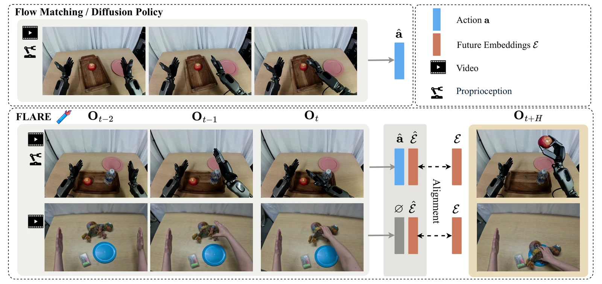
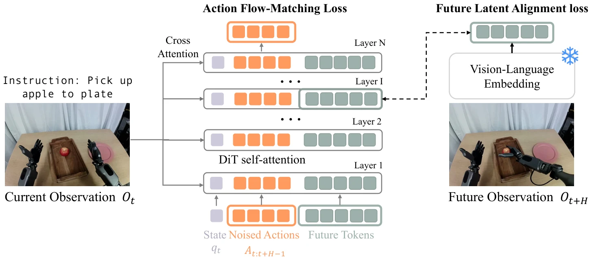
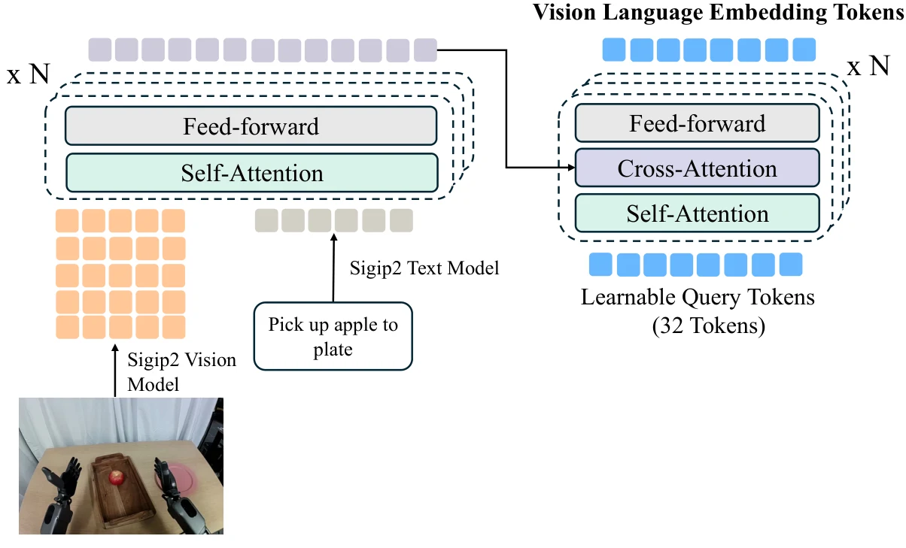
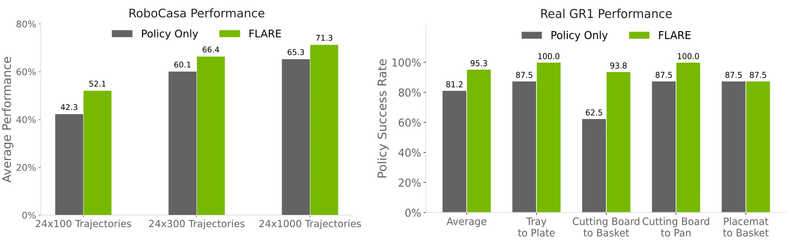
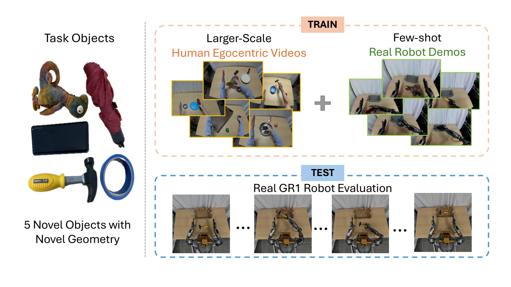
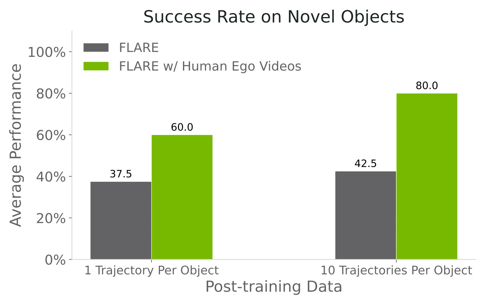
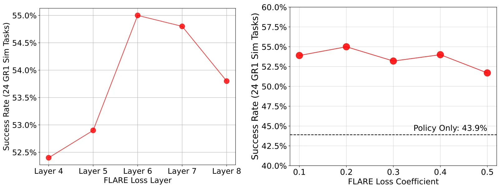

> **한 줄 요약:** 플로우 매칭 DiT 정책의 입력에 **학습 가능한 "미래 토큰" 몇 개**를 추가하고, 중간 레이어에서 이 토큰들이 **H 스텝 뒤 관측의 비전-언어 임베딩**과 코사인 유사도로 가까워지도록 정렬합니다. 픽셀을 복원하지 않는 이 "암묵적 월드모델" 목표 하나로 시뮬레이션 멀티태스크 벤치마크에서 기존 정책 학습 기법들을 앞서고, 행동 라벨이 없는 사람 1인칭 영상까지 학습에 쓸 수 있게 됩니다.

| 항목 | 내용 |
|---|---|
| 저자 | Ruijie Zheng, Jing Wang (공동 1저자), Scott Reed, Johan Bjorck 외, Jan Kautz, Furong Huang, Yuke Zhu, Linxi Fan |
| 소속 | NVIDIA, University of Maryland College Park, Nanyang Technological University, UT Austin (논문 표기 기준) |
| 발표 | 2025.05 arXiv (2505.15659) |
| 링크 | [arXiv 2505.15659](https://arxiv.org/abs/2505.15659) · [프로젝트 페이지](https://research.nvidia.com/labs/gear/flare) |
| 실험 환경 | RoboCasa 24개 과제(시뮬레이션, 단일 팔), GR-1 테이블탑 24개 과제(시뮬레이션, 휴머노이드), 실제 GR1 휴머노이드 |

> **읽는 법:** 본문은 논문에 적힌 내용을 그대로 옮긴 것이고, 가능한 곳에는 근거(섹션, 그림, 표 번호)를 달았습니다. 초록색 **AI 해석** 박스는 논문에 없는 해석, 비유, 평가, 다른 연구와의 연결입니다. "먼저 알아둘 개념"은 논문 밖의 일반 배경 설명입니다.
{: .prompt-info }

## 왜 이 논문을 읽나

[월드 액션 모델 계보 지도](/posts/world-model-survey/)에서 이 논문은 **잠재공간 예측(C 갈래)**의 C-4 노드입니다. 이 갈래의 뿌리는 사전학습 특징 공간에서 미래를 예측하는 [DINO-WM](/posts/dino-wm/)이고, FLARE 다음으로 [DreamVLA](/posts/dreamvla/), [VLA-JEPA](/posts/vla-jepa/), [LiLa-WAM](/posts/lila-wam/)이 이어집니다.

- 이전 글: [DINO-WM](/posts/dino-wm/)
- 다음 글: [DreamVLA](/posts/dreamvla/)

논문 스스로도 DINO-WM과의 차이를 짚습니다. DINO-WM이 제로샷 **계획(planning)**에 초점을 둔다면, FLARE는 **정책과 월드모델을 함께 학습(co-training)**하도록 설계됐다고 적고 있습니다 (Sec. 5).

> **AI 해석**  
> 계보에서 FLARE의 자리를 한 문장으로 말하면 "월드모델을 따로 두지 않고 정책 네트워크 안에 숨겨 넣은 첫 번째 단계"입니다. DINO-WM은 잠재 동역학 모델을 명시적으로 만들고 그걸로 계획을 하지만, FLARE에는 굴려볼 수 있는 동역학 모델이 없습니다. 대신 "미래를 예측하는 능력"을 **보조 손실(auxiliary loss)**로만 정책에 주입합니다. 이후 VLA-JEPA 같은 연구가 이 방향을 JEPA식 목표와 연결하게 됩니다.
{: .prompt-tip }

---

## 1. 먼저 알아둘 개념

### 1-1. 모방 학습과 액션 청크

로봇 정책을 사람 시연(teleoperation 등)으로 학습하는 것을 **모방 학습(imitation learning)**이라고 합니다. 관측 $$ o_t $$를 보고 전문가가 한 행동을 따라 하도록 지도학습합니다.

최근 로봇 정책들은 한 스텝 행동 대신 앞으로 $$ H $$ 스텝 동안의 행동을 한꺼번에 예측합니다. 이것을 **액션 청크(action chunk)**라고 합니다.

$$
A_t = (a_t, a_{t+1}, \dots, a_{t+H})
$$

### 1-2. 플로우 매칭(flow matching) 정책

같은 상황에서도 시연자는 여러 방식으로 행동할 수 있습니다. 평균을 내는 회귀로는 이런 **다봉(multimodal)** 분포를 표현하기 어렵기 때문에, 이미지 생성처럼 **생성 모델**로 행동을 뽑는 방식이 널리 쓰입니다. 디퓨전 정책(Diffusion Policy)이 대표적이고, $$ \pi_0 $$, GR00T N1은 **플로우 매칭**을 씁니다.

플로우 매칭의 아이디어는 간단합니다. 노이즈 $$ \epsilon $$과 정답 $$ A $$ 사이를 직선으로 잇고, 그 직선 위 임의의 지점 $$ A^\tau $$에서 "어느 방향으로 가야 하는지(속도)"를 신경망이 예측하도록 학습합니다.

$$
A^\tau = \tau A + (1-\tau)\epsilon, \quad \tau \in [0,1]
$$

추론 때는 순수 노이즈에서 시작해 예측한 속도를 따라 몇 걸음(Euler 적분) 이동하면 행동이 만들어집니다.

### 1-3. DiT (Diffusion Transformer)

디퓨전/플로우 모델의 뼈대로 U-Net 대신 **트랜스포머**를 쓴 구조입니다. 노이즈 섞인 입력을 토큰 시퀀스로 만들어 self-attention으로 처리하고, 조건(이미지, 텍스트 등)은 cross-attention으로 받아들입니다. 토큰 시퀀스에 새 토큰을 끼워 넣기가 쉽다는 점이 FLARE에서 중요합니다.

### 1-4. 비전-언어 임베딩, SigLIP, Q-Former

- **SigLIP(2):** 이미지와 텍스트를 같은 공간에 임베딩하도록 대규모로 학습된 인코더입니다. 이미지는 패치 토큰 여러 개로, 문장은 텍스트 토큰 여러 개로 바뀝니다.
- **Q-Former:** BLIP-2에서 제안된 모듈로, **학습 가능한 쿼리 토큰 몇 개**가 cross-attention으로 긴 토큰 시퀀스에서 필요한 정보만 뽑아 요약합니다. 입력 길이가 달라도 출력은 항상 쿼리 개수만큼의 고정 크기가 됩니다.

### 1-5. 표현 정렬 (REPA)

**REPA(Representation Alignment)**는 이미지 생성용 DiT를 학습할 때, DiT 중간 레이어의 은닉 상태를 사전학습된 비전 인코더(예: DINOv2)의 특징과 **유사도가 높아지도록** 맞추는 보조 손실입니다. 생성 모델이 "좋은 표현"을 빨리 배우게 해서 학습 수렴을 크게 앞당긴다고 알려져 있습니다.

두 벡터 $$ u, v $$의 코사인 유사도는 다음과 같습니다.

$$
\cos(u, v) = \frac{u \cdot v}{\lVert u \rVert \, \lVert v \rVert}
$$

### 1-6. 명시적 월드모델 vs 암묵적 월드모델

- **명시적:** 다음 프레임(픽셀 또는 VAE 잠재)을 실제로 생성합니다. 눈으로 확인할 수 있지만 큰 생성 모델과 계산이 필요합니다.
- **암묵적(implicit):** 미래를 생성하지 않고, 네트워크 내부 표현이 미래 정보를 **담고 있도록** 학습 신호만 줍니다. FLARE는 이쪽입니다.

### 1-7. EMA (지수 이동 평균) 타깃

자기지도 학습(BYOL 등)에서 흔히 쓰는 기법으로, 타깃 네트워크의 파라미터를 학습 중인 네트워크 파라미터 쪽으로 **아주 천천히** 끌어오는 방식입니다.

$$
\theta_{\text{target}} \leftarrow \rho\,\theta_{\text{target}} + (1-\rho)\,\theta_{\text{online}}
$$

$$ \rho $$가 1에 가까울수록 타깃이 느리게 변해 안정적이고, $$ \rho = 1 $$이면 타깃이 고정됩니다.

---

## 2. 문제 설정과 이전 연구의 한계

논문은 사람이 책상 위 머그컵을 잡을 때 손이 어떻게 움직이고 무엇에 부딪힐지 **의식하지 않고도 예측한다**는 예로 시작합니다. 이런 내적 미래 예측, 즉 월드모델링이 효율적인 운동 제어의 바탕이라는 것입니다 (Sec. 1).

최근 여러 연구(GR-1, GR-2, UVA, UWM, CoT-VLA 등)는 **행동과 함께 미래 영상 프레임을 생성**하는 방식으로 월드모델과 정책을 같이 학습해 왔습니다. 논문은 이 방식의 문제를 두 가지로 정리합니다 (Sec. 1).

1. **계산 비용:** 고품질 영상 예측에는 대규모 생성 모델이 필요해 계산량과 지연(latency)이 큽니다.
2. **모델 용량의 경쟁:** 영상 생성은 세밀한 공간 정보와 텍스처를 요구하고, 행동 예측은 압축된 추상적·과제 관련 표현을 선호합니다. 둘을 동시에 최적화하면 학습 효율이 희석된다고 논문은 봅니다.

그래서 FLARE의 목표는 **전체 프레임 복원 없이** 잠재공간에서 미래를 예측하게 하되, 기존 VLA 구조를 거의 바꾸지 않는 것입니다.

---

## 3. 방법


_기존 플로우 매칭/디퓨전 정책(위)은 관측에서 행동만 예측합니다. FLARE(아래)는 행동과 함께 미래 임베딩을 예측해 미래 관측 O(t+H)의 임베딩과 정렬하며, 행동 라벨이 없는 사람 영상은 정렬 손실만으로 학습합니다 (출처: FLARE, Figure 1)_

### 3-1. 기반: 플로우 매칭 DiT 정책 (Sec. 2)

FLARE는 $$ \pi_0 $$, GR00T N1을 따라 플로우 매칭으로 행동을 학습합니다. 기호는 다음과 같습니다.

| 기호 | 의미 |
|---|---|
| $$ o_t $$ | 관측 (여러 시점의 이미지 + 언어 지시) |
| $$ q_t $$ | 로봇 고유 상태(proprioception) |
| $$ A_t = (a_t, \dots, a_{t+H}) $$ | 전문가 시연의 액션 청크 |
| $$ \phi_t = VL(o_t) $$ | 관측의 비전-언어 임베딩 |

노이즈 섞인 액션 청크를 만들고,

$$
A_t^\tau = \tau A_t + (1-\tau)\epsilon, \quad \epsilon \sim \mathcal{N}(\mathbf{0}, \mathbf{I})
$$

모델 $$ V_\theta(\phi_t, A_t^\tau, q_t) $$가 방향 $$ \epsilon - A_t $$를 근사하도록 다음 손실을 최소화합니다 (Eq. 1).

$$
\mathcal{L}_{fm}(\theta) = \mathbb{E}_\tau \left[ \lVert V_\theta(\phi_t, A_t^\tau, q_t) - (\epsilon - A_t) \rVert^2 \right]
$$

- 타임스텝 $$ \tau $$는 $$ \pi_0 $$와 같이 $$ p(\tau) = \text{Beta}\left(\frac{s-\tau}{s}; 1.5, 1\right) $$, $$ s = 0.999 $$에서 샘플링합니다.
- 추론 때는 $$ A_t^0 \sim \mathcal{N}(\mathbf{0}, \mathbf{I}) $$에서 시작해 $$ K $$번의 전진 Euler 적분으로 행동을 다듬습니다.

$$
A_t^{\tau + 1/K} = A_t^\tau + \frac{1}{K} V_\theta(\phi_t, A_t^\tau, q_t)
$$

- GR00T N1을 따라 모든 실험에서 $$ K = 4 $$이고, $$ V_\theta $$는 cross-attention과 self-attention이 번갈아 나오는 DiT로 비전-언어 임베딩 $$ \phi_t $$를 조건으로 받습니다.

> **AI 해석**  
> Eq. 1은 타깃을 $$ \epsilon - A_t $$로 적었지만, 부록의 의사코드(Appendix D)는 `velocity = actions - noise`, 즉 $$ A_t - \epsilon $$을 타깃으로 씁니다. 추론 식이 $$ V_\theta $$를 더해 노이즈에서 행동 쪽으로 이동하는 형태이므로 의사코드 쪽 부호가 추론 식과 일관돼 보입니다. 방법의 핵심과는 무관한 표기 차이로 보이지만, 재구현할 때는 주의할 부분입니다.
{: .prompt-tip }

### 3-2. 미래 잠재 표현 정렬 (Sec. 3.1)


_FLARE 구조. 상태 토큰, 노이즈 섞인 액션 토큰, 학습 가능한 미래 토큰을 이어 붙여 DiT에 넣고, 중간 레이어에서 미래 토큰의 활성값을 고정된 비전-언어 임베딩 모델이 만든 미래 관측 임베딩과 정렬합니다 (출처: FLARE, Figure 2)_

핵심 변경은 딱 하나입니다. DiT 입력 시퀀스에 **학습 가능한 미래 토큰 $$ M $$개**를 추가해서, 시퀀스가 세 부분으로 구성됩니다.

1. 상태 인코더로 인코딩한 현재 고유 상태 $$ q_t $$
2. 액션 인코더로 인코딩한 노이즈 섞인 액션 청크 $$ A_t^\tau $$
3. $$ M $$개의 학습 가능한 미래 토큰

그다음 내부 레이어 $$ L $$에서 미래 토큰 $$ M $$개에 해당하는 DiT 표현을 잘라내 MLP로 투영하고, **고정된(frozen)** 비전-언어 임베딩 모델이 만든 미래 관측 임베딩 $$ \phi_{t+H} $$와 정렬합니다. 정렬 손실은 다음과 같습니다 (Eq. 2).

$$
\mathcal{L}_{align}(\theta) = -\mathbb{E}_\tau \left[ \cos\left( f_\theta(\phi_t, A_t^\tau, q_t),\; g(\phi_{t+H}) \right) \right]
$$

- $$ f_\theta \rightarrow \mathbb{R}^{B \times M \times D} $$: 레이어 $$ L $$에서 미래 토큰 $$ M $$개의 DiT 활성값
- $$ g \rightarrow \mathbb{R}^{B \times M \times D} $$: 미래 관측 $$ \phi_{t+H} $$의 인코더
- $$ B $$는 배치 차원, $$ D $$는 임베딩 차원

전체 손실은 두 손실의 가중합입니다 (Eq. 3).

$$
\mathcal{L} = \mathcal{L}_{fm} + \lambda \mathcal{L}_{align}
$$

논문은 실험적으로 $$ \lambda = 0.2 $$가 가장 좋았다고 보고합니다. 정렬은 8개 레이어 DiT 중 **6번째 레이어**에 적용합니다 (Sec. 4.4).

**REPA와의 차이 (Sec. 3.1, Sec. 5).** 논문은 이 방식이 텍스트-이미지 디퓨전 모델에 쓰이는 REPA와 비슷하지만 두 가지가 다르다고 강조합니다.

- **현재가 아닌 미래 관측**의 임베딩과 정렬합니다. 또 이미지 모델이 아닌 플로우 매칭 **정책**을 학습합니다.
- **별도의 미래 토큰**을 추가하므로, 플로우 매칭(액션 토큰)과 정렬(미래 토큰)이 DiT 안에서 서로 다른 흐름으로 진행되고, 둘은 self-attention으로 상호작용합니다. 이렇게 해서 DiT가 행동 예측 능력을 유지하면서 내부적으로 미래 잠재 상태를 추론하도록 유도한다는 것이 논문의 설명입니다.

부록의 의사코드(Appendix D)를 요약하면 학습 루프는 다음과 같습니다. 인코더와 디코더는 모두 2층 MLP입니다.

```python
# 미래 토큰: nn.Embedding(M, hidden_dim)
noisy_action = t * actions + (1 - t) * noise
velocity = actions - noise

sa_tokens = concat([state_token, action_tokens, future_tokens])
policy_outputs = dit(sa_tokens, vl_tokens)          # vl_tokens는 cross-attention 조건

action_loss = MSE(action_decoder(policy_outputs[:, 1:1+n_action]), velocity)

with no_grad():
    target = target_vl_embedding(future_obs)        # 미래 관측 임베딩 (그래디언트 없음)
pred = decode_embedding(policy_outputs[:, -M:])
flare_loss = 1 - cosine_similarity(pred, target)

loss = action_loss + 0.2 * flare_loss
```

> **AI 해석**  
> 구조적으로 보면 FLARE는 "정책이 행동을 뽑는 동안 옆 칸(미래 토큰)에서 미래 요약을 같이 맞히게 하는" 멀티태스크 학습입니다. 미래 토큰은 추론 시 출력을 쓰지 않으므로 사실상 **학습 때만 의미 있는 보조 헤드**이지만, self-attention으로 액션 토큰과 섞이기 때문에 "미래를 예측하는 데 필요한 정보"가 액션 토큰 쪽에도 흘러들게 됩니다. 픽셀 복원이 없어서 추가 비용은 토큰 32개 정도에 불과합니다. 다만 추론 때 미래 예측을 실제로 "사용하는" 경로(예: 예측을 보고 계획을 수정)는 없기 때문에, 효과는 어디까지나 표현 학습을 통한 간접 효과라는 점을 기억해 두는 게 좋습니다.
{: .prompt-tip }

### 3-3. 행동 인지(action-aware) 미래 임베딩 모델 (Sec. 3.2)

정렬 타깃 $$ g(\phi_{t+H}) $$를 무엇으로 쓸지가 두 번째 설계 요소입니다. 논문은 범용 임베딩 모델도 쓸 수 있지만, **제어 과제에 맞춰 최적화된 압축 임베딩**이 성능과 효율 모두에서 낫다고 말합니다. 설계 목표는 **압축성(compactness)**과 **행동 인지성(action-awareness)** 두 가지입니다.


_Q-Former 기반 비전-언어 임베딩 모듈. SigLIP2 비전/텍스트 토큰을 self-attention 층으로 융합한 뒤, 32개의 학습 가능한 쿼리 토큰으로 압축합니다 (출처: FLARE, Figure 10)_

구조 (Sec. 3.2, Appendix A):

| 단계 | 내용 |
|---|---|
| 백본 | `siglip2-large-patch16-256` (비전·텍스트 인코더 모두) |
| 비전 토큰 | 256×256 이미지 → 패치 토큰 256개 |
| 언어 토큰 | 패딩된 지시문 → 토큰 32개 |
| 융합 | 256 + 32 = 288개 토큰을 self-attention 트랜스포머 4층으로 융합 |
| 압축 | 무작위 초기화된 쿼리 토큰 32개가 Q-Former(self/cross-attention 교대)로 288개 토큰을 요약 → **32개 토큰** ($$ M = 32 $$) |

고정 크기 출력이라 여러 카메라 입력에도 자연스럽게 일반화된다고 논문은 설명합니다.

**행동 인지성 확보.** 이 임베딩 모델 위에 DiT 블록 8개를 붙여 **일반 액션 플로우 매칭 목표로 끝까지(end-to-end) 학습**합니다. 이렇게 하면 과제 관련 정보가 모두 잠재 토큰에 담기도록 보장된다는 것이 논문의 설명입니다.

**사전학습 데이터.** GR00T N1의 시뮬레이션·실제 휴머노이드 테이블탑 데이터와 Open X-Embodiment의 7개 데이터셋을 섞은 교차 체화(cross-embodiment) 로봇 데이터를 씁니다 (Sec. 3.2, Table 3).

| 데이터셋 | 프레임 | 시간(hr) | FPS | 분류 |
|---|---|---|---|---|
| GR-1 In-house | 6.4M | 88.4 | 20 | 실제 로봇 |
| DROID (OXE) | 23.1M | 428.3 | 15 | 실제 로봇 |
| RT-1 (OXE) | 3.7M | 338.4 | 3 | 실제 로봇 |
| Language Table (OXE) | 7.0M | 195.7 | 10 | 실제 로봇 |
| Bridge-v2 (OXE) | 2.0M | 111.1 | 5 | 실제 로봇 |
| MUTEX (OXE) | 362K | 5.0 | 20 | 실제 로봇 |
| Plex (OXE) | 77K | 1.1 | 20 | 실제 로봇 |
| RoboSet (OXE) | 1.4M | 78.9 | 5 | 실제 로봇 |
| GR-1 Simulation | 125.5M | 1,742.6 | 20 | 시뮬레이션 |
| **합계** | **169.5M** | **2,989.5** | – | – |

본문(Sec. 3.2)에는 "약 2,000시간"이라고 적혀 있지만 부록 Table 3의 합계는 2,989.5시간입니다.

사전학습은 H100 256장, 배치 8192로 150,000 스텝, AdamW($$ \beta_1 = 0.95 $$, $$ \beta_2 = 0.999 $$, $$ \epsilon = 10^{-8} $$), weight decay 1e-5, 코사인 스케줄(warmup 비율 0.05)을 씁니다 (Appendix C).

**사후학습(post-training)과 EMA 타깃.** 다운스트림 정책의 인코더를 사전학습 임베딩 모델로 초기화하고, 같은 사전학습 모델을 미래 표현의 **타깃**으로도 씁니다. 사전학습과 다운스트림 관측 사이의 분포 차이를 줄이기 위해, 타깃 모델을 완전히 고정하지 않고 정책 인코더의 EMA로 갱신합니다 (Sec. 3.2, Sec. 4.4).

$$
\theta_{\text{target}} \leftarrow \rho\,\theta_{\text{target}} + (1-\rho)\,\theta_{\text{policy\_vl}}
$$

EMA 계수는 $$ \rho = 0.995 $$가 가장 좋았다고 합니다.

> **AI 해석**  
> 이 설계는 BYOL이나 JEPA의 "EMA 타깃 인코더"와 같은 뼈대를 공유합니다. 다만 FLARE는 타깃 인코더를 처음부터 **행동 예측으로 사전학습**해 둔다는 점이 다릅니다. 그 결과 정렬 타깃은 "로봇 제어에 필요한 정보만 담긴 32개 토큰"이 되고, 정책이 예측해야 하는 미래도 "제어에 중요한 미래"로 좁혀집니다. 픽셀 생성 기반 월드모델이 텍스처까지 맞히느라 용량을 쓰는 문제(Sec. 1)를 타깃 공간 선택으로 우회한 셈입니다. 한편 타깃이 행동 라벨로 학습된 모델이라는 점에서 "완전히 비지도적인 월드모델"과는 성격이 조금 다릅니다.
{: .prompt-tip }

---

## 4. 실험

실험은 네 부분입니다.

1. 시뮬레이션 멀티태스크 벤치마크 (Sec. 4.1)
2. 교차 체화 사전학습 임베딩을 이용한 데이터 효율적 사후학습 (Sec. 4.2)
3. 행동 라벨 없는 사람 1인칭 영상 활용 (Sec. 4.3)
4. 어블레이션 (Sec. 4.4)

### 4-1. 멀티태스크 벤치마크 (Sec. 4.1)

**벤치마크 (Fig. 4)**

- **RoboCasa:** 시뮬레이션 주방의 단일 팔 과제 24개(집어 옮기기, 문 조작, 수도꼭지 조작 등). 관측은 왼쪽·오른쪽·손목 카메라 RGB 3장.
- **GR-1 테이블탑:** GR00T N1의 휴머노이드 과제 24개. 물체 재배치 18개 + 캐비닛·서랍·전자레인지 같은 관절 물체 조작 6개. 관측은 머리에 달린 1인칭 카메라 RGB 1장.

**공정 비교 설정.** 이 절에서는 Sec. 3.2의 대규모 사전학습 임베딩을 쓰지 **않습니다**. 대신 같은 도메인 멀티태스크 데이터로만 임베딩 모델을 80,000 스텝 사전학습해, 성능 향상이 추가 사전학습 데이터 덕분이 아니도록 했습니다.

**베이스라인**

| 방법 | 설명 |
|---|---|
| Diffusion Policy | U-Net 기반 디퓨전 행동 생성 |
| UWM | 이미지 VAE 잠재와 행동을 디퓨전으로 함께 예측 (영상+행동 공동 학습의 대표) |
| GR00T N1 (Scratch) | 같은 구조, DiT는 처음부터 학습, Eagle VLM 가중치만 로드 |
| FLARE (Policy Only) | FLARE와 완전히 같은 구조, 정책 목표만으로 학습 |

모든 방법은 80,000 스텝 학습합니다. 단 UWM은 80k 스텝 끝에서도 성능이 오르고 있어 **400k 스텝(다른 방법의 5배)**까지 늘렸습니다. 평가는 GR00T N1을 따라 1,000 스텝마다 과제당 50 에피소드를 돌리고, 마지막 5개 체크포인트 중 최고 성공률을 보고합니다. 학습은 H100 32장, 배치 1024입니다 (Appendix C).

**결과 (Table 1)**

| 과제 그룹 | **FLARE** | Policy Only | UWM | GR00T N1 (Scratch) | Diffusion Policy |
|---|---|---|---|---|---|
| RoboCasa: Pick and Place | **53.2%** | 43.8% | 35.6% | 44.1% | 29.2% |
| RoboCasa: Open & Close Doors / Drawers | **88.8%** | 78.7% | 82.0% | 80.0% | 78.7% |
| RoboCasa: Others | **80.0%** | 75.2% | 74.2% | 69.6% | 61.3% |
| **RoboCasa 24개 평균** | **70.1%** | 61.9% | 60.8% | 60.6% | 51.7% |
| GR1: Pick and Place | **58.2%** | 46.6% | 30.1% | 51.8% | 40.4% |
| GR1: Articulated | **51.3%** | 47.4% | 38.4% | 42.8% | 50.1% |
| **GR1 24개 평균** | **55.0%** | 44.0% | 29.5% | 45.1% | 40.9% |

논문이 뽑은 관찰은 두 가지입니다.

- **FLARE가 모든 베이스라인을 일관되게 앞섭니다.** 정책 전용 베이스라인과 UWM 모두 포함입니다. 또 정책 목표만으로 160k 스텝 학습해도 44.1%로 80k 스텝과 차이가 없어서, 향상이 학습 스텝이 늘어난 효과가 아니라고 논문은 설명합니다.
- **정책 목표만 써도 FLARE 구조는 GR00T N1 (Scratch)와 비슷합니다.** GR00T N1이 더 큰 VLM을 쓰는데도 그렇다는 점에서, 논문은 Q-Former 기반 임베딩이 행동 관련 정보를 잘 담는다고 해석합니다.

> **AI 해석**  
> 가장 눈에 띄는 비교는 UWM입니다. UWM은 미래 VAE 잠재를 **명시적으로 생성**하는 방식이고 5배 더 학습했는데도, GR1에서 29.5%로 Diffusion Policy(40.9%)보다도 낮습니다. 논문의 핵심 주장인 "픽셀(또는 VAE) 수준 미래 생성은 행동 학습과 용량을 다툰다"를 뒷받침하는 숫자로 읽을 수 있습니다. 다만 UWM은 다른 연구진의 방법을 이 벤치마크에 옮겨 돌린 결과라, 하이퍼파라미터 튜닝 정도에 따라 격차가 달라질 여지는 있습니다. FLARE 대 Policy Only(같은 구조, 같은 스텝)의 차이인 +8.2%p(RoboCasa), +11.0%p(GR1)가 순수한 정렬 손실의 효과를 가장 깔끔하게 보여 주는 비교입니다.
{: .prompt-tip }

### 4-2. 교차 체화 사전학습 임베딩으로 사후학습 (Sec. 4.2)

Sec. 4.1 방식은 도메인마다 임베딩 모델을 따로 학습해야 한다는 한계가 있습니다. 그래서 이 절에서는 Sec. 3.2의 **교차 체화 사전학습 임베딩**을 미래 예측 타깃으로 쓰고, 처음 보는 체화·과제에서 데이터가 적은 상황을 봅니다.

- **평가:** RoboCasa 24개 과제(시뮬레이션), 실제 GR1 휴머노이드 테이블탑 과제 4개 (Fig. 5).
- **비교:** Policy Only 베이스라인은 Q-Former 임베딩과 DiT 모두 사전학습 모델로 초기화합니다. FLARE는 **비전-언어 임베딩만** 사전학습 모델로 초기화(warm start)합니다.
- **실제 GR1 평가:** 과제마다 기준 초기 프레임 8개, 조작 물체는 사과·캔·생수병·오이 4종. 최종 체크포인트의 성공률을 보고합니다. 서론에 따르면 실제 GR1에서는 과제당 궤적 100개로 사후학습했습니다 (Sec. 1).


_왼쪽: RoboCasa 24개 과제에서 과제당 궤적 수(100/300/1000)별 평균 성공률. 오른쪽: 실제 GR1 휴머노이드 4개 과제 성공률 (출처: FLARE, Figure 6)_

Fig. 6의 수치를 표로 옮기면 다음과 같습니다.

| 설정 | Policy Only | **FLARE** |
|---|---|---|
| RoboCasa 24×100 궤적 | 42.3 | **52.1** |
| RoboCasa 24×300 궤적 | 60.1 | **66.4** |
| RoboCasa 24×1000 궤적 | 65.3 | **71.3** |
| 실제 GR1 평균 | 81.2 | **95.3** |
| 실제 GR1: Tray to Plate | 87.5 | **100.0** |
| 실제 GR1: Cutting Board to Basket | 62.5 | **93.8** |
| 실제 GR1: Cutting Board to Pan | 87.5 | **100.0** |
| 실제 GR1: Placemat to Basket | 87.5 | 87.5 |

논문의 해석은 다음과 같습니다.

- FLARE는 두 환경 모두에서 베이스라인을 일관되게 앞서고, 특히 **데이터가 적을 때** 향상이 커서 과제당 100개 궤적에서 RoboCasa 약 10% 향상을 보입니다.
- 사전학습 임베딩은 RoboCasa를 **한 번도 본 적 없는데도**, 1000 궤적 설정에서 RoboCasa 전용으로 학습한 임베딩과 비슷한 성능을 냅니다 (본문 기준 71.3% 대 70.2%).
- 실제 GR-1에서 최대 95.1% 성공률, 베이스라인보다 평균 14% 높다고 본문에 적혀 있습니다. (Fig. 6의 막대 수치는 평균 95.3%입니다.)

본문의 수치와 다른 곳의 수치가 조금씩 다릅니다. "70.2%"는 Table 1의 RoboCasa 평균 70.1%와, "95.1%"는 Fig. 6의 95.3%와 약간 차이가 있습니다. 이 글의 표는 그림과 표에 적힌 값을 그대로 옮겼습니다.

**정성적 관찰.** 캔이나 물병이 로봇 손 가까이 놓인 경우, 정책 목표만으로 학습한 베이스라인은 물체를 자주 **쓰러뜨렸습니다**. 반면 FLARE 정책은 물체를 **돌아가거나 위로 넘어가서** 잡는 법을 배웠고, 논문은 이를 미래 잠재 추론의 이점으로 봅니다 (Sec. 4.2, Appendix E.1).

> **AI 해석**  
> "손 근처 물체를 쓰러뜨리지 않고 돌아간다"는 관찰은 이 논문이 주장하는 "미래 결과를 고려한 행동"을 직관적으로 보여 주는 사례입니다. 다만 실제 로봇 평가는 과제당 초기 조건 8개 규모라서, 성공률 1건 차이가 12.5%p에 해당합니다(예: 87.5 대 100.0). 수치 차이는 추세 정도로 읽는 것이 안전합니다. 또 이 비교에서 Policy Only는 DiT까지 사전학습 가중치로 초기화했고 FLARE는 임베딩만 초기화했으므로, 초기화 조건은 오히려 베이스라인 쪽에 유리합니다.
{: .prompt-tip }

### 4-3. 행동 라벨 없는 사람 1인칭 영상 활용 (Sec. 4.3)

정렬 손실은 **미래 관측만 있으면** 계산할 수 있으므로, 행동 라벨이 없는 데이터에도 적용할 수 있습니다. 논문은 사람 시연이 로봇 원격조작보다 훨씬 싸고 효율적이라는 점에서 이 설정이 매력적이라고 말합니다.


_학습 데이터에 없는 독특한 형태의 새 물체 5개. 대규모 사람 1인칭 영상과 소수의 실제 로봇 시연으로 학습하고, 실제 GR1에서 평가합니다 (출처: FLARE, Figure 7)_

**설정**

- 학습 데이터에 없는, 형태가 독특해 **새로운 잡기 전략**이 필요한 물체 5개를 고릅니다. 예를 들어 파란 테이프는 크기가 커서 로봇 손이 위에서 아래로 잡아야 합니다.
- 물체마다 머리에 GoPro를 단 사람이 로봇과 비슷한 과제를 수행하는 **1인칭 시연 150개**를 모읍니다.
- 로봇 쪽은 물체당 원격조작 시연을 **최대 10개**만 모읍니다.
- 학습 데이터는 이 소량 로봇 시연 + GR-1 사전학습 데이터셋 + 사람 1인칭 영상의 혼합입니다.
- 행동이 있는 로봇 시연에는 **플로우 매칭 + 정렬 손실**을, 행동이 없는 사람 영상에는 **정렬 손실만** 적용합니다.
- 평가는 물체마다 기준 초기 자세 5개, 물체를 잡았지만 바구니에 넣지 못하면 **부분 점수 0.5**를 줍니다.


_새 물체 5개에 대한 평균 성공률. 회색은 로봇 시연만으로 학습한 FLARE, 초록은 사람 1인칭 영상을 함께 학습한 FLARE (출처: FLARE, Figure 7)_

| 사후학습 로봇 데이터 | FLARE (로봇 데이터만) | **FLARE + 사람 1인칭 영상** |
|---|---|---|
| 물체당 궤적 1개 | 37.5% | **60.0%** |
| 물체당 궤적 10개 | 42.5% | **80.0%** |

논문에 따르면 물체당 원격조작 궤적 **1개**만으로 최대 60%, 궤적 10개와 사람 영상을 함께 쓰면 **80%**에 도달해, 행동 라벨 데이터만으로 학습한 경우의 약 두 배가 됩니다.

> **AI 해석**  
> 이 실험의 비교 대상은 "다른 방법"이 아니라 **사람 영상 유무**입니다. 즉 이 결과가 보여 주는 것은 "FLARE 목표 덕분에 라벨 없는 영상을 학습 신호로 쓸 수 있고, 그게 실제로 도움이 된다"는 점입니다. 다른 행동 없는 영상 활용 기법(잠재 행동, 손 자세 추정 등)과의 직접 비교는 없습니다. 또 사람 영상은 로봇과 같은 책상 환경에서 비슷한 과제를 머리 장착 GoPro로 찍은 통제된 데이터라, 인터넷 규모 영상으로 그대로 확장된다는 근거는 아직 아닙니다. 논문도 이 점을 한계로 인정합니다 (Sec. 6).
{: .prompt-tip }

### 4-4. 어블레이션 (Sec. 4.4)

**(1) 타깃 임베딩 모델 (Table 2).** 행동 인지 임베딩 대신 사전학습된 SigLIP2-Large 비전 토큰을 $$ t+16 $$ 시점에서 타깃으로 쓰는 실험입니다. 원본 토큰(이미지당 256개)과 2×2 평균 풀링 토큰(이미지당 64개)을 비교했습니다.

| 타깃 | 성공률 (%) |
|---|---|
| FLARE 손실 없음 | 43.9 |
| SigLIP2 | 49.6 |
| SigLIP2 (Average Pooled) | 50.9 |
| **Action-aware Embedding** | **55.0** |

논문은 FLARE가 다양한 교사(teacher) 인코더와 호환되며, 범용 인코더인 SigLIP2를 써도 베이스라인 대비 약 7% 향상이 있다고 말합니다. 최고 성능은 도메인에 맞춰 사전학습한 임베딩에서 나옵니다.

**(2) 정렬 레이어와 손실 계수 (Fig. 8).** GR1 시뮬레이션 벤치마크에서 평가했습니다.


_왼쪽: FLARE 손실을 적용하는 DiT 레이어별 성공률. 오른쪽: FLARE 손실 계수별 성공률. 점선은 정책 목표만 쓴 경우(43.9%) (출처: FLARE, Figure 8)_

| 정렬 레이어 | 4 | 5 | **6** | 7 | 8 |
|---|---|---|---|---|---|
| 성공률 (%) | 52.4 | 52.9 | **55.0** | 54.8 | 53.8 |

| 손실 계수 $$ \lambda $$ | 0.1 | **0.2** | 0.3 | 0.4 | 0.5 |
|---|---|---|---|---|---|
| 성공률 (%) | 53.9 | **55.0** | 53.2 | 54.0 | 51.7 |

(위 수치는 Fig. 8 그래프에서 읽은 값입니다.)

논문의 설명은 이렇습니다. 더 깊은 레이어에 적용하면 더 많은 가중치가 미래 예측 감독을 받지만, 행동 예측과 정렬 목표가 충돌할 수 있습니다. 전반적으로 넓은 범위의 설정에서 성능이 좋지만, **너무 이른 레이어(4번)**에 적용하면 눈에 띄게 떨어져서 미래 예측 목표를 행동 디노이징 과정과 맞추는 것이 중요하다고 봅니다.

**(3) EMA 계수 (Fig. 9).** RoboCasa 24개 과제, 과제당 300개 궤적($$ 24 \times 300 $$)으로 학습했습니다.

| EMA 계수 $$ \rho $$ | Baseline (FLARE 손실 없음) | 0.99 | **0.995** | 0.999 | 1.0 (EMA 없음) |
|---|---|---|---|---|---|
| 성공률 (%) | 60.1 | 63.5 | **66.4** | 65.7 | 64.6 |

모든 EMA 설정이 베이스라인보다 낫고 $$ \rho = 0.995 $$가 최고입니다. $$ \rho = 1.0 $$(타깃 고정)에서도 베이스라인을 넘지만, $$ \rho = 0.99 $$는 가장 낮았는데 논문은 타깃이 너무 자주 바뀌어 불안정해진 탓으로 추정합니다.

> **AI 해석**  
> 어블레이션을 종합하면, FLARE의 이득 대부분은 "미래 정렬 손실을 넣는다" 자체에서 나오고, 세부 설정은 그 위에서 몇 %p를 조정하는 수준입니다. GR1 시뮬레이션 기준으로 손실이 없을 때 43.9%, 범용 SigLIP2 타깃만 써도 49.6~50.9%, 레이어·계수를 어떻게 골라도 51.7~55.0% 범위에 있습니다. 구현이 쉽고 하이퍼파라미터에 덜 민감하다는 점은 실용적인 장점입니다. 반대로 미래 시점 $$ H $$(얼마나 먼 미래를 맞힐지)나 미래 토큰 개수 $$ M $$에 대한 어블레이션은 논문에 없어서, "얼마나 먼 미래가 가장 유용한가"는 열린 질문으로 남습니다.
{: .prompt-tip }

---

## 5. 논문이 밝힌 한계 (Sec. 6)

- **과제 범위:** 실제 휴머노이드 실험은 주로 **집어 옮기기(pick-and-place)** 모방 학습에 집중했습니다. 더 정교한 손재주 조작, 강화학습과의 결합은 향후 과제입니다.
- **소량의 전문가 시연 의존:** 새 물체 일반화가 가능해졌지만 여전히 소수의 전문가 시연이 필요해서, 그런 데이터를 얻기 어려운 환경에서는 확장성이 제한될 수 있습니다.
- **통제된 사람 영상:** 머리 장착 GoPro로 통제된 환경에서 모은 1인칭 영상만 썼습니다. 자연 환경의 더 다양하고 큰 규모의 1인칭 데이터로 확장하는 것이 향후 방향입니다.

> **AI 해석 (비판적으로 보기)**  
> - **"월드모델"이라는 이름의 범위:** FLARE의 월드모델은 굴려볼 수 있는(rollout 가능한) 동역학 모델이 아니라 정책 내부 표현에 대한 보조 목표입니다. 계획, 상상 속 학습, 반사실 평가 같은 월드모델의 전형적 용도는 이 논문 범위 밖이고, 논문도 계획을 향후 확장으로 언급합니다 (Sec. 5).  
> - **예측의 해석 가능성:** 미래를 32개 임베딩 토큰으로만 예측하므로, 영상 생성형 월드모델처럼 "정책이 무엇을 예상했는지" 눈으로 확인하기 어렵습니다.  
> - **타깃이 행동 라벨에 의존:** 가장 좋은 타깃(행동 인지 임베딩)은 대규모 행동 라벨 데이터로 사전학습됩니다. 사람 영상은 행동 없이 쓸 수 있지만, 그 영상을 해석하는 "눈"은 로봇 행동 데이터로 만든 것입니다.  
> - **수치 보고의 작은 불일치:** 본문과 그림·표 사이에 95.1 대 95.3, 70.2 대 70.1, 약 2,000시간 대 2,989.5시간 같은 차이가 있습니다. 결론을 바꿀 정도는 아니지만 인용할 때는 출처를 명시하는 게 좋습니다.  
> - **평가 규모:** 시뮬레이션은 과제당 50 에피소드로 충분하지만, 실제 로봇은 과제당 8개(4-2), 물체당 5개(4-3) 초기 조건이라 통계적 불확실성이 큽니다.
{: .prompt-tip }

---

## 6. 정리

- FLARE는 플로우 매칭 DiT 정책에 **학습 가능한 미래 토큰 $$ M = 32 $$개**를 추가하고, 중간 레이어(8개 중 6번째)의 해당 활성값을 **미래 관측 $$ \phi_{t+H} $$의 임베딩**과 코사인 유사도로 정렬합니다. 전체 손실은 $$ \mathcal{L}_{fm} + 0.2\,\mathcal{L}_{align} $$입니다.
- 정렬 타깃은 SigLIP2 + Q-Former로 만든 **32토큰짜리 행동 인지 임베딩**이며, 약 3천 시간 규모(Table 3 기준)의 교차 체화 로봇 데이터로 행동 예측과 함께 사전학습하고, 사후학습 중에는 EMA($$ \rho = 0.995 $$)로 천천히 갱신합니다.
- 시뮬레이션 벤치마크 평균 성공률은 RoboCasa 70.1%, GR1 55.0%로, 같은 구조의 정책 전용 학습(61.9%, 44.0%)과 UWM, GR00T N1 (Scratch), Diffusion Policy를 앞섭니다 (Table 1).
- 교차 체화 사전학습 임베딩으로 적은 데이터에서도 이득이 크고(RoboCasa 과제당 100궤적에서 42.3 → 52.1), 실제 GR1 4개 과제 평균 81.2 → 95.3을 기록합니다 (Fig. 6).
- 정렬 손실만으로 **행동 라벨 없는 사람 1인칭 영상**을 학습에 넣을 수 있고, 새 물체 5개에서 42.5% → 80.0%(물체당 로봇 궤적 10개)로 성능이 오릅니다 (Fig. 7).

> **AI 해석**  
> 잠재공간 예측 갈래에서 FLARE가 남긴 메시지는 "미래를 **그릴** 필요는 없고, 미래를 **알고 있는** 표현만 있으면 정책이 좋아진다"입니다. 구현 비용이 토큰 몇 개와 손실 하나뿐이라 기존 VLA에 바로 붙일 수 있다는 점이 가장 큰 실용적 가치입니다. 다음 글인 [VLA-JEPA](/posts/vla-jepa/)에서 이 아이디어가 어떻게 이어지는지 이어서 보면 좋습니다.
{: .prompt-tip }

---

## 참고 자료

- Ruijie Zheng, Jing Wang, et al. *FLARE: Robot Learning with Implicit World Modeling.* [arXiv 2505.15659](https://arxiv.org/abs/2505.15659), 2025.
- [FLARE 프로젝트 페이지 (NVIDIA GEAR)](https://research.nvidia.com/labs/gear/flare)
- Black et al. *$$ \pi_0 $$: A Vision-Language-Action Flow Model for General Robot Control.* [arXiv 2410.24164](https://arxiv.org/abs/2410.24164)
- NVIDIA et al. *GR00T N1: An Open Foundation Model for Generalist Humanoid Robots.* [arXiv 2503.14734](https://arxiv.org/abs/2503.14734)
- Yu et al. *Representation Alignment for Generation: Training Diffusion Transformers Is Easier Than You Think (REPA).* ICLR 2025.
- Zhu et al. *Unified World Models: Coupling Video and Action Diffusion for Pretraining on Large Robotic Datasets (UWM).* 2025.
- Zhou et al. *DINO-WM: World Models on Pre-trained Visual Features Enable Zero-shot Planning.* [arXiv 2411.04983](https://arxiv.org/abs/2411.04983)
- Tschannen et al. *SigLIP 2.* [arXiv 2502.14786](https://arxiv.org/abs/2502.14786)
- Li et al. *BLIP-2 (Q-Former).* ICML 2023.
- Nasiriany et al. *RoboCasa: Large-Scale Simulation of Everyday Tasks for Generalist Robots.* RSS 2024.

> 이 글의 그림은 모두 FLARE 논문(arXiv 2505.15659)의 그림입니다. SVG로 제공된 결과 그래프(Figure 6, 7, 8)는 흰 배경의 이미지로 변환했습니다.
{: .prompt-info }
