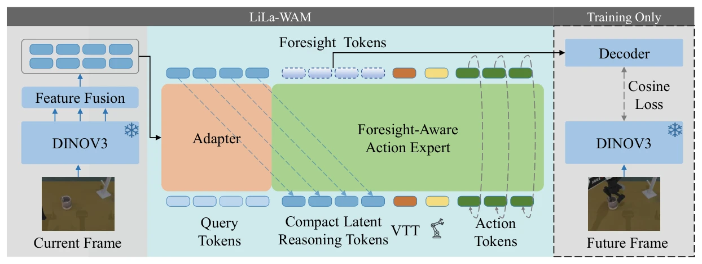
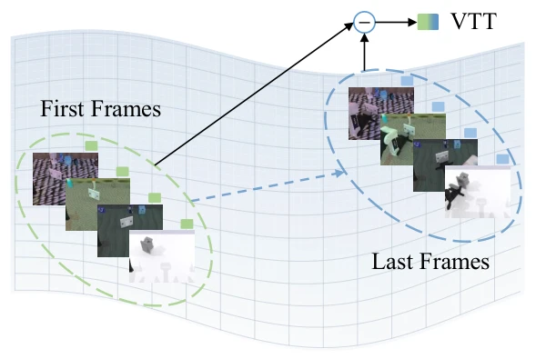
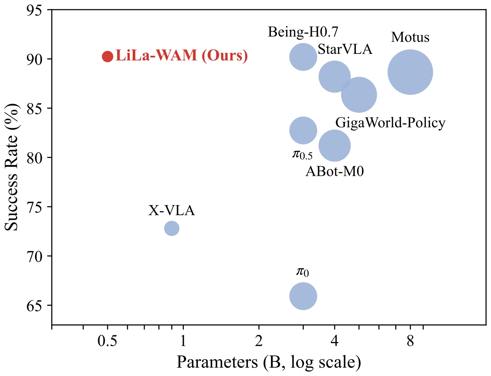
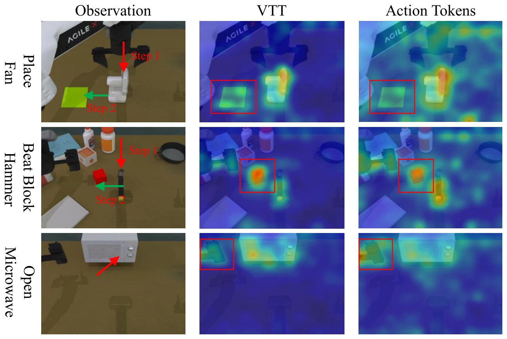
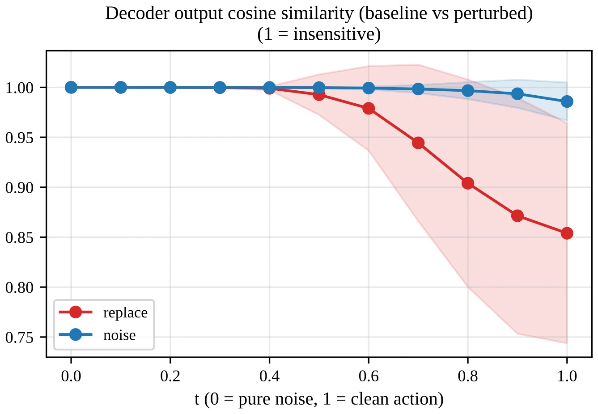
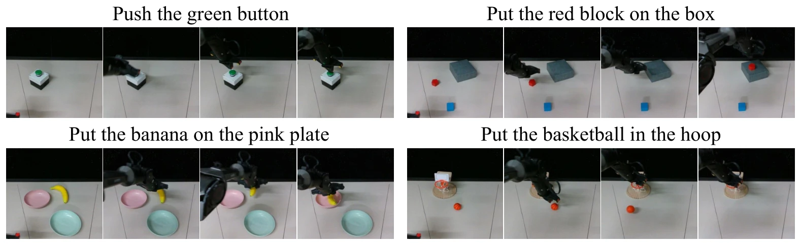

> **한 줄 요약:** 얼어 있는(frozen) **DINOv3** 인코더 위에 0.2B짜리 학습 가능한 부분만 얹고, **행동 생성과 미래 상태 예측을 하나의 토큰 스트림**에서 같이 학습시켰습니다. 미래는 픽셀이 아니라 **DINOv3 특징 공간**에서 코사인 손실로만 감독하고, 태스크는 언어 대신 **데모 영상의 "처음→끝" 특징 차이 벡터(VTT)**로 지정합니다. 그 결과 **24GB GPU 한 장**으로 end-to-end 학습하면서 RoboTwin 2.0 50개 작업 평균 **90.48%**, LIBERO 평균 **97.1%**를 기록했습니다.

| 항목 | 내용 |
|---|---|
| 저자 | Fan Yang, Yuting Su, Xiaobo Wang, Yuncheng You, Fugui Fan, Yuting Wu, Minghui Wu, Chenxu Zhao, Jiahong Ning, Peiguang Jing |
| 소속 | Tianjin University, Shenzhen University of Advanced Technology, Mininglamp Technology, Ministry of Natural Resources Information Center, Sangfor Technologies |
| 발표 | 2026.08 arXiv (v1, 2026-08-04) |
| 링크 | [arXiv 2608.03701](https://arxiv.org/abs/2608.03701) · [HTML](https://arxiv.org/html/2608.03701) · [코드](https://github.com/teee000/LiLa-WAM) |
| 실험 환경 | RoboTwin 2.0 (50개 작업), LIBERO (4개 스위트), 실제 로봇 (AgileX PiPer, 4개 작업) |

> **읽는 법:** 본문은 논문에 적힌 내용을 그대로 옮긴 것이고, 가능한 곳에는 근거(섹션, 그림, 표 번호)를 달았습니다. 초록색 **AI 해석** 박스는 논문에 없는 해석, 비유, 평가, 다른 연구와의 연결입니다. "먼저 알아둘 개념"은 논문 밖의 일반 배경 설명입니다.
{: .prompt-info }

## 왜 이 논문을 읽나

[월드 액션 모델 계보 지도](/posts/world-model-survey/)에서 월드 액션 모델(WAM)을 "미래를 무엇으로 예측하느냐"로 나눴을 때, **픽셀을 그리지 않고 특징(잠재) 공간에서 미래를 예측하는 갈래**를 C 갈래로 정리했습니다. 이 갈래는 사전학습 특징 위에서 동역학을 학습한 [DINO-WM](/posts/dino-wm/)을 뿌리로, [FLARE](/posts/flare/), [VLA-JEPA](/posts/vla-jepa/)로 이어지고, 그 가장 최신 논문(C-1)이 LiLa-WAM입니다. 이전 글은 [VLA-JEPA 리뷰](/posts/vla-jepa/)입니다.

논문이 스스로 내세우는 키워드는 **가벼움**입니다. 초록과 서론(Sec. 1)에 따르면 기존 WAM은 학습 비용이 커서 "적당한 계산 예산(modest computational budgets)"으로는 다루기 어렵고, LiLa-WAM은 이 문제를 **24GB GPU 한 장에서 end-to-end로 학습 가능한** 구조로 풀었다고 주장합니다.

> **AI 해석**  
> 논문 원문 표현은 "single 24GB GPU"이고, 실제로 적힌 하드웨어는 학습에 RTX 5090, 추론 측정에 RTX 4090입니다(Sec. 4.1). 둘 다 일반 소비자용 그래픽카드 라인이라, 연구실 서버 없이도 개인이 직접 학습해 볼 수 있는 규모라는 점이 이 논문의 실용적인 의미라고 봅니다.
{: .prompt-tip }

---

## 1. 먼저 알아둘 개념

### 1-1. VLA와 WAM

**VLA(Vision-Language-Action) 모델**은 카메라 이미지 $$ o_t $$, 로봇 관절 상태(고유수용감각, proprioception) $$ q_t $$, 언어 지시 $$ l $$을 받아 앞으로 $$ H $$스텝 동안의 행동 묶음(action chunk)을 바로 출력합니다.

$$
p(\mathbf{a}_{t:t+H} \mid o_t, q_t, l)
$$

지금 보이는 것에 **반응**만 할 뿐, "내가 이렇게 움직이면 장면이 어떻게 바뀔지"는 명시적으로 모델링하지 않습니다.

**WAM(World-Action Model)**은 여기에 **미래 상태 예측**을 붙입니다. 행동과 미래를 함께 예측하게 해서 모델이 "앞일을 내다보는 능력(foresight)"을 갖도록 하자는 발상입니다. 문제는 미래를 **무엇으로** 표현하느냐입니다.

- **픽셀 공간:** 미래 이미지나 영상을 직접 생성합니다. 눈으로 확인할 수 있지만 무겁습니다.
- **잠재(특징) 공간:** 미래를 압축된 벡터로만 예측합니다. 가볍지만 사람이 직접 볼 수는 없습니다.

### 1-2. DINOv3 특징

**DINO** 계열은 라벨 없이 이미지만으로 학습하는 **자기지도학습(self-supervised) 비전 트랜스포머(ViT)**입니다. 이미지를 $$ 16 \times 16 $$ 픽셀 같은 작은 조각(patch)으로 나누고, 각 조각마다 특징 벡터를 하나씩 뽑아 줍니다. 이 **패치 특징(patch feature)**은 "이 위치에 어떤 물체의 어떤 부분이 있는지"를 잘 담고 있어서, 깊이 추정이나 분할 같은 조밀한(dense) 작업에 많이 쓰입니다. DINOv3는 이 계열의 세 번째 버전입니다.

ViT는 블록(층)을 여러 개 쌓은 구조인데, 일반적으로 **앞쪽 블록은 위치·모양 같은 세밀한 정보**를, **뒤쪽 블록은 "이건 컵이다" 같은 추상적 의미**를 더 많이 담는다고 알려져 있습니다. 뒤에서 보겠지만 이 논문은 이 차이를 실험으로 확인합니다.

### 1-3. Flow matching과 "행동 속도"

**Flow matching**은 노이즈를 정답 데이터로 바꾸는 "흐름"을 학습하는 생성 모델 기법입니다. 로봇 정책에서는 정답 행동 묶음 $$ \mathbf{x}_1 $$을 만들기 위해 쓰입니다.

1. 가우시안 노이즈 $$ \mathbf{x}_0 \sim \mathcal{N}(\mathbf{0}, \mathbf{I}) $$를 하나 뽑습니다.
2. 시간 $$ s \in [0, 1] $$에서 노이즈와 정답을 직선으로 섞습니다: $$ \mathbf{x}_s = (1-s)\,\mathbf{x}_0 + s\,\mathbf{x}_1 $$
3. 이 직선 위에서 움직이는 **속도(velocity)**는 $$ \mathbf{v}^\star = \mathbf{x}_1 - \mathbf{x}_0 $$로 일정합니다.
4. 신경망이 섞인 입력 $$ \mathbf{x}_s $$를 보고 이 속도를 맞히도록 학습합니다.

추론할 때는 노이즈에서 출발해 예측한 속도를 따라 조금씩 이동(ODE 적분)하면 행동이 나옵니다. 가장 단순한 적분법이 **오일러(Euler) 방법**입니다.

$$
\mathbf{x}_{s + \Delta s} = \mathbf{x}_s + \Delta s \cdot \hat{\mathbf{v}}_s
$$

이 과정에서 $$ s $$가 0에 가까울 때를 "초기 디노이징 단계", 1에 가까울 때를 "후기 디노이징 단계"라고 부릅니다.

### 1-4. DiT와 쿼리 기반 어댑터(Q-Former 스타일)

- **DiT(Diffusion Transformer):** 디퓨전/flow matching의 노이즈 제거 네트워크를 트랜스포머로 만든 것입니다. 여러 종류의 토큰(이미지, 상태, 행동 등)을 한 줄로 이어 붙여서 **셀프 어텐션**으로 서로 정보를 주고받게 할 수 있습니다.
- **쿼리 기반 어댑터(Q-Former 스타일):** 학습 가능한 "질문 토큰"(learnable query) $$ N_q $$개를 만들어 두고, 이 쿼리가 수백 개의 이미지 패치 특징에 **크로스 어텐션**으로 질문해서 필요한 정보만 뽑아 옵니다. 입력 패치가 몇 개든 출력은 항상 $$ N_q $$개라서, 이미지를 고정 크기의 짧은 토큰열로 압축하는 데 자주 쓰입니다.

### 1-5. 코사인 손실

두 벡터 $$ \mathbf{a}, \mathbf{b} $$의 **방향**이 얼마나 비슷한지를 재는 값이 코사인 유사도입니다.

$$
\cos(\mathbf{a}, \mathbf{b}) = \frac{\mathbf{a} \cdot \mathbf{b}}{\lVert \mathbf{a} \rVert \, \lVert \mathbf{b} \rVert}
$$

코사인 손실은 보통 $$ 1 - \cos(\mathbf{a}, \mathbf{b}) $$ 형태로 쓰며, 크기(norm)는 무시하고 방향만 맞추게 합니다. 논문은 "토큰별 코사인 손실(per-token cosine loss)"이라고만 적고 정확한 수식은 제시하지 않습니다.

---

## 2. 문제 설정: 기존 WAM은 왜 무거운가

논문은 기존 WAM의 계산 부담을 두 갈래로 나눠 설명합니다(Sec. 1, Sec. 2.2).

**픽셀 공간 방법**은 미래 이미지나 영상을 직접 만듭니다. 논문에 따르면 한 장이든 영상이든 조밀한 미래 프레임을 생성하는 일은 **질감, 조명, 배경처럼 제어와 무관한 디테일**에 모델 용량을 많이 쓰게 만들고, 학습과 추론 모두 계산량과 메모리를 많이 요구합니다. 특히 WAN 같은 비디오 생성 백본에서 출발하는 방법들은 학습이나 적응에 "단일 GPU를 훨씬 넘는" 예산이 필요하다고 지적합니다.

**잠재 공간 방법**은 이런 외형 중복은 피하지만, 논문에 따르면 상당수가 **다단계 파이프라인**으로 추론 공간을 만듭니다. 논문이 예로 드는 것은 다음과 같습니다(Sec. 2.2).

| 방법 | 논문이 지적하는 복잡성 |
|---|---|
| WoG | 미래 관측을 행동 파이프라인에 먼저 연결한 뒤 VLM으로 증류하는 2단계 구성 |
| LaWAM | 시각 변화에서 잠재 행동을 추론하는 잠재 월드모델을 따로 학습하고, 2단계에서 VLA 정책에 통합 |
| Being-H0.7 | 학습 시 미래 관측을 보는 사후(posterior) 브랜치를 쓰며, 특징 붕괴(collapse)를 막으려고 추가 정렬 손실이 필요 |

더 근본적인 원인으로 논문은 **백본의 사전학습 목표와 로봇 제어의 요구가 어긋난다**는 점을 듭니다(Sec. 3.2).

- VLM 기반 VLA는 다음 토큰 예측이나 이미지-텍스트 대조 정렬로 사전학습된 백본을 물려받는데, 이 목표는 **고수준 의미**를 선호하고 정밀 조작에 필요한 **세밀한 공간·기하 단서**는 덜 중시합니다. 파라미터의 상당 부분이 물리적 상호작용이 아니라 **언어 모델링**에 쓰입니다.
- 비디오 생성 기반 WAM은 파라미터 대부분을 **픽셀 수준 동역학**에 씁니다.

그래서 논문은 "세밀한 시각 정보가 풍부한 **작은 비전 백본만으로** 로봇 제어의 기반을 삼고, 태스크 정보도 언어가 아니라 **시각 특징에서** 받자"는 방향을 제시합니다(Sec. 1).

---

## 3. 방법

_LiLa-WAM 전체 구조. 현재 프레임을 얼린 DINOv3로 인코딩하고 여러 층 특징을 융합한 뒤, 어댑터가 쿼리 토큰으로 압축합니다. Foresight-Aware Action Expert가 압축된 잠재 추론 토큰, VTT, 고유수용 토큰, 노이즈 섞인 행동 토큰을 한 줄로 처리해 행동 속도와 미래(foresight) 토큰을 동시에 냅니다. 오른쪽 점선 영역(디코더와 미래 프레임의 DINOv3 특징, 코사인 손실)은 학습에만 쓰입니다 (출처: LiLa-WAM, Figure 2)_

### 3-1. 문제 정식화 (Sec. 3.1)

LiLa-WAM이 학습하는 분포는 다음과 같습니다.

$$
p_\theta\big(\mathbf{a}_{t:t+H},\, \hat{\mathbf{z}}_{t+\Delta} \mid o_t, q_t, c_\tau\big)
$$

- $$ \mathbf{a}_{t:t+H} = (a_t, \dots, a_{t+H-1}) $$: 길이 $$ H $$의 행동 묶음
- $$ \hat{\mathbf{z}}_{t+\Delta} $$: $$ \Delta $$스텝 뒤 미래 상태의 **압축 잠재값**
- $$ c_\tau $$: 언어 지시 $$ l $$을 대신하는 **시각적 태스크 단서**(뒤에 나올 VTT)

VLA 식과 비교하면 두 가지가 다릅니다. 출력에 미래 잠재값이 추가되고, 조건에서 언어가 빠졌습니다. 논문은 여기서 미래가 원본 관측이나 픽셀 복원이 아니라 **행동 전문가(action expert) 내부에서 만들어지는 압축 잠재값**으로 표현되므로, 무거운 생성 백본이 필요 없다고 강조합니다.

### 3-2. 시각 입력 압축: 다층 특징 융합 + 쿼리 어댑터 (Sec. 3.2)

먼저 얼린 DINOv3 인코더 $$ \mathcal{V} $$에서 **여러 블록의 패치 특징**을 꺼내 채널 방향으로 이어 붙이고, 선형층으로 전문가 폭 $$ D $$로 되돌립니다. 이렇게 융합한 특징을 $$ \tilde{\mathcal{V}}(o_t) \in \mathbb{R}^{N_p \times D} $$라고 씁니다. 논문은 깊이 추정, 세밀 인식 연구에서 층마다 다른 세밀도의 정보를 담는다는 점이 알려져 있고, 정밀한 행동 예측도 이런 세밀한 단서에 의존하므로 압축 전에 다층 정보를 쓴다고 설명합니다. 실제 구현에서는 **17번째와 21번째 블록**을 씁니다(Sec. 4.1).

그다음 쿼리 기반 어댑터 $$ \mathcal{A} $$가 이를 $$ N_q $$개의 토큰으로 압축합니다.

$$
\mathbf{Z}_v = \mathcal{A}\big(\mathbf{Q},\, \tilde{\mathcal{V}}(o_t)\big) \in \mathbb{R}^{N_q \times D}
$$

- $$ \mathbf{Q} \in \mathbb{R}^{N_q \times D} $$: 패치 특징에 크로스 어텐션하는 학습 가능한 쿼리
- 어댑터는 셀프 어텐션과 크로스 어텐션 층을 번갈아 쌓은 구조
- $$ N_q $$가 입력 해상도와 무관하게 고정이므로, 잠재값 크기가 패치 수와 분리되어 이후 모든 어텐션의 비용이 묶입니다.

그림에서는 이 $$ \mathbf{Z}_v $$를 **Compact Latent Reasoning Tokens(압축 잠재 추론 토큰)**이라고 부릅니다.

### 3-3. Foresight-Aware Action Expert (Sec. 3.2)

행동 전문가 $$ v_\theta $$는 DiT 블록 $$ L $$개(구현에서는 12개)를 쌓은 것입니다. flow matching의 매 스텝마다 입력은 **하나의 토큰 시퀀스**입니다.

$$
\big[\, \mathbf{Z}_a;\; \mathbf{Z}_q;\; c_\tau;\; \mathbf{Z}_v \,\big]
$$

| 토큰 | 의미 | 크기 |
|---|---|---|
| $$ \mathbf{Z}_a $$ | 노이즈 섞인 행동 묶음 $$ \mathbf{x}_s $$의 임베딩 | $$ H \times D $$ |
| $$ \mathbf{Z}_q $$ | 고유수용 상태 $$ q_t $$의 임베딩 | |
| $$ c_\tau $$ | VTT에서 만든 태스크 토큰 | 1개 |
| $$ \mathbf{Z}_v $$ | 어댑터가 압축한 시각 잠재값 | $$ N_q \times D $$ |

마지막 블록을 지난 뒤 출력은 두 곳에서 읽습니다.

- **행동 토큰 위치** → 선형 헤드 → 예측 속도 $$ \hat{\mathbf{v}}_s \in \mathbb{R}^{H \times d_a} $$
- **관측 쪽 토큰 위치** → 예측 미래 잠재값 $$ \hat{\mathbf{z}}_{t+\Delta} \in \mathbb{R}^{N_q \times D} $$ (그림의 Foresight Tokens)

즉 **같은 토큰 시퀀스에서 행동과 미래가 동시에 나옵니다.** 논문은 이 때문에 두 목표의 기울기가 **하나의 공유 표현**으로 흘러 들어가고, 공유 잠재값이 압축적이면서 제어와 관련된 상태로 유지되도록 유도한다고 설명합니다. 또 전문가는 어텐션 마스크 없이 전체 시퀀스에 **양방향 셀프 어텐션**을 적용해, 모든 토큰 그룹이 자유롭게 정보를 주고받습니다(Sec. 4.5).

### 3-4. 미래 상태 예측: DINOv3 특징 공간에서 감독 (Sec. 3.2, 3.4)

학습 중에는 가벼운 Q-Former 스타일 디코더 $$ \mathcal{D} $$가 $$ \hat{\mathbf{z}}_{t+\Delta} $$를 **얼린 인코더의 패치 특징 공간으로 되돌리고**, 실제 미래 관측 $$ o_{t+\Delta} $$를 같은 $$ \mathcal{V} $$로 인코딩한 패치 특징과 비교합니다. 비교는 **토큰별 코사인 손실**입니다.

논문이 강조하는 점은 다음과 같습니다.

- **픽셀 디코더나 무거운 생성 모듈이 전혀 없습니다.** 미래 예측은 공유 잠재값을 다듬는 **보조 목표** 역할을 합니다.
- **추론할 때 디코더는 버립니다.** 전문가는 한 번의 순전파로 행동과 함께 미래를 의식한 잠재값을 만들어 내므로 테스트 시 추가 비용이 없습니다.
- 미래 간격 $$ \Delta $$는 행동 묶음 길이와 같은 32로 둡니다(Sec. 4.1).

### 3-5. Visual Transition Token (VTT) (Sec. 3.3)

_VTT 계산 개념도. 한 태스크의 데모 에피소드들에서 첫 프레임 임베딩(초록)과 마지막 프레임 임베딩(파랑)을 뽑아, 그 차이의 평균을 태스크 토큰으로 씁니다 (출처: LiLa-WAM, Figure 3a)_

논문은 언어 지시가 텍스트 처리 비용을 만든다고 보고, **언어가 필요 없고, 계산이 싸고, 배포 때 목표 이미지도 필요 없는** 태스크 표현을 찾습니다.

태스크 $$ \tau $$의 데모 에피소드 집합을 $$ \mathcal{E}_\tau $$라고 할 때, 각 에피소드 $$ e $$의 **첫 프레임**과 **마지막 프레임**의 전역(global) 이미지 임베딩 $$ \mathbf{g}^e_0, \mathbf{g}^e_T $$를 같은 얼린 백본으로 뽑고, 그 차이를 평균합니다.

$$
\mathbf{u}_\tau = \frac{1}{\lvert \mathcal{E}_\tau \rvert} \sum_{e \in \mathcal{E}_\tau} \big(\mathbf{g}^e_T - \mathbf{g}^e_0\big)
$$

논문의 설명으로는 VTT는 태스크를 특징 공간의 **하나의 변화 방향**, 즉 "이 태스크가 장면을 어떻게 바꾸는가"로 인코딩합니다. 이 벡터는 가벼운 MLP로 전문가 폭에 맞춰 $$ c_\tau $$로 주입되며, **태스크마다 고정된 벡터**라서 테스트 시 텍스트도 목표 프레임도 필요 없습니다. 배포할 때는 목표 태스크에 해당하는 VTT를 골라 넣기만 합니다(Sec. 4.1).

논문은 RoboTwin 2.0의 10개 작업에서 에피소드별 변화 임베딩을 t-SNE로 시각화해 태스크별로 구조가 드러남을 보이고(Fig. 3b), 부록에서는 LIBERO-Goal에서 **물체나 장면을 공유하는 의미적으로 가까운 태스크**(예: 와인병을 캐비닛 위에 놓기 / 와인병을 선반에 놓기)의 군집이 서로 가깝게 나타난다고 적습니다(Fig. 10).

### 3-6. 학습 목표 (Sec. 3.4)

전체 손실은 행동 flow matching 손실과 미래 예측(foresight) 손실의 합입니다.

$$
\mathcal{L} = \mathcal{L}_{\mathrm{fm}} + \lambda_{\mathrm{ff}}\, \mathcal{L}_{\mathrm{ff}}
$$

행동 쪽은 1-3에서 본 조건부 flow matching 그대로입니다. $$ \mathbf{x}_s = (1-s)\,\mathbf{x}_0 + s\,\mathbf{x}_1 $$, $$ \mathbf{v}^\star = \mathbf{x}_1 - \mathbf{x}_0 $$로 두고,

$$
\mathcal{L}_{\mathrm{fm}} = \mathbb{E}_{\mathbf{x}_0,\, s} \big\lVert \hat{\mathbf{v}}_s - \mathbf{v}^\star \big\rVert_2^2
$$

조건 집합 $$ \mathcal{C} = \{ o_t, q_t, c_\tau \} $$는 별도 조건 입력이 아니라 앞의 토큰 시퀀스를 통해 들어갑니다. $$ \mathcal{L}_{\mathrm{ff}} $$는 디코더 출력과 실제 미래 DINOv3 패치 특징 사이의 토큰별 코사인 손실이고, $$ \lambda_{\mathrm{ff}} = 0.5 $$입니다.

### 3-7. 구현 세부 (Sec. 4.1)

| 항목 | 설정 |
|---|---|
| 인코더 | 얼린 DINOv3-ViT-L/16, 17번째와 21번째 블록 특징 사용 |
| 어댑터 | 쿼리 64개, 4층 |
| 행동 전문가 | DiT 12층, 어텐션 헤드 8개, 특징 차원 768 |
| 디코더 | 4층 (학습 전용) |
| 입출력 | 16차원 고유수용 상태 입력, 14차원 행동 출력 |
| 행동 묶음 | 길이 32 중 앞 16스텝 실행, $$ \Delta = 32 $$ |
| 카메라 해상도 | $$ 320 \times 240 $$ |
| 파라미터 | 총 0.5B (학습 0.2B, 고정 0.3B) |
| 옵티마이저 | AdamW ($$ \beta_1 = 0.9 $$, $$ \beta_2 = 0.99 $$, weight decay 0.01), 배치 128, gradient clipping 1.0 |
| 학습률 | 단계별 코사인 스케줄, 초반 최대 $$ 2 \times 10^{-4} $$, 후반 $$ 5 \times 10^{-5} $$ |
| flow 시간 샘플링 | logit-normal 분포 |
| 추론 | 오일러 방법 10 ODE 스텝 |
| 학습 비용 | 24GB GPU 예산 안, RoboTwin 2.0 50개 작업 공동 학습에 RTX 5090으로 약 110 GPU 시간 |
| 추론 속도 | RTX 4090에서 85 ms |

> **AI 해석**  
> 구조를 한 문장으로 줄이면 "**FLARE류의 '미래 특징 맞추기' 보조 손실을, DINOv3라는 강한 고정 인코더와 작은 DiT 하나로 아주 싸게 구현한 것**"에 가깝습니다. 잠재공간 WAM이 흔히 겪는 "예측 대상 잠재공간도 같이 학습하다가 붕괴하는" 문제를, 예측 목표를 **얼린 DINOv3 특징**으로 못 박아서 피해 갑니다. 목표가 움직이지 않으니 붕괴 방지용 추가 손실이 필요 없고, 이것이 논문이 Being-H0.7과 대비해 말하는 "직접 미래 감독만으로 충분하다"의 구조적 이유로 보입니다.  
>  
> 한편 이 구조의 "미래 예측"은 **추론 시 버려지는 보조 신호**입니다. 계획(planning)이나 롤아웃에 미래 예측을 쓰는 DINO-WM과 달리, LiLa-WAM에서 미래 예측은 표현을 다듬는 **학습용 선생님** 역할만 합니다. 계보 지도에서 말한 "영상 예측은 학습용 선생님이면 충분하다"는 흐름의 가장 가벼운 형태라고 볼 수 있습니다.  
>  
> VTT는 언어 대신 쓰는 태스크 ID에 가깝지만, 원-핫 ID와 달리 "무엇이 바뀌는가"라는 시각적 의미를 담아 비슷한 태스크끼리 가까워진다는 점(Fig. 10)이 차이입니다. 다만 태스크마다 데모로 미리 계산해 두는 **고정 벡터**이므로, 새로운 문장으로 새 태스크를 지시하는 언어의 조합적 유연성은 포기한 설계입니다.
{: .prompt-tip }

---

## 4. 실험

### 4-1. 벤치마크 설정 (Sec. 4.2)

**RoboTwin 2.0 (주 벤치마크):** 50개 조작 작업, 작업당 깨끗한(clean) 데모 50개 + 도메인 랜덤화된(randomized) 데모 500개를 모아 **모든 작업을 한 모델로 공동 학습**합니다. 3인칭 RGB 한 장($$ 320 \times 240 $$)만 입력으로 받고 길이 32의 행동 묶음을 예측합니다. 작업당 50회 롤아웃으로 평가합니다. 절제 실험용으로는 난이도와 유형이 다른 10개 작업 부분집합(adjust_bottle, grab_roller, hanging_mug, move_stapler_pad, open_microwave, press_stapler, scan_object, stack_blocks_two, stamp_seal, turn_switch)을 따로 씁니다.

**LIBERO:** 경량 VLA와 비교하기 위해 사용합니다. 3인칭 + 손목 카메라 두 장($$ 256 \times 256 $$)을 받고 길이 12의 행동 묶음을 예측합니다. 4개 스위트(각 10개 작업, 총 40개)마다 **정책을 따로** 학습하고, 작업당 50회 평가합니다.

### 4-2. RoboTwin 2.0 결과 (Table 1)

_RoboTwin 2.0 50개 작업에서 모델 크기(로그 스케일) 대비 평균 성공률. 원의 크기는 파라미터 수를 나타냅니다. 왼쪽 위의 빨간 점이 LiLa-WAM입니다 (출처: LiLa-WAM, Figure 1a)_

| 방법 | 파라미터 | Clean | Random |
|---|---|---|---|
| ABot-M0 | 4B | 81.20 | 80.40 |
| StarVLA | 4B | 88.20 | 88.30 |
| $$ \pi_0 $$ | 3B | 65.92 | 58.40 |
| $$ \pi_{0.5} $$ | 3B | 82.74 | 76.76 |
| X-VLA | 0.9B | 72.88 | 72.84 |
| Motus | 8B | 88.66 | 87.02 |
| GigaWorld-Policy | 5B | 86.36 | 85.04 |
| Being-H0.7 | 3B | 90.20 | **89.60** |
| **LiLa-WAM** | **0.5B** | **90.48** | 89.04 |

논문에 따르면(Sec. 4.2, "Results on RoboTwin 2.0"):

- 8B Motus보다 1.8점, 5B GigaWorld-Policy보다 4.1점 높으며, 파라미터는 각각 16배, 10배 적습니다.
- Clean 설정에서 Being-H0.7보다 0.3점 높습니다.

표를 그대로 읽으면 Random 설정에서는 Being-H0.7(89.60)이 LiLa-WAM(89.04)보다 높습니다. 본문은 이 비교를 따로 언급하지 않습니다.

부록의 작업별 표(Table 8)에서 $$ \pi_{0.5} $$, Motus, X-VLA, GigaWorld-Policy와 작업별로 비교한 결과도 제공합니다. 몇 가지 눈에 띄는 행을 옮기면 다음과 같습니다(Clean / Random).

| 작업 | $$ \pi_{0.5} $$ | Motus | X-VLA | GigaWorld-Policy | LiLa-WAM |
|---|---|---|---|---|---|
| Hanging Mug | 18 / 17 | 38 / 38 | 23 / 27 | 16 / 12 | **56 / 44** |
| Blocks Ranking Size | 49 / 26 | 75 / 63 | 67 / 74 | 44 / 48 | **92 / 88** |
| Scan Object | 72 / 65 | 67 / 66 | 14 / 36 | 60 / 64 | **94 / 90** |
| Open Microwave | 34 / 77 | **95 / 91** | 79 / 71 | 74 / 66 | 66 / 58 |
| Place Dual Shoes | 75 / 75 | 93 / 87 | 79 / **88** | **96** / 84 | 60 / 54 |
| Stamp Seal | 79 / 55 | 93 / 92 | 76 / 82 | **96 / 98** | 72 / 78 |

### 4-3. LIBERO 결과 (Table 2)

| 방법 | 파라미터 | Spatial | Object | Goal | Long | 평균 |
|---|---|---|---|---|---|---|
| OpenVLA | 7B | 84.7 | 88.4 | 79.2 | 53.7 | 76.5 |
| OpenVLA-OFT | 7B | 97.6 | 98.4 | **97.9** | 94.5 | **97.1** |
| StarVLA | 4B | 97.8 | 98.6 | 96.2 | 93.8 | 96.6 |
| $$ \pi_0 $$ | 3B | 96.8 | **98.8** | 95.8 | 85.2 | 94.1 |
| GR00T-N1.6 | 3.3B | 97.7 | 98.5 | 97.5 | 94.4 | 97.0 |
| JEPA-VLA | – | 97.2 | 98.0 | 95.6 | **94.8** | 96.4 |
| SmolVLA | 2B | 93.0 | 94.0 | 91.0 | 77.0 | 88.8 |
| EVO-1 | 0.8B | 92.7 | 97.7 | 96.3 | 92.3 | 94.8 |
| **LiLa-WAM** | **0.5B** | **98.0** | **98.8** | 97.2 | 94.2 | **97.1** |

논문에 따르면 0.5B 파라미터로 평균 97.1%를 기록해 **약 14배 큰 OpenVLA-OFT와 같은 평균**이고, $$ \pi_0 $$보다 3.0점 높습니다. 경량 모델 중에서는 EVO-1보다 2.3점, SmolVLA보다 8.3점 높습니다. 논문은 이 결과가 "미래를 의식하는 조작이 단일 GPU 예산의 가볍고 end-to-end 학습 가능한 구조로도 가능함"을 시사한다고 정리합니다.

> **AI 해석**  
> 수치로 보면 **"같은 크기대에서 압도적"이라기보다 "10배 이상 큰 모델들과 같은 급"**이라는 것이 정확한 요약입니다. RoboTwin Clean에서 1위지만 Being-H0.7과의 차이는 0.28점이고, Random에서는 오히려 0.56점 뒤집니다. LIBERO는 여러 모델이 97% 근처에 몰려 있어 포화된 벤치마크라 차이를 크게 읽기 어렵습니다.  
>  
> 작업별 표를 보면 성격이 갈립니다. 걸기(Hanging Mug), 크기순 정렬(Blocks Ranking Size), 스캔(Scan Object)처럼 **물체 위치·자세를 세밀하게 봐야 하는 작업**에서 큰 격차를 보이는 반면, 전자레인지 열기, 도장 찍기, 신발 두 짝 놓기에서는 큰 모델들보다 확연히 낮습니다. 이것이 DINOv3 특징의 성격 때문인지, 3인칭 카메라 한 장만 쓰는 입력 때문인지는 논문이 분석하지 않아 알 수 없습니다.  
>  
> 비교 대상 수치는 각 논문이 보고한 값을 모은 것으로 보이며(표에 별도 재현 표시가 없음), 데이터 양이나 학습 설정이 모델마다 같다는 보장은 논문에 적혀 있지 않습니다.
{: .prompt-tip }

### 4-4. 절제 실험 (Sec. 4.3)

아래 수치는 모두 **RoboTwin 2.0의 10개 작업 부분집합** 평균 성공률입니다.

**미래 감독, 태스크 조건, 백본 (Table 3)**

| 백본 | 미래 예측 | 태스크 조건 | 파라미터 | 평균 |
|---|---|---|---|---|
| DINOv3 | ✗ | VTT | 0.5B | 54.4 |
| DINOv3 | ✓ | CLIP 언어 | 0.5B | 61.4 |
| Qwen3VL | ✓ | 언어 | 2.2B | 61.0 |
| **DINOv3** | **✓** | **VTT** | **0.5B** | **70.0** |

논문에 따르면:

- **미래 예측 손실 $$ \mathcal{L}_{\mathrm{ff}} $$를 빼면** 모델이 반응형 VLA로 무너지면서 70.0% → 54.4%로 떨어집니다. 미래 감독이 성능의 중요한 기여 요소라는 근거입니다.
- **VTT를 CLIP으로 인코딩한 언어 지시로 바꾸면** 8.6점 떨어집니다. VTT가 가벼운 태스크 지정 방식으로 쓸 만하다는 근거입니다.
- **Qwen3VL-2B 백본**은 4배 넘게 큰데도 61.0%에 그쳐, 같은 학습 예산에서 큰 사전학습 백본이 더 나은 제어를 보장하지 않는다고 논문은 해석합니다.

**어댑터 쿼리 수 $$ N_q $$ (Table 4)**

| $$ N_q $$ | 8 | 32 | 64 | 96 |
|---|---|---|---|---|
| 평균 성공률 | 66.2 | 65.2 | **70.0** | 67.6 |
| 학습 메모리 (GB) | 14.7 | 16.0 | 18.0 | 21.3 |

논문은 8이나 32처럼 작으면 세밀한 조작에 필요한 공간 정보를 잃는 것으로 보이고, 96은 메모리만 늘고 성능은 조금 떨어져 충분한 크기 이후 이득이 줄어든다고 해석합니다. 최고 성능이면서 24GB 예산에 여유가 있는 64를 채택했습니다.

**DINOv3 특징 층 선택 (Table 5)**

| 사용한 블록 | 24 (마지막) | 23 | 21 | 17 | 17 + 21 |
|---|---|---|---|---|---|
| 평균 성공률 | 48.0 | 53.2 | 57.4 | 67.2 | **70.0** |

앞쪽 블록 특징을 쓸수록 성능이 꾸준히 오릅니다. 논문은 뒤쪽 블록이 공간 디테일을 희생하고 전역 의미를 강조하는 반면, 중간 블록은 세밀한 조작에 필요한 **물체 위치와 국소 기하**를 더 잘 보존하기 때문일 것이라고 설명합니다. 17번과 21번을 합치면 70.0%로 더 오르므로, 두 수준이 상보적 단서를 준다고 봅니다.

> **AI 해석**  
> 절제 실험에서 가장 인상적인 숫자는 사실 미래 예측 손실보다 **특징 층 선택**입니다. 마지막 층(48.0%)과 17번 층(67.2%)의 차이가 19.2점으로, 미래 손실을 뺐을 때의 차이(15.6점)보다 큽니다. "어떤 사전학습 특징을 어느 깊이에서 꺼내느냐"가 이 계열 모델에서 매우 민감한 설계 변수라는 뜻으로 읽힙니다. 마지막 층 특징을 그대로 쓰는 경우가 많은 다른 DINO 기반 로봇 연구에도 참고할 만한 결과입니다.  
>  
> 다만 절제 실험이 **10개 작업, 작업당 50회**로 이뤄지고 시드별 분산이 보고되지 않았습니다. Table 4에서 $$ N_q = 8 $$(66.2)이 32(65.2)보다 높은 것처럼 단조롭지 않은 부분도 있어, 몇 점 차이는 잡음 범위일 수 있습니다. 또 Qwen3VL 비교는 백본과 태스크 조건(언어)이 동시에 바뀐 설정이라, 순수 백본 효과만 분리한 비교는 아닙니다.
{: .prompt-tip }

### 4-5. VTT와 행동 토큰은 어디를 보는가 (Sec. 4.4)

_세 작업(Place Fan, Beat Block Hammer, Open Microwave)에서 VTT와 행동 토큰의 이미지 어텐션 분포. VTT는 과제의 대상 물체(선풍기와 목표 패드, 블록과 망치)에, 행동 토큰은 로봇 팔과 그리퍼 쪽에 더 반응합니다 (출처: LiLa-WAM, Figure 4)_

논문은 두 토큰 종류 사이에 **분업**이 나타난다고 관찰합니다(Fig. 4).

- **VTT**는 작업이 다루는 **물체**(예: 선풍기와 그 목표 패드, 블록과 망치)에 더 집중합니다.
- **행동 토큰**은 **팔과 그리퍼**에 더 집중하고, 반응이 조작 영역 전체로 퍼집니다.

논문은 이것이 "태스크 지정은 **무엇을** 조작할지를, 행동 생성은 조작기가 **어떻게** 움직이는지를 잡아야 한다"는 직관과 맞고, VTT가 태스크 관련 단서를 준다는 근거라고 해석합니다.

DiT 12개 블록별 분석(Fig. 5, place fan 작업, 행동 토큰은 모든 디노이징 스텝 평균)에서는 VTT가 **잡을 선풍기와 목적지 패드 양쪽**에 반응하고, 행동 토큰은 **지금 조작 중인 선풍기**에 더 좁게 집중한다고 보고합니다.

### 4-6. 예측된 미래는 정말 행동에 따라 달라지나 (Sec. 4.5)

미래 토큰이 단순히 현재 화면만 보고 만들어지는 것인지, **행동을 조건으로 한 동역학**을 담는지 확인하는 실험들입니다.

**행동 교란 실험 (Fig. 6)**

_디노이징 시간 t(0 = 순수 노이즈, 1 = 깨끗한 행동)별로 행동 토큰을 교란했을 때, 디코더가 복원한 미래 특징이 원래 예측과 얼마나 비슷한지(코사인 유사도, 1이면 무반응). 빨강은 행동 묶음을 다른 궤적의 것으로 교체, 파랑은 가우시안 노이즈 추가 (출처: LiLa-WAM, Figure 6)_

flow matching 궤적의 각 시점 $$ s $$에서 행동 토큰에 (1) 가우시안 노이즈를 더 넣거나 (2) 행동 묶음 전체를 다른 궤적에서 뽑은 것으로 바꾼 뒤, 디코더가 복원한 미래 특징이 원래 예측과 얼마나 비슷한지 코사인 유사도로 잽니다. 논문에 따르면:

- 초기 디노이징 단계에서는 두 교란 모두 영향이 거의 없습니다. 이때 행동 토큰은 아직 노이즈가 지배적이기 때문입니다.
- **행동 교체**는 $$ s \approx 0.5 $$ 이후 유사도를 뚜렷하게 떨어뜨려 $$ s = 1 $$에서 약 0.85까지 내려갑니다. 노이즈 추가는 약간만 떨어뜨립니다.
- 따라서 예측된 미래 특징은 시각 문맥만으로 정해지지 않고 **행동에 조건화된 미래 동역학**을 담는다고 논문은 결론짓습니다. 후기 단계에서 민감한 이유는 디노이징이 진행될수록 행동 토큰이 구체적 의미를 갖고 모델이 특정 궤적에 "커밋"하므로, 이를 바꾸면 모순된 미래가 되기 때문이라고 설명합니다.
- 흥미롭게도 시각 토큰 위치에서 행동 토큰으로 가는 어텐션은 디노이징 전 구간에서 낮게 유지됩니다. 논문은 이 민감도가 소수의 강한 연결이 아니라 **셀프 어텐션을 통한 분산된 정보 혼합**에서 온다고 봅니다.

**어텐션 마스크 실험 (Table 6)**

| 어텐션 설정 | 마스킹한 Query–KV | 평균 성공률 |
|---|---|---|
| 양방향 어텐션 (기본) | – | **70.0** |
| 시각→행동 어텐션 마스크 | Q: $$ \mathbf{Z}_v $$, K/V: $$ \mathbf{Z}_a $$ | 64.8 |

시각 문맥 토큰이 행동 토큰을 키/값으로 참조하지 못하게 막으면 10개 작업 평균이 70.0%에서 64.8%로 떨어집니다. 논문은 행동→시각 방향 정보 흐름이 동역학을 의식한 예측에 중요하다는 추가 근거로 해석하며, 해당 어텐션 가중치가 낮은데도 성능이 떨어진다는 점을 들어 정보가 희소하거나 분산된 어텐션 패턴으로 전달될 수 있다고 적습니다.

**디노이징 단계별 어텐션 흐름 (Fig. 7)**

press stapler 작업에서 10개 디노이징 스텝 동안 토큰 그룹 사이 평균 어텐션(모든 DiT 블록 평균)을 추적한 결과, 논문은 세 경향을 보고합니다.

1. VTT는 디노이징 내내 어텐션 대부분을 **추론 토큰(시각 잠재값)**에 줍니다.
2. 행동 토큰은 초기에 추론 토큰을 강하게 참조하다가 점점 줄어듭니다. 논문은 "문맥 수집에서 행동 다듬기로의 전환"일 수 있다고 봅니다.
3. 추론 토큰에서 행동 토큰으로 가는 어텐션은 내내 낮습니다.

> **AI 해석**  
> Sec. 4.5는 이 논문에서 가장 "월드 모델다운" 증거를 찾으려는 부분입니다. 미래 예측이 그냥 "현재 장면 특징의 복사본"으로 퇴화하지 않았는지 확인하는 것이 잠재공간 WAM에서 중요한 질문이기 때문입니다. 행동 교체 시 유사도가 0.85까지 떨어진다는 결과는 행동 정보가 미래 예측에 실제로 섞여 들어간다는 것을 보여 줍니다.  
>  
> 다만 해석에는 한계가 있습니다. 0.85라는 값이 "행동이 바뀐 만큼 미래가 제대로 바뀐 것"인지, 단지 "입력이 바뀌어서 출력이 흔들린 것"인지는 이 실험만으로 구별되지 않습니다. 바뀐 행동에 맞는 **실제 미래 특징과 더 가까워졌는지**를 재는 실험(반사실적 정확도)이 있었다면 더 강한 근거가 됐을 것입니다. 또 Table 6의 마스크 실험은 미래 예측 경로뿐 아니라 시각 토큰이 행동 정보를 쓰는 모든 경로를 막는 것이라, 성능 하락을 전부 "행동 조건부 미래 예측" 덕분으로 돌리기는 조심스럽습니다.
{: .prompt-tip }

### 4-7. 실제 로봇 실험 (Sec. 4.6, Appendix A)

_실제 로봇 4개 작업의 실행 과정: 초록 버튼 누르기, 빨간 블록을 상자 위에 놓기, 바나나를 분홍 접시에 놓기, 농구공을 골대에 넣기 (출처: LiLa-WAM, Figure 8)_

**설정**

- 로봇: AgileX PiPer 6자유도 팔 + 평행 그리퍼, 행동 공간은 절대 관절 위치, 그리퍼는 연속값
- 카메라: Intel RealSense D435 한 대, 작업 공간을 내려다보는 머리 위치의 3인칭 시점
- 입력 $$ 256 \times 256 $$ RGB, 30 Hz로 절대 관절각 명령 출력, 행동 묶음 크기 32
- 작업당 데모 60개, 물체 배치를 무작위로 바꿔 작업당 50회 평가
- 비교 대상: **미래 예측 손실을 뺀 자기 자신(w/o $$ \mathcal{L}_{\mathrm{ff}} $$)**. 같은 데이터, 같은 전처리·후처리 파이프라인을 써서 미래 감독의 효과만 분리했다고 적습니다.
- **비동기 추론:** 실행할 행동을 담은 큐를 별도 스레드가 관리하고, 남은 행동이 8개로 줄면 다른 스레드에서 추론을 시작해 끝나면 큐를 새 행동 묶음으로 갱신합니다. 추론 지연 때문에 로봇이 멈추는 일을 없애기 위한 장치입니다.

**결과 (Table 7, 성공률 %)**

| 방법 | 버튼 | 블록 | 바나나 | 농구공 | 평균 |
|---|---|---|---|---|---|
| w/o $$ \mathcal{L}_{\mathrm{ff}} $$ | 72 | 84 | 92 | 48 | 74.0 |
| **LiLa-WAM** | **86** | **90** | **96** | **56** | **82.0** |

네 작업 모두에서 미래 예측 손실이 있는 쪽이 높고, 평균은 74.0% → 82.0%입니다. 향상 폭은 4~14점이며 버튼 누르기에서 가장 큽니다. 농구공 넣기는 두 변형 모두에게 가장 어려운 작업으로 남았습니다. 부록 Fig. 9에서는 실제 로봇 데모 세트에서도 에피소드별 변화 임베딩의 t-SNE를 보여 줍니다.

---

## 5. 논문이 밝힌 한계

이 논문에는 **별도의 한계(Limitations) 절이 없습니다.** 본문에서 한계로 읽을 수 있는 언급은 실제 로봇 실험 결과의 마지막 문장 하나입니다(Sec. 4.6). 미래 감독이 실제 로봇 제어에도 도움이 되지만, **더 어려운 작업(농구공 넣기)에서는 여전히 개선의 여지가 있다**는 것입니다.

> **AI 해석 (비판적으로 보기)**  
> 논문이 직접 다루지 않았지만 읽으면서 확인하고 싶었던 점들입니다.  
>  
> - **VTT의 일반화 범위:** VTT는 학습 데모로 태스크마다 미리 계산한 고정 벡터입니다. 데모가 없는 **새 태스크**를 어떻게 지시할지, 같은 장면에서 목표만 다른 태스크를 얼마나 잘 구별하는지는 실험되지 않았습니다. 언어가 주는 조합적 일반화(처음 보는 문장으로 새 지시)는 이 설계로는 얻기 어렵습니다.  
> - **인코더가 담지 못하는 정보:** 미래를 얼린 DINOv3 특징으로만 감독하므로, 힘·접촉·가려진 부분처럼 한 장의 RGB 특징에 잘 드러나지 않는 정보는 예측 목표에 들어가지 않습니다. 계보 지도에서 이 갈래의 공통 과제로 적었던 부분입니다.  
> - **"24GB"의 의미:** Table 4 기준 $$ N_q = 64 $$에서 학습 메모리는 18.0GB로 24GB 안에 들어갑니다. 다만 실제 학습에 쓴 RTX 5090은 32GB 제품이고, 24GB 카드에서 끝까지 학습한 시간은 따로 보고되지 않았습니다. "24GB 예산 안에 들어간다"와 "24GB 카드로 학습했다"는 구분해서 읽는 게 안전합니다.  
> - **통계적 신뢰도:** 결과에 표준편차나 여러 시드 결과가 없어서, 절제 실험의 몇 점 차이나 Being-H0.7과의 0.3점 차이를 확정적으로 해석하기 어렵습니다.  
> - **실제 로봇 비교의 범위:** 실제 로봇에서는 자기 자신의 절제 버전하고만 비교했고, 다른 VLA/WAM과의 비교는 없습니다. 네 작업 모두 단일 팔로 하는 비교적 짧은 작업(버튼 누르기, 집어서 놓기)입니다.  
> - **미래 예측이 추론에서 쓰이지 않음:** 디코더는 추론 시 버려지므로, 예측된 미래를 계획이나 안전 검사에 활용하는 방향은 열려 있지 않습니다. 이는 가벼움과 맞바꾼 선택으로 보입니다.
{: .prompt-tip }

---

## 6. 정리

- **문제:** 기존 WAM은 픽셀 생성 백본이 무겁거나, 잠재공간 방법이라도 다단계 파이프라인이 필요해 적은 계산 예산으로 학습하기 어렵다.
- **핵심 1, Foresight-Aware Action Expert:** 얼린 DINOv3의 17·21번째 블록 특징을 64개 쿼리로 압축하고, 행동·상태·태스크 토큰과 함께 **하나의 DiT 스트림**에서 처리해 행동 속도와 미래 잠재값을 동시에 출력한다. 미래는 미래 프레임의 **DINOv3 패치 특징과의 코사인 손실**로만 감독하고, 디코더는 추론 시 버린다.
- **핵심 2, VTT:** 데모의 "마지막 프레임 − 첫 프레임" 전역 임베딩 차이를 평균한 벡터로 태스크를 지정해 언어와 목표 이미지를 없앴다.
- **결과:** 0.5B(학습 0.2B)로 RoboTwin 2.0 50개 작업 **90.48% / 89.04%**, LIBERO **97.1%**, 실제 로봇 **82.0%**. RTX 5090 약 110 GPU 시간 학습, RTX 4090 추론 85 ms.
- **절제:** 미래 손실 제거 시 70.0 → 54.4, VTT를 CLIP 언어로 바꾸면 −8.6점, 마지막 층 특징만 쓰면 48.0까지 하락한다.

---

## 참고 자료

- Fan Yang et al. *LiLa-WAM: Lightweight Latent Reasoning World-Action Model for Robotic Manipulation.* [arXiv 2608.03701](https://arxiv.org/abs/2608.03701), 2026.
- [공식 코드 (teee000/LiLa-WAM)](https://github.com/teee000/LiLa-WAM)
- Siméoni et al. *DINOv3.* [arXiv 2508.10104](https://arxiv.org/abs/2508.10104)
- Chen et al. *RoboTwin 2.0.* [arXiv 2506.18088](https://arxiv.org/abs/2506.18088)
- Liu et al. *LIBERO: Benchmarking Knowledge Transfer for Lifelong Robot Learning.* NeurIPS 2023.
- Zheng et al. *FLARE: Robot Learning with Implicit World Modeling.* [arXiv 2505.15659](https://arxiv.org/abs/2505.15659)
- Luo et al. *Being-H0.7: A Latent World-Action Model from Egocentric Videos.* [arXiv 2605.00078](https://arxiv.org/abs/2605.00078)
- 이 블로그: [월드 액션 모델 계보 지도](/posts/world-model-survey/) · [DINO-WM 리뷰](/posts/dino-wm/) · [FLARE 리뷰](/posts/flare/) · [DreamVLA 리뷰](/posts/dreamvla/) · [VLA-JEPA 리뷰](/posts/vla-jepa/)

> 이 글의 그림은 모두 LiLa-WAM 논문(arXiv 2608.03701)의 그림을 여백만 잘라 옮긴 것입니다. SVG로 제공된 Figure 1a, Figure 6은 흰 배경 위에 PNG로 렌더링한 뒤 변환했습니다.
{: .prompt-info }
