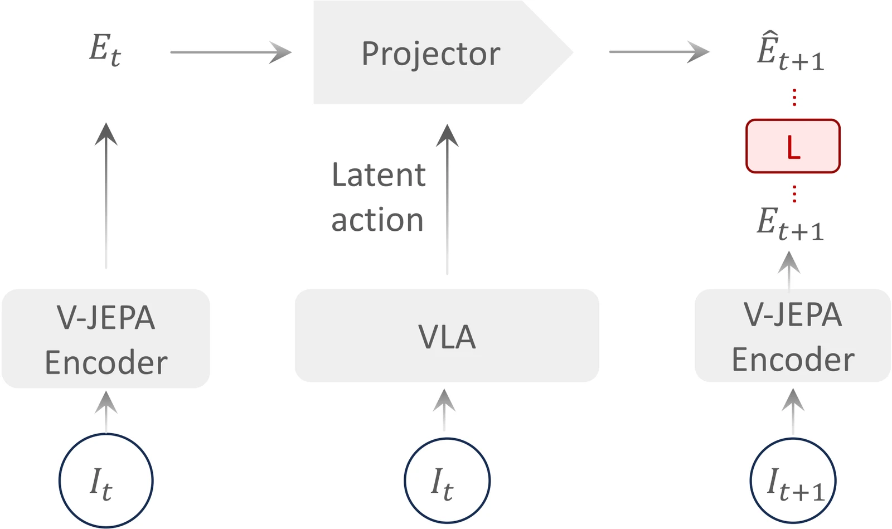
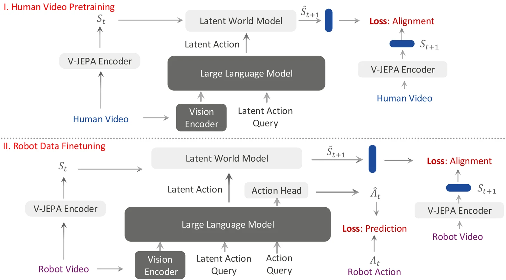
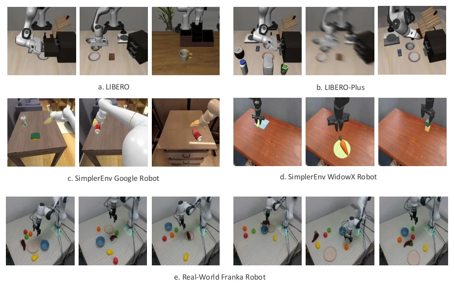
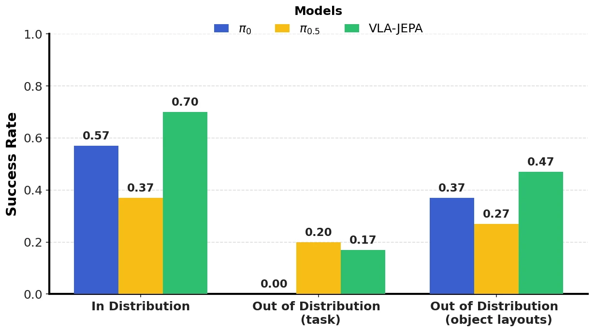
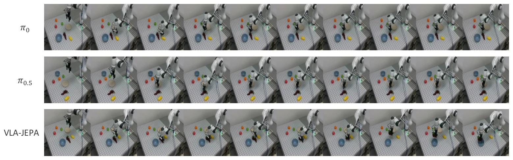
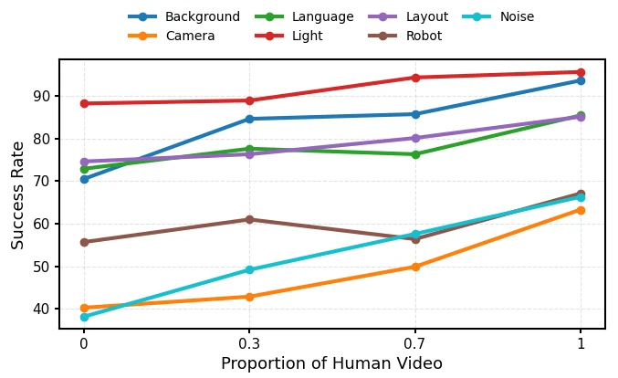
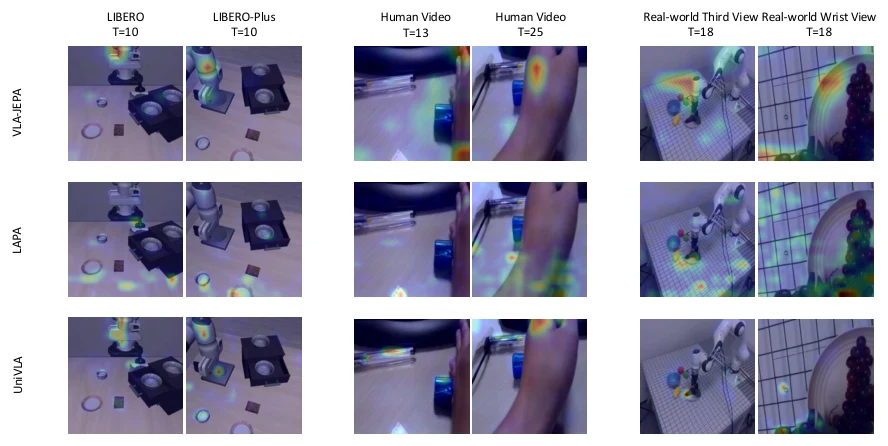

> **한 줄 요약:** 기존 "영상에서 잠재 행동 배우기"는 픽셀 변화에 끌려가고, 미래 프레임을 입력으로 넣다 보니 잠재 행동이 **미래 자체를 베껴 쓰는 지름길**로 무너지기 쉽습니다. VLA-JEPA는 VLM(Qwen3-VL)이 **현재 관측과 지시문만 보고** 잠재 행동 토큰을 만들게 하고, 고정된 V-JEPA2 인코더가 만든 **미래 잠재 상태를 정답으로만** 써서 잠재 월드모델을 학습합니다. 그 위에 flow matching 행동 헤드를 붙여 LIBERO 평균 97.2%, LIBERO-Plus 평균 79.5%를 기록했습니다.

| 항목 | 내용 |
|---|---|
| 저자 | Jingwen Sun\*, Wenyao Zhang\*, Zekun Qi, Shaojie Ren, Zezhi Liu, Hanxin Zhu, Guangzhong Sun, Xin Jin†, Zhibo Chen† (\* 공동 1저자, † 교신저자) |
| 소속 | 중국과학기술대(USTC), Zhongguancun Academy, 상하이자오퉁대, 칭화대, Eastern Institute of Technology (Ningbo), 중국과학원대학, 난카이대 |
| 발표 | 2026.02 arXiv (v2: 2026.02.14), ECCV 2026 (코드 저장소 표기 기준) |
| 링크 | [arXiv 2602.10098](https://arxiv.org/abs/2602.10098) · [프로젝트 페이지](https://ginwind.github.io/VLA-JEPA/) · [코드](https://github.com/ginwind/VLA-JEPA) · [Hugging Face](https://huggingface.co/ginwind/VLA-JEPA) |
| 실험 환경 | LIBERO, LIBERO-Plus, SimplerEnv (Google Robot, WidowX), 실제 Franka Research 3 |

> **읽는 법:** 본문은 논문에 적힌 내용을 그대로 옮긴 것이고, 가능한 곳에는 근거(섹션, 그림, 표 번호)를 달았습니다. 초록색 **AI 해석** 박스는 논문에 없는 해석, 비유, 평가, 다른 연구와의 연결입니다. "먼저 알아둘 개념"은 논문 밖의 일반 배경 설명입니다.
{: .prompt-info }

### 이 글에서 쓰는 기호

논문의 기호를 그대로 따릅니다(Sec. 3).

| 기호 | 뜻 |
|---|---|
| $$ I_{v,t_i} $$ | 시점 $$ t_i $$, 시점(카메라) $$ v $$의 영상 프레임 |
| $$ \ell $$ | 언어 지시문 |
| $$ F(\cdot) $$ | 단일 시점 영상 인코더 (고정된 V-JEPA2) |
| $$ s_{t_i} $$ | 시점 $$ t_i $$의 **월드 상태**. 여러 카메라의 $$ F $$ 출력을 이어 붙인 것 |
| $$ \langle \text{latent}_i \rangle $$ | VLM에 넣는 학습 가능한 **잠재 행동 토큰** |
| $$ z_{t_i} $$ | VLM이 $$ \langle \text{latent}_i \rangle $$ 위치에서 출력한 잠재 행동 표현 |
| $$ \hat{s}_{t_i} $$ | 잠재 월드모델이 예측한 월드 상태 |
| $$ \langle \text{action} \rangle $$, $$ z_a $$ | 실제 로봇 행동용 토큰과 그 출력 표현 |
| $$ a_{0:H} $$ | 길이 $$ H $$의 실제 행동 시퀀스(action chunk) |
| $$ T $$ | 미래 영상 예측 구간(video horizon) |

---

## 왜 이 논문을 읽나

[월드 액션 모델 계보 지도](/posts/world-model-survey/)에서 VLA-JEPA는 **"잠재공간 예측(C 갈래)"**의 C-2로 분류했습니다. 이 갈래는 "미래를 픽셀로 그리지 않고, 행동에 필요한 정보만 특징 공간에서 예측한다"는 입장이고, 흐름은 다음과 같습니다.

| 순서 | 논문 | 한 줄 |
|---|---|---|
| 뿌리 | [DINO-WM](/posts/dino-wm/) | 고정된 DINOv2 특징 위에서 동역학을 학습해 계획 |
| 이전 | [FLARE](/posts/flare/) | 행동 디노이징 네트워크 안에서 미래 임베딩과 정렬 |
| 이전 글 | [DreamVLA](/posts/dreamvla/) | 동적 영역·깊이·의미 특징만 골라 예측하는 VLA |
| **이 글** | **VLA-JEPA** | VLA + 정보 누출 없는 JEPA식 잠재 월드모델 |
| 다음 글 | [LiLa-WAM](/posts/lila-wam/) | 고정된 DINOv3 특징 공간에서 미래를 추론하는 가벼운 WAM |

서베이에서는 이 논문을 "VLA + 정보 누출 없는 JEPA 예측"이라고 한 줄로 요약했습니다. 이번 글에서는 그 **"정보 누출이 없다"**가 정확히 어떤 의미인지, 어디까지가 논문의 주장인지를 원문 기준으로 확인합니다.

---

## 1. 먼저 알아둘 개념

이 절은 논문 밖의 일반 배경 설명입니다.

### 1-1. VLM과 VLA

**VLM(Vision-Language Model)**은 이미지와 텍스트를 함께 입력받아 텍스트를 출력하는 모델입니다. 이미지 인코더(예: SigLIP)가 이미지를 토큰으로 바꾸고, LLM이 그 토큰과 텍스트 토큰을 이어서 처리합니다.

**VLA(Vision-Language-Action)**는 VLM을 로봇 정책으로 바꾼 것입니다. 카메라 이미지 $$ o_t $$와 지시문 $$ \ell $$을 받아 행동을 출력합니다.

$$
\pi_\theta(a_{t:t+H} \mid o_t, \ell)
$$

VLM이 인터넷 규모로 배운 "무엇이 컵이고 어디에 있는지" 같은 지식을 로봇 제어로 옮기려는 발상입니다. 문제는 행동 라벨이 붙은 로봇 데이터가 **비싸고 적다**는 점입니다. 그래서 행동 라벨이 없는 영상(특히 사람 영상)을 어떻게 쓸지가 큰 관심사입니다.

### 1-2. 잠재 행동(latent action)

행동 라벨이 없는 영상에서도 "두 프레임 사이에 무슨 일이 있었나"는 알 수 있습니다. 이걸 벡터로 뽑아 **가짜 행동 라벨**로 쓰는 것이 잠재 행동 학습입니다. LAPA, Genie 같은 연구의 전형적인 구조는 두 부품입니다.

- **역동역학 모델(IDM):** 현재와 미래 프레임을 **둘 다** 보고 잠재 행동 $$ z_t $$를 뽑습니다.
- **순동역학 모델(FDM):** 현재 프레임과 $$ z_t $$로 미래 프레임을 복원합니다.

$$
z_t = \mathrm{IDM}(x_t, x_{t+1}), \qquad \hat{x}_{t+1} = \mathrm{FDM}(x_t, z_t), \qquad \mathcal{L} = \lVert \hat{x}_{t+1} - x_{t+1} \rVert^2
$$

보통 $$ z_t $$를 VQ-VAE 코드북으로 양자화해 정보량을 제한합니다. 그다음 VLA가 이 $$ z_t $$를 예측하도록 사전학습하고, 마지막에 실제 로봇 행동으로 옮깁니다.

### 1-3. 정보 누출(information leakage)과 지름길

위 구조에서 IDM은 **정답인 $$ x_{t+1} $$을 입력으로 봅니다.** 그러면 $$ z_t $$가 "어떤 행동을 했나"를 요약하는 대신, **미래 프레임을 그냥 압축해서 FDM에게 넘겨주는** 편한 길이 생깁니다. 손실은 잘 줄지만, $$ z_t $$는 행동이 아니라 "미래 이미지의 압축본"이 됩니다. 시험 문제에 정답이 같이 적혀 있으면 풀이법을 배울 필요가 없는 것과 같습니다.

정보 누출을 막는 가장 단순한 방법은 **미래는 손실 계산에만 쓰고, 예측하는 쪽의 입력에는 절대 넣지 않는 것**입니다.

### 1-4. JEPA, I-JEPA, V-JEPA

**JEPA(Joint-Embedding Predictive Architecture)**는 LeCun 진영이 제안한 자기지도 학습 틀입니다. 핵심은 **픽셀을 복원하지 않고 표현(임베딩)을 예측**하는 것입니다.

- **컨텍스트 인코더** $$ E_\theta $$가 보이는 부분 $$ x $$를 인코딩합니다.
- **타깃 인코더** $$ \bar{E} $$가 가려진 부분 $$ y $$를 인코딩합니다.
- **예측기** $$ g_\phi $$가 $$ E_\theta(x) $$로부터 $$ \bar{E}(y) $$를 맞힙니다.

$$
\mathcal{L}_{\text{JEPA}} = \big\lVert g_\phi(E_\theta(x)) - \mathrm{sg}[\bar{E}(y)] \big\rVert
$$

$$ \mathrm{sg} $$는 stop-gradient입니다. **I-JEPA**는 이미지 안에서 가려진 영역을, **V-JEPA**는 영상에서 가려진 시공간 영역을 예측합니다. **V-JEPA 2**는 이를 대규모 영상으로 키우고 행동 조건 예측과 계획까지 확장한 후속작입니다.

픽셀 복원은 조명, 질감, 배경처럼 **변화는 크지만 제어와는 무관한** 정보까지 맞혀야 합니다. 표현 공간에서 예측하면 인코더가 이미 걸러낸 추상적 정보만 맞히면 됩니다.

### 1-5. EMA 타깃 인코더와 표현 붕괴

JEPA를 처음부터 학습할 때 위험한 것이 **표현 붕괴(representation collapse)**입니다. 인코더가 모든 입력에 **같은 상수 벡터**를 내놓으면 예측 오차가 0이 되어 버립니다. 그래서 I-JEPA/V-JEPA는 타깃 인코더를 컨텍스트 인코더의 **지수이동평균(EMA)**으로 천천히 따라가게 하고, 타깃 쪽으로는 gradient를 흘리지 않습니다.

$$
\bar{\theta} \leftarrow m \, \bar{\theta} + (1 - m) \, \theta, \quad m \approx 0.99 \sim 0.999
$$

뒤에서 보겠지만 VLA-JEPA는 타깃 인코더를 EMA로 갱신하지 않고 **사전학습된 V-JEPA2를 아예 고정**해서 씁니다.

### 1-6. Flow matching 행동 헤드

$$ \pi_0 $$ 계열 VLA가 쓰는 연속 행동 생성 방식입니다. 가우시안 노이즈 $$ \epsilon $$과 실제 행동 $$ a $$ 사이를 직선으로 잇고, 그 직선 위 점에서 "데이터 쪽으로 가는 속도"를 신경망이 맞히도록 학습합니다.

$$
a_t = (1 - t)\,\epsilon + t\,a, \qquad \text{목표 속도} = a - \epsilon
$$

추론할 때는 노이즈에서 출발해 예측 속도를 몇 번 적분하면 행동이 나옵니다. 한 번에 여러 스텝의 행동(action chunk)을 연속값으로 뽑을 수 있고, 다봉 분포도 표현할 수 있습니다.

### 1-7. Teacher forcing과 시간 인과 어텐션

**Teacher forcing**은 자기회귀 모델을 학습할 때 **이전 스텝의 예측값 대신 실제 정답**을 다음 스텝 입력으로 넣는 방식입니다. 학습이 안정적이고 병렬화가 쉽습니다.

**시간 인과(time-causal) 어텐션**은 시점 $$ t $$의 토큰이 $$ t $$ 이하의 토큰만 보도록 마스크를 씌우는 것입니다. 같은 시점 안에서는 서로 자유롭게 봅니다.

---

## 2. 문제 설정: 기존 잠재 행동 사전학습의 네 가지 실패 (Sec. 1)

논문은 "영상에서 잠재 행동을 배우는" 기존 목표가 **제어에 실제로 필요한 것을 배우지 못한다**고 주장합니다. 로봇에게 쓸모 있는 "행동"은 픽셀 차이의 압축이 아니라 **상호작용에 따라 상태가 어떻게 변하는지(action-relevant state transition)**를 담은 변수여야 한다는 것입니다. 그리고 반복적으로 나타나는 실패 유형 네 가지를 꼽습니다.

| # | 실패 유형 | 논문의 설명 |
|---|---|---|
| 1 | 픽셀 목표가 외형에 치우침 | 미래 픽셀 예측이나 프레임 차이 압축(VQ-VAE 포함)은 질감, 조명, 배경, 시점 변화에 지배된다. 이들은 변화량은 크지만 제어와는 약하게만 연결된다. |
| 2 | 실제 영상이 잡음 움직임을 키움 | 사람 영상이나 야외 영상에서는 카메라 움직임, 인과와 무관한 배경 변화가 상호작용에 의한 변화보다 클 수 있다. 프레임 차이 기반 목표는 이런 잡음 움직임을 인코딩하게 된다. |
| 3 | 정보 누출로 잠재 행동이 지름길로 붕괴 | 현재와 미래 관측을 같은 모듈에 넣거나, 미래 맥락이 잠재 행동에 영향을 주게 하면 잠재 행동이 **미래 자체를 인코딩**하는 지름길이 생긴다. 결과적으로 "행동"은 의미가 비어 있다. |
| 4 | 다단계 파이프라인이 복잡하고 취약 | 표현 사전학습 → 잠재 행동 학습/정렬 → 정책 학습의 3단계 이상 절차는 엔지니어링 부담과 단계 간 불일치를 낳는다. |

논문은 이 네 가지가 결국 **"잠재 행동 목표가 암묵적으로 픽셀 변화에 묶여 있다"**는 하나의 문제로 모인다고 봅니다. 그래서 원칙을 이렇게 세웁니다.

> 행동과 관련된 전이 구조를 담은 **미래 잠재 상태를 예측**하되, **미래 정보가 예측기로 새어 들어가지 않게** 한다. (Sec. 1)

Related Work(Sec. 2.2)에서는 광류(optical flow)나 객체 중심 제약으로 잠재 행동 공간을 묶는 시도들도 언급합니다. 논문에 따르면 이런 제약은 잠재 행동을 **사람이 정한 시각적 사전 지식** 쪽으로 치우치게 하고, 새 환경에서 그 사전 지식이 맞지 않으면 체계적으로 실패하며, 결국 다단계 학습과 추가 정렬 장치를 필요로 합니다.

---

## 3. 방법: VLA-JEPA

### 3-1. 핵심 아이디어: 누출 없는 상태 예측

_VLA-JEPA의 핵심 구조. 현재 프레임 I_t는 V-JEPA 인코더(왼쪽)와 VLA(가운데)로 들어가고, 미래 프레임 I_t+1은 오른쪽 V-JEPA 인코더를 거쳐 손실의 정답 E_t+1로만 쓰인다 (출처: VLA-JEPA, Figure 1)_

Figure 1이 논문의 요지를 가장 간결하게 보여줍니다.

- 현재 프레임 $$ I_t $$는 V-JEPA 인코더를 거쳐 현재 상태 $$ E_t $$가 됩니다.
- **VLA는 현재 프레임 $$ I_t $$만 보고** 잠재 행동을 출력합니다.
- 프로젝터(뒤의 잠재 월드모델)가 $$ E_t $$와 잠재 행동으로 $$ \hat{E}_{t+1} $$을 예측합니다.
- 미래 프레임 $$ I_{t+1} $$은 V-JEPA 인코더를 거쳐 $$ E_{t+1} $$이 되고, **오직 손실 $$ L $$의 정답으로만** 쓰입니다.

초록(Abstract)과 Sec. 1의 표현을 그대로 옮기면, 핵심은 **"leakage-free state prediction"**입니다. 타깃 인코더가 미래 프레임으로 잠재 표현을 만들고, 학생 경로는 현재 관측만 봅니다. **미래 정보는 지도 신호로만 쓰이고 입력으로는 절대 쓰이지 않습니다.** 논문은 특히 "미래 프레임은 VLM 백본의 입력으로 절대 주어지지 않는다"고 명시합니다(Sec. 1).

논문이 말하는 이득은 두 가지입니다.

1. 지도 신호가 픽셀이 아니라 잠재 공간에서 작동하므로 **카메라 움직임과 배경 변화에 강건**하다.
2. 추가 모듈 없이 **JEPA 사전학습 → 행동 헤드 파인튜닝**의 간소한 2단계 파이프라인이 된다.

### 3-2. 전체 구조

_위: 사람 영상은 잠재 월드모델의 정렬 손실(alignment)로만 학습한다. 아래: 로봇 데이터는 정렬 손실과 행동 예측 손실을 함께 쓴다 (출처: VLA-JEPA, Figure 2)_

구성 요소는 네 가지입니다(Sec. 3.1, Appendix A.1).

| 부품 | 구현 | 학습 여부 |
|---|---|---|
| VLM 백본 | **Qwen3-VL-2B** (Qwen3 LLM + SigLIP-2 계열 비전 인코더) | 학습 |
| 월드 상태 인코더 | **V-JEPA2** 인코더 체크포인트 | **고정** |
| 잠재 월드모델(예측기) | 무작위 초기화한 자기회귀 트랜스포머, 시간 인과 어텐션 | 학습 |
| 행동 헤드 | flow matching 기반 **DiT-B** | 학습 |

VLM 어휘에는 두 종류의 특수 토큰이 추가됩니다.

- $$ \langle \text{latent}_i \rangle $$: 시점 $$ i $$의 잠재 행동 토큰. 예를 들어 $$ \langle \text{latent}_0 \rangle $$은 $$ s_0 $$에서 $$ s_1 $$로의 상태 전이를 나타냅니다.
- $$ \langle \text{action} \rangle $$: 실제 로봇 행동 생성을 위한 토큰.

### 3-3. 월드 상태 인코더 (Sec. 3.2, 식 1)

사람 영상 데이터셋을 $$ D = \{ (O_0, O_1, \dots, O_v, \ell) \} $$로 둡니다. $$ O_v = (I_{v,t_0}, I_{v,t_1}, \dots, I_{v,t_n}) $$은 시점(카메라) $$ v $$에서 찍은 영상입니다.

같은 에피소드의 여러 카메라 영상을 하나의 **월드 상태**로 묶습니다. 카메라마다 V-JEPA2 인코더 $$ F $$를 통과시킨 뒤 이어 붙입니다.

$$
s_{t_i} = \big\Vert_{v} \, F(I_{v,t_i})
$$

여기서 $$ \Vert $$는 벡터 이어 붙이기입니다. 구현상 카메라 수는 2로 맞춥니다. 카메라가 하나뿐이면 월드 상태 표현을 복제해 두 개를 이어 붙이고, 셋 이상이면 두 개를 골라 씁니다(Appendix A.2).

### 3-4. 잠재 행동: 현재 관측만 보고 만든다 (식 2)

VLM은 **초기 시점 $$ t_0 $$의 다중 시점 관측과 지시문 $$ \ell $$만** 입력으로 받고, 잠재 행동 토큰 위치에서 표현을 출력합니다.

$$
z_{t_i} = p_\theta^{VLM}\big( \langle \text{latent}_i \rangle \mid \{ I_{j,t_0} \}_{j=0}^{v}, \ell \big)
$$

$$ z_{t_i} $$는 $$ i $$번째 시점의 잠재 행동 표현입니다. 즉 **모든 시점의 잠재 행동이 $$ t_0 $$ 관측 하나에서 나옵니다.** VLM은 미래 프레임을 한 장도 보지 않습니다.

구현상 각 $$ \langle \text{latent}_i \rangle $$는 입력 시퀀스에 $$ K $$번 반복해 넣습니다. 논문은 이를 "가변 길이 잠재 행동 인코딩"을 위해서라고 설명하고(Sec. 3.2), 부록에서는 "잠재 행동 토큰에 대한 주의를 강화하기 위해" $$ K = 24 / T $$로 둔다고 적었습니다. 24는 실험적으로 찾은 최적값입니다(Appendix A.1). 기본 설정 $$ T = 8 $$에서는 시점당 잠재 행동 토큰이 3개이고, 이는 Table 5의 "Number of action tokens per time step: 3"과 일치합니다.

### 3-5. 잠재 월드모델 (식 3)

잠재 월드모델은 지금까지의 월드 상태와 잠재 행동으로 **다음 상태 묶음**을 예측합니다.

$$
\hat{s}_{t_{1:i+1}} = p_\theta^{WM}\big( s_{t_{0:i}}, \, z_{t_{0:i}} \big)
$$

어텐션 규칙은 다음과 같습니다(Sec. 3.2, Appendix A.1).

- **같은 시점 안:** $$ K $$개의 잠재 행동 토큰과 $$ N $$개의 이미지 잠재 토큰이 서로 양방향으로 봅니다.
- **다른 시점 사이:** 엄격하게 인과적입니다. 시점 $$ t $$의 토큰은 $$ t $$ 이하만 보고, 미래 시점은 마스킹됩니다.

학습은 **teacher forcing**으로 합니다(Sec. 3.2). 잠재 월드모델의 설정은 Table 5와 같습니다.

| 항목 | 값 |
|---|---|
| 트랜스포머 층 수 | 12 |
| 어텐션 헤드 | 8 |
| 이미지 토큰 차원 | 2048 |
| 시점당 이미지 토큰 수 | 256 |
| 행동 토큰 차원 | 2048 |
| 시점당 행동 토큰 수 | 3 |
| 카메라 수 | 2 |
| 미래 영상 구간 $$ T $$ | 8 |

### 3-6. 학습 목표: 잠재 공간 정렬 (식 4, 5)

논문은 이 목표를 JEPA 관점에서 **의미 공간에서의 예측 로그우도에 대한 ELBO 최대화**로 해석합니다.

$$
\log p(s_{t_{1:T}} \mid z_{t_{0:T-1}}) \ge \sum_{k=1}^{T} \mathbb{E}_{s_{t_k} \sim F(\cdot)} \big[ \log p_\theta(\hat{s}_{t_k} \mid s_{t_k}) \big] - D_{\mathrm{KL}}\big[ F(\cdot) \,\Vert\, p_\theta^{WM} \big]
$$

여기서 $$ F $$는 stop-gradient가 걸린 **고정된 타깃 인코더**, $$ p_\theta^{WM} $$은 온라인 예측기입니다. 논문에 따르면 $$ F $$가 결정론적 임베딩을 내므로 KL 항은 사라지고, ELBO는 **잠재 공간에서의 복원 손실**로 줄어듭니다. 최종 월드모델 손실은 다음과 같습니다.

$$
\mathcal{L}_{\mathrm{WM}} = \sum_{k=1}^{T} \mathbb{E}_{s_{t_k} \sim F(\cdot)} \big( \hat{s}_{t_k} - s_{t_k} \big)
$$

$$ s_{t_k} $$는 시점 $$ t_k $$의 정답 월드 상태, $$ \hat{s}_{t_k} $$는 예측, $$ T $$는 영상 예측 구간입니다. 이 손실로 **VLM과 월드모델을 함께** 최적화하므로, gradient는 월드모델을 거쳐 VLM의 잠재 행동 토큰 $$ z_{t_i} $$까지 흐릅니다. 논문은 이를 통해 VLM이 가진 세계 지식이 담긴 $$ z_{t_i} $$가 월드 상태 전이를 잘 설명하게 된다고 설명합니다.

> **AI 해석**  
> 몇 가지를 원문과 대조해 정리해 두면 좋습니다.  
> **① 표현 붕괴 대책:** 일반적인 JEPA는 타깃 인코더를 EMA로 갱신하며 붕괴를 막지만, 이 논문은 타깃(V-JEPA2)을 완전히 **고정**합니다. 타깃이 움직이지 않으니 "모두 같은 벡터로 수렴"하는 고전적 붕괴는 구조적으로 일어나기 어렵습니다. 대신 표현의 질은 전적으로 V-JEPA2가 이미 배운 것에 달려 있습니다. 이 점에서 방법의 성격은 "JEPA를 새로 학습"한다기보다 **"고정된 JEPA 특징 공간 위에서 잠재 행동 조건 월드모델을 학습"**하는 쪽에 가깝고, DINO-WM이 DINOv2 특징을 고정해 쓰는 것과 같은 계열입니다.  
> **② 손실의 형태:** 식 5에는 노름(L1/L2 등)이 적혀 있지 않고 차이 $$ (\hat{s} - s) $$만 쓰여 있습니다. 문자 그대로면 손실이 음수로 갈 수 있으므로, 실제로는 어떤 거리 함수가 쓰였을 것으로 보이지만 논문 본문만으로는 확인되지 않습니다.  
> **③ ELBO 유도:** 식 4의 부등식은 엄밀한 유도라기보다 "JEPA 정렬 손실을 확률적 관점에서 읽을 수 있다"는 동기 설명에 가깝게 읽힙니다.
{: .prompt-tip }

### 3-7. 행동 예측: 잠재 행동을 조건으로 쓰기 (Sec. 3.3, 식 6)

로봇 데이터(행동 라벨 있음)에서는 두 가지를 동시에 합니다.

1. 로봇의 다중 시점 RGB 영상에 **같은 식 5**를 적용해, 잠재 행동 표현을 로봇 도메인에 맞게 조정합니다.
2. 잠재 행동 토큰 **뒤에** 학습 가능한 $$ \langle \text{action} \rangle $$ 토큰을 붙입니다. VLM의 인과 어텐션 덕분에 $$ \langle \text{action} \rangle $$은 초기 관측, 지시문, 잠재 행동 토큰을 모두 참조합니다.

$$
z_a = p_\theta^{VLM}\big( \langle \text{action} \rangle \mid \{ I_{i,t_0} \}_{i=0}^{v}, \ell, \langle \text{latent}_i \rangle \big)
$$

논문은 잠재 행동이 초기 이미지나 지시문처럼 **행동 생성의 조건 신호** 역할을 하도록 의도했다고 설명합니다. 구현상 $$ \langle \text{action} \rangle $$ 토큰은 32번 반복해 행동 헤드의 조건 시퀀스로 씁니다(Appendix A.1).

### 3-8. Flow matching 행동 헤드 (식 7, 8, 9)

실제 행동 시퀀스 $$ a_{0:H} $$와 가우시안 노이즈 $$ \epsilon \sim \mathcal{N}(0, I) $$ 사이를 선형 보간합니다.

$$
a_t = (1 - t)\,\epsilon + t\,a_{0:H}, \qquad t \sim \mathcal{U}(0, 1)
$$

행동 헤드는 $$ z_a $$를 조건으로 속도장 $$ v_\theta(a_t, t \mid z_a) $$를 출력하고, 다음 손실로 학습합니다.

$$
\mathcal{L}_{\mathrm{FM}} = \mathbb{E}_{a_{0:H}, \epsilon, t} \Big[ \big\lVert v_\theta(a_t, t \mid z_a) - (a_{0:H} - \epsilon) \big\rVert_2^2 \Big]
$$

추론 때는 노이즈에서 출발해 속도장을 적분해 $$ \hat{a}_{0:H} $$를 얻습니다. 행동 라벨이 있는 로봇 데이터의 전체 손실은 다음과 같습니다.

$$
\mathcal{L} = \mathcal{L}_{\mathrm{FM}} + \beta \, \mathcal{L}_{\mathrm{WM}}
$$

$$ \beta $$는 조절 가능한 하이퍼파라미터입니다(논문에 구체적 값은 적혀 있지 않습니다). 행동 헤드 설정은 Table 6과 같습니다.

| 항목 | 값 |
|---|---|
| 구조 | DiT-B |
| 트랜스포머 층 수 / 헤드 | 16 / 12 |
| 토큰 차원 | 1024 |
| 상태 차원 / 행동 차원 | 8 / 7 |
| 미래 행동 구간 | 7 |
| 위치 인코딩 | 학습 가능 |
| 디노이징 스텝 | 4 |

### 3-9. 학습 절차와 데이터 (Sec. 4.1, Appendix A.2)

| 단계 | 데이터 | 손실 | 스텝 |
|---|---|---|---|
| 사전학습 | Something-Something-v2 (**사람 영상 22만 개**, 행동 라벨 없음) + DROID (**로봇 궤적 7.6만 개**) | 사람 영상: 식 5, 로봇 데이터: 식 9 | 50K (둘을 함께 학습) |
| 시뮬레이션 파인튜닝 | LIBERO (약 2K 시연) / SimplerEnv용 Fractal, BridgeV2 | 식 9 | 30K |
| 실제 로봇 파인튜닝 | 직접 수집한 시연 100개 (3개 태스크) | 식 9 | 20K |

- 사전학습에서는 **월드 상태 인코더를 제외한 모든 파라미터**를 학습합니다.
- VLM 입력 이미지는 224×224, 월드 상태 인코더 입력 영상은 256×256입니다.
- 행동은 엔드이펙터 위치 변화량과 축-각(axis-angle) 변화량을 [0, 1]로 min-max 정규화하고, 그리퍼는 {0, 1}로 이진화합니다.
- GPU당 배치 32, A100 8장, 전역 배치 256. cosine 스케줄 + 선형 warmup, 최대 학습률은 VLM과 월드모델 1e-5, 행동 헤드 1e-4입니다.
- LIBERO-Plus 평가에도 LIBERO 데이터만 쓰고, LIBERO-Plus의 증강 데이터는 쓰지 않았습니다.

> **AI 해석**  
> **"누출 없음"의 범위를 정확히 짚어 두겠습니다.** 논문이 보장하는 것은 **VLM(잠재 행동을 만드는 쪽)이 미래 프레임을 입력으로 보지 않는다**는 점입니다(식 2). 반면 잠재 월드모델은 식 3에서 $$ s_{t_{0:i}} $$를 입력으로 받고 teacher forcing으로 학습되므로, 시점 $$ t_{i+1} $$을 예측할 때 $$ t_1, \dots, t_i $$의 **정답 미래 상태**를 조건으로 봅니다. 즉 "미래가 어디에도 입력되지 않는다"가 아니라 **"잠재 행동 $$ z $$가 미래로부터 계산되지 않는다"**가 정확한 의미입니다. 이것이 LAPA식 IDM(미래 프레임을 직접 보고 $$ z $$를 뽑음)과의 결정적 차이이고, 지름길을 막는 데 필요한 조건이기도 합니다. $$ z $$는 $$ t_0 $$ 관측과 지시문만으로 "앞으로 어떻게 변할지"를 요약해야 하므로, 미래 이미지를 베껴 넘겨줄 통로가 없습니다.  
> **"2단계"라는 표현도 주의가 필요합니다.** 초록은 "JEPA 사전학습 → 행동 헤드 파인튜닝"의 2단계라고 쓰지만, 실제 구현(Sec. 4.1)에서는 사전학습 단계부터 DROID 로봇 데이터에 식 9(행동 손실 포함)를 함께 씁니다. 따라서 "행동 헤드는 두 번째 단계에서만 붙는다"기보다 **"잠재 행동 학습과 행동 학습을 한 단계로 합쳤고, 그다음 도메인별 파인튜닝을 한다"**로 읽는 것이 실제 절차에 더 가깝습니다. 기존의 "표현 → 잠재 행동 → 정책" 3단계보다 단계가 줄어든 것은 분명합니다.
{: .prompt-tip }

---

## 4. 실험

_실험 환경: LIBERO, LIBERO-Plus, SimplerEnv Google Robot, SimplerEnv WidowX, 실제 Franka 로봇 (출처: VLA-JEPA, Figure 3)_

### 4-1. 벤치마크와 비교 대상 (Sec. 4.2)

논문은 세 시뮬레이션 벤치마크를 서로 다른 일반화 상황으로 배치합니다.

| 벤치마크 | 상황 | 로봇 |
|---|---|---|
| **LIBERO** | 시뮬레이션 시연으로 학습 → 같은 분포의 태스크 평가 (ID) | Franka Panda, 4개 태스크 묶음 |
| **SimplerEnv** | **실제** 데이터로 학습 → 시뮬레이션 평가 (real-to-sim OOD) | Google Robot, WidowX |
| **LIBERO-Plus** | 시뮬레이션 시연으로 학습 → 7가지 교란이 들어간 태스크 평가 (OOD) | Franka Panda |

비교 대상은 잠재 행동 VLA(LAPA, UniVLA, villa-X, Moto), 미래 예측 VLA(CoT-VLA, WorldVLA), 그리고 공개 SOTA VLA(RoboVLMs, GR00T N1, OpenVLA-OFT, $$ \pi_0 $$, $$ \pi_0 $$-FAST, $$ \pi_{0.5} $$)입니다.

### 4-2. LIBERO (Table 1)

태스크당 50 에피소드(묶음당 500 에피소드)로 평가한 성공률(%)입니다.

| 방법 | Spatial | Object | Goal | LIBERO-10 | 평균 |
|---|---|---|---|---|---|
| LAPA | 73.8 | 74.6 | 58.8 | 55.4 | 65.7 |
| UniVLA | 96.5 | 96.8 | 95.6 | 92.0 | 95.2 |
| OpenVLA-OFT | 97.6 | 98.4 | 97.9 | 94.5 | 97.1 |
| $$ \pi_0 $$ | 96.8 | 98.8 | 95.8 | 85.2 | 94.2 |
| $$ \pi_0 $$-FAST | 96.4 | 96.8 | 88.6 | 60.2 | 85.5 |
| CoT-VLA | 87.5 | 91.6 | 87.6 | 69.0 | 81.1 |
| WorldVLA | 87.6 | 96.2 | 83.4 | 60.0 | 81.8 |
| villa-X | 97.5 | 97.0 | 91.5 | 74.5 | 90.1 |
| GR00T N1 | 94.4 | 97.6 | 93.0 | 90.6 | 93.9 |
| $$ \pi_{0.5} $$ | **98.8** | 98.2 | **98.0** | 92.4 | 96.9 |
| **VLA-JEPA** | 96.2 | **99.6** | 97.2 | **95.8** | **97.2** |
| VLA-JEPA (사람 영상 없이) | 94.8 | 99.6 | 95.8 | 94.0 | 96.1 |

논문에 따르면 VLA-JEPA는 4개 중 2개 묶음(Object, LIBERO-10)에서 최고이고, **평균 성공률이 가장 높습니다.** 논문은 OpenVLA-OFT와 $$ \pi_{0.5} $$가 대규모 로봇 데이터로 사전학습했다는 점을 지적하며, VLA-JEPA가 더 적은 학습 데이터로 더 나은 성능을 냈다고 설명합니다. 또 UniVLA, villa-X, LAPA, CoT-VLA처럼 잠재 행동이나 사람 영상을 쓰는 기존 방법이 모두 VLA-JEPA보다 낮은 것은 Sec. 1에서 지적한 한계를 뒷받침한다고 봅니다.

### 4-3. SimplerEnv (Table 2)

Visual matching 설정의 태스크별 평균 성공률(%)입니다. LAPA\*는 시뮬레이션에서 수집한 in-distribution 시연으로 학습했고, 나머지는 OXE 부분집합으로 학습했습니다.

| 방법 | Google: Pick | Move | Drawer | Place | **평균** | WidowX: Spoon | Carrot | Block | Eggplant | **평균** |
|---|---|---|---|---|---|---|---|---|---|---|
| LAPA\* | - | - | - | - | - | 70.8 | 45.8 | 54.2 | 58.3 | 57.3 |
| villa-X | 81.7 | 55.4 | 38.4 | 4.2 | 44.9 | 48.3 | 24.2 | 19.2 | 71.7 | 40.8 |
| UniVLA | - | - | - | - | - | - | - | - | - | 42.7 |
| RoboVLMs | 77.3 | 61.7 | 43.5 | 24.1 | 51.7 | 45.8 | 20.8 | 4.2 | 79.2 | 37.5 |
| GR00T N1 | 0.7 | 1.9 | 2.9 | 0.0 | 1.4 | 1.4 | 0.0 | 0.0 | 13.9 | 3.8 |
| Moto | 74.0 | 60.4 | 43.1 | - | - | - | - | - | - | - |
| OpenVLA-OFT | - | - | - | - | - | 34.2 | 30.0 | 30.0 | 72.5 | 41.8 |
| $$ \pi_0 $$ | 72.7 | 65.3 | 38.3 | - | - | 29.1 | 0 | 16.6 | 62.5 | 40.1 |
| $$ \pi_0 $$-FAST | 75.3 | 67.5 | 42.9 | - | - | 29.1 | 21.9 | 10.8 | 66.7 | 48.3 |
| **VLA-JEPA** | 88.3 | 64.1 | 59.3 | 49.1 | 65.2 | 75.0 | 70.8 | 12.5 | 70.8 | 57.3 |
| VLA-JEPA (사람 영상 없이) | 85.3 | 66.7 | 75.5 | 86.1 | 78.4 | 75.0 | 54.2 | 20.8 | 79.2 | 57.3 |

논문의 설명은 다음과 같습니다.

- VLA-JEPA는 Google Robot 평균에서 최고, WidowX 평균에서 두 번째입니다.
- SimplerEnv는 전문가 시연을 제공하지 않아 **로봇 데이터의 질**이 성능에 결정적입니다. 예를 들어 LAPA는 SimplerEnv에서 성공한 rollout만 골라 시연으로 썼고, 100개 rollout만으로 WidowX에서 높은 성공률을 냈습니다. 논문은 성공 rollout으로 학습하면 real-to-sim 격차가 효과적으로 줄기 때문이라고 봅니다.
- VLA-JEPA, UniVLA, RoboVLMs, Moto는 모두 villa-X가 쓴 학습 데이터의 **1% 미만**을 쓰는데, 그중 VLA-JEPA가 가장 경쟁력 있는 결과를 냈다고 설명합니다.

### 4-4. LIBERO-Plus (Table 3)

LIBERO의 4개 태스크 묶음에 7가지 교란을 넣었을 때의 평균 성공률(%)입니다.

| 방법 | Camera | Robot | Language | Light | Background | Noise | Layout | **평균** |
|---|---|---|---|---|---|---|---|---|
| UniVLA | 1.8 | 46.2 | 69.6 | 69.0 | 81.0 | 21.2 | 31.9 | 42.9 |
| OpenVLA-OFT | 56.4 | 31.9 | 79.5 | 88.7 | 93.3 | 75.8 | 74.2 | 69.6 |
| $$ \pi_0 $$ | 13.8 | 6.0 | 58.8 | 85.0 | 81.4 | **79.0** | 68.9 | 53.6 |
| $$ \pi_0 $$-FAST | **65.1** | 21.6 | 61.0 | 73.2 | 73.2 | 74.4 | 68.8 | 61.6 |
| WorldVLA | 0.1 | 27.9 | 41.6 | 43.7 | 17.1 | 10.9 | 38.0 | 25.0 |
| **VLA-JEPA** | 63.3 | **67.1** | **85.4** | **95.6** | **93.6** | 66.3 | **85.1** | **79.5** |
| VLA-JEPA (사람 영상 없이) | 40.3 | 55.7 | 72.9 | 88.2 | 70.5 | 38.2 | 74.6 | 62.9 |

논문에 따르면 VLA-JEPA는 7개 중 5개 교란에서 최고입니다. 특히 Language, Light, Background, Layout 교란에서 모든 비교 대상보다 크게 앞서며, 논문은 이를 잠재 행동이 **태스크와 무관한 교란**을 잘 다룬다는 근거로 봅니다. 또한 논문은 이 결과가 "사전학습으로 배운 잠재 행동이 텍스트 데이터에 담긴 것에 견줄 만한 세계 지식 표현을 가진다"는 것을 보여준다고 주장합니다.

> **AI 해석**  
> **결과를 읽을 때 눈여겨볼 점들입니다.**  
> **① LIBERO 평균 차이는 작습니다.** 97.2 대 OpenVLA-OFT 97.1, $$ \pi_{0.5} $$ 96.9로, 이 정도 차이는 LIBERO가 이미 포화 상태에 가깝다는 것을 보여주는 쪽에 가깝습니다. 이 논문의 강점이 더 분명히 드러나는 곳은 **LIBERO-Plus**(평균 79.5 대 차순위 69.6)입니다.  
> **② SimplerEnv에서는 사람 영상이 오히려 손해처럼 보입니다.** Google Robot 평균이 사람 영상 없이 78.4, 사람 영상 포함 65.2로, "없이" 버전이 13.2%p 높습니다. 특히 Place(86.1 대 49.1)와 Drawer(75.5 대 59.3) 차이가 큽니다. 논문도 이를 인정합니다(4-6절 Q1 참고).  
> **③ 본문과 표가 어긋나는 부분이 있습니다.** Sec. 4.3 본문은 "villa-X가 WidowX 평균 최고"라고 쓰지만, Table 2에서 villa-X의 WidowX 평균은 40.8이고 최고는 LAPA\*와 VLA-JEPA의 57.3(동률)입니다. 또 "Google Robot과 WidowX 모두 4개 중 2개 태스크에서 최고"라는 서술도, 사람 영상 포함 버전만 보면 Google에서는 Pick, Drawer, Place 3개가 최고이고, "사람 영상 없이" 행까지 포함하면 셈이 달라집니다. 원문 표 숫자를 우선해서 읽는 것이 안전합니다.  
> **④ Noise와 Camera 교란은 여전히 약점입니다.** Noise에서는 $$ \pi_0 $$(79.0)나 OpenVLA-OFT(75.8)보다 낮고, Camera도 $$ \pi_0 $$-FAST보다 약간 낮습니다. 다만 이 두 항목은 사람 영상 사전학습으로 가장 크게 오른 항목(Noise 38.2 → 66.3, Camera 40.3 → 63.3)이기도 합니다.
{: .prompt-tip }

### 4-5. 실제 로봇 실험 (Sec. 4.4, Appendix B)

**환경:** Franka Research 3 팔 + Robotiq 2F-85 그리퍼, Intel RealSense D435 카메라 3대(3인칭 2대, 손목 1대). 포도, 사과, 망고, 오렌지를 테이블에서 집어 접시나 그릇에 놓는 3가지 pick-and-place 태스크의 시연 100개로 학습했습니다. 태스크마다 10회씩 독립 시행했습니다. 비교를 위해 $$ \pi_0 $$와 $$ \pi_{0.5} $$도 같은 시연으로 파인튜닝했습니다.

**평가 설정:**

- **ID:** 학습한 태스크 그대로.
- **태스크 OOD:** 학습에 없던 태스크. (i) 바나나를 그릇에, (ii) 복숭아를 접시에, (iii) 포도를 선반 윗칸에.
- **배치 OOD:** 학습 태스크 3개를 골라 물체 배치를 무작위로 섞음.

_실제 로봇 성공률. 분포 내(ID), 태스크 OOD, 물체 배치 OOD에서 π0, π0.5, VLA-JEPA 비교 (출처: VLA-JEPA, Figure 4)_

| 설정 | $$ \pi_0 $$ | $$ \pi_{0.5} $$ | VLA-JEPA |
|---|---|---|---|
| In Distribution | 0.57 | 0.37 | **0.70** |
| OOD (태스크) | 0.00 | **0.20** | 0.17 |
| OOD (물체 배치) | 0.37 | 0.27 | **0.47** |

(Figure 4 막대그래프에 표기된 값)

논문의 관찰은 다음과 같습니다.

- VLA-JEPA는 ID와 배치 OOD에서 최고, 태스크 OOD에서 두 번째입니다.
- 실제 배치 중 **일반화 능력은 $$ \pi_{0.5} $$보다 덜 강건**했지만, **실행 궤적은 훨씬 안정적**이었습니다. $$ \pi_{0.5} $$는 지시문을 더 정확히 따라 목표 물체에 접근하지만, 위치 제어가 **로봇 팔의 안전 경계를 자주 넘어서** 실패했습니다. VLA-JEPA는 지시문에 대한 세밀한 추론이 부족해 **지시와 다른 물체를 집는** 경향이 있지만, 안전 경계를 넘는 일은 드물었습니다.
- 바나나 태스크에서는 $$ \pi_{0.5} $$와 VLA-JEPA 모두 약 50% 성공률을 냈습니다. 복숭아는 모양이 불규칙해 로봇이 안전 경계를 자주 넘었습니다. 선반 태스크는 학습 데이터에 선반이 없어 **어떤 모델도 성공하지 못했지만**, $$ \pi_0 $$와 $$ \pi_{0.5} $$가 선반에 바로 부딪힌 것과 달리 VLA-JEPA는 선반 뒤쪽에서 접근해 엔드이펙터를 높이 드는 다른 행동을 보였다고 합니다(Appendix B).

**다시 잡기(repeated grasping)**

_물체 배치 OOD에서 세 모델의 실행 프레임. VLA-JEPA(아래)만 잡기에 실패한 뒤 그리퍼를 다시 열고 재시도한다 (출처: VLA-JEPA, Figure 7)_

논문이 강조하는 정성적 결과입니다. VLA-JEPA는 잡기에 실패하면 **그리퍼를 다시 열고 재시도**하는 행동을 보였고, 이는 $$ \pi_0 $$나 $$ \pi_{0.5} $$에서는 관찰되지 않았습니다(Sec. 4.4, Fig. 7). 논문은 이것이 학습용 로봇 시연에는 재시도 장면이 없지만 **사람 영상에는 재시도 장면이 풍부**하기 때문이라고 봅니다. 또한 재시도는 새로운 물리 동역학을 배워야 하는 기술이 아니라 **"언제 다시 잡을지"라는 시간적 결정**만 배우면 되고, 그 결정만 배우면 정책이 자신의 물리 동역학으로 매핑해 실행할 수 있다고 주장합니다(Appendix B).

### 4-6. 분석과 절제 실험 (Sec. 4.5)

#### Q1. 사람 영상은 어떤 영향을 주나?

Table 1~3의 "사람 영상 없이" 행이 이 질문에 대한 답입니다. 논문의 해석은 다음과 같습니다.

- **LIBERO와 SimplerEnv에서는 사람 영상을 빼도 성능이 크게 떨어지지 않고**, SimplerEnv에서는 오히려 더 높아지기도 합니다. 논문은 ID 상황과 real-to-sim OOD 상황에서는 **고품질 전문가 시연이 사람 영상보다 더 중요**하다고 결론짓습니다.
- **LIBERO-Plus에서는 사람 영상이 큰 이득**을 줍니다(평균 62.9 → 79.5). 논문은 사람 영상에는 행동 궤적 정보가 부족해 로봇 행동의 물리 동역학을 직접 가르치지는 못하고, 대신 **이미 가진 기술(예: 다시 잡기)의 강건성과 안정성을 높인다**고 해석합니다.

_사전학습 데이터에서 사람 영상 비율(0, 0.3, 0.7, 1)에 따른 LIBERO-Plus 교란별 성공률 (출처: VLA-JEPA, Figure 5)_

Figure 5는 사전학습 데이터에서 사람 영상 비율을 늘릴 때 LIBERO-Plus 교란별 성공률이 어떻게 변하는지 보여줍니다. 논문은 이 결과가 "사람 영상은 새로운 행동 능력을 주기보다 기존 기술 목록을 강화해 강건성과 안정성을 높인다"는 가설을 뒷받침하며, **사람 영상 규모가 커질수록 정책의 강건성이 꾸준히 좋아진다**고 설명합니다.

#### Q2. 통합 사전학습은 어떤 영향을 주나?

논문은 Sec. 4.3의 결과로 통합 사전학습이 기존 2단계 사전학습보다 일관되게 낫다고 말하고, 잠재 행동 토큰이 무엇을 보는지 확인하기 위해 **잠재 행동 토큰 → 이미지 토큰 어텐션 가중치**를 시각화했습니다. 공정한 비교를 위해 LAPA, UniVLA, VLA-JEPA 모두 **사전학습만 한 체크포인트**(파인튜닝 없음)를 썼습니다.

_잠재 행동 토큰이 이미지 토큰에 주는 어텐션. 위부터 VLA-JEPA, LAPA, UniVLA. 시뮬레이션, 사람 영상, 실제 로봇 3인칭/손목 시점 입력 (출처: VLA-JEPA, Figure 6)_

논문의 해석(Fig. 6):

- **LAPA:** 지나치게 넓은 시각 정보에 주의를 둬, 책상 위 무관한 물체 같은 조작과 무관한 디테일까지 포함합니다. 논문은 이를 사전학습 단계의 **정보 누출로 잠재 행동이 목표 이미지의 압축 표현으로 퇴화**했기 때문이라고 봅니다.
- **UniVLA:** 태스크 관련 텍스트 안내로 이 문제를 줄이지만, 의미를 지나치게 강조해 사람 영상의 가만히 있는 펜이나 손목 영상의 식탁보 무늬 같은 배경 요소에 주의를 둡니다.
- **VLA-JEPA:** 로봇 팔, 손, 조작 대상 물체에 더 정확히 집중합니다.

#### Q3. 미래 영상 구간 $$ T $$는 어떤 영향을 주나? (Table 4)

잠재 행동 토큰 수는 항상 "프레임 수 − 1"이 되도록 두고, $$ T \in \{4, 8, 16\} $$을 비교했습니다. 모든 모델은 LIBERO 데이터로 바로 파인튜닝했고 다른 하이퍼파라미터는 같게 두었습니다.

| $$ T $$ | Spatial | Object | Goal | LIBERO-10 | 평균 |
|---|---|---|---|---|---|
| 4 | **95.0** | 99.2 | 95.8 | 89.0 | 94.8 |
| 8 | 94.8 | **99.8** | 95.8 | **94.0** | **96.1** |
| 16 | 92.8 | 98.8 | **98.0** | 92.2 | 95.5 |

논문에 따르면 **영상 구간이 미리 정한 행동 구간(7)에 가까울 때 가장 좋고**, 이는 잠재 행동이 실제 행동 생성에 효과적이라는 뜻입니다. $$ T $$가 너무 작으면 담긴 정보가 부족해 특히 긴 태스크(LIBERO-10: 89.0)에서 떨어지고, 너무 크면 불필요한 정보가 들어가 목표가 단순한 Goal 묶음에서는 최고지만 세밀한 조작이 필요한 Spatial 묶음에서는 최저가 됩니다.

> **AI 해석**  
> **"사람 영상은 새 기술이 아니라 기존 기술의 강건성을 준다"는 결론은 흥미롭지만, 근거의 강도는 나눠서 봐야 합니다.**  
> - 정량 근거는 탄탄한 편입니다. LIBERO-Plus 평균 62.9 → 79.5는 큰 차이이고, Figure 5에서 여러 교란 축이 비율에 따라 전반적으로 오릅니다. 다만 그래프를 보면 Robot과 Language는 비율 0.7에서 잠깐 내려가서, "모든 축이 단조 증가"라고까지 말하기는 어렵습니다.  
> - "다시 잡기가 사람 영상에서 왔다"는 설명은 **정성적 관찰과 해석**입니다. 사람 영상 없이 학습한 VLA-JEPA가 실제 로봇에서 다시 잡기를 하는지는 보고되지 않아, 이 행동이 사람 영상 때문인지 VLA-JEPA의 다른 설계 때문인지는 완전히 분리되지 않습니다.  
> - 어텐션 맵(Fig. 6)은 직관적이지만 몇 장의 예시이고, 어텐션 가중치가 실제 행동 결정에 쓰이는 정보와 같다는 보장은 없습니다.  
>
> **FLARE와의 연결:** 이전 글의 [FLARE](/posts/flare/)도 "미래 관측 임베딩과 정렬"과 "사람 1인칭 영상 활용"이라는 같은 두 축을 가졌습니다. FLARE가 행동 디노이징 네트워크 안에서 미래 임베딩과 정렬했다면, VLA-JEPA는 **VLM 쪽에 잠재 행동 토큰을 두고 별도의 잠재 월드모델로 정렬**한다는 점이 다릅니다. 덕분에 행동 라벨이 없는 사람 영상은 행동 헤드 없이 식 5만으로 학습할 수 있습니다.
{: .prompt-tip }

---

## 5. 논문이 밝힌 한계

논문에는 따로 "Limitations" 절이 없습니다. 아래는 본문과 부록에서 저자들이 직접 언급한 약점을 모은 것입니다.

- **지시문에 대한 세밀한 추론 부족:** 실제 로봇에서 VLA-JEPA는 지시와 다른 물체를 집는 경향이 있었고, 일반화 능력은 $$ \pi_{0.5} $$보다 덜 강건했습니다(Sec. 4.4).
- **태스크 OOD는 여전히 어렵다:** 태스크 OOD 성공률은 0.17로 $$ \pi_{0.5} $$(0.20)보다 낮았고, 학습 데이터에 없던 선반 태스크는 어떤 모델도 성공하지 못했습니다(Fig. 4, Appendix B).
- **사람 영상의 역할이 제한적:** 사람 영상에는 행동 궤적 정보가 부족해 로봇 행동의 물리 동역학을 직접 가르치지 못하며, ID 상황과 real-to-sim 상황에서는 고품질 전문가 시연이 더 중요하다고 논문 스스로 결론지었습니다(Sec. 4.5 Q1).
- **데이터 질에 대한 의존:** SimplerEnv처럼 전문가 시연이 없는 환경에서는 로봇 데이터의 질이 성능에 결정적이라고 밝혔습니다(Sec. 4.3).

결론(Sec. 5)에서는 앞으로 로봇 데이터와 **텍스트 기반 추론 데이터**를 더해 사람 영상 사전학습 패러다임을 확장할 수 있다고 전망합니다.

> **AI 해석**  
> **논문이 직접 다루지 않은, 비판적으로 볼 만한 지점들입니다.**  
> 1. **고정 인코더의 천장:** 월드 상태는 전적으로 고정된 V-JEPA2 특징으로 정의됩니다. V-JEPA2가 잘 담지 못하는 정보(예: 미세한 접촉, 힘, 가려진 물체)는 잠재 월드모델이 예측할 방법이 없습니다. 서베이에서 LiLa-WAM에 대해 쓴 "사전학습 인코더가 담지 못하는 정보는 예측할 수 없다"는 한계가 여기에도 그대로 적용됩니다.  
> 2. **공정 비교의 어려움:** 비교 대상마다 백본 크기, 사전학습 데이터, 행동 공간(관절 vs 엔드이펙터)이 모두 다릅니다. 논문도 데이터 규모 차이를 언급하지만, "잠재 월드모델 목표 자체"의 효과만 떼어 보는 실험(예: 같은 Qwen3-VL-2B + DiT 구조에서 $$ \mathcal{L}_{\mathrm{WM}} $$만 끈 비교, 또는 LAPA식 IDM 목표로 바꾼 비교)은 보이지 않습니다. "사람 영상 없이" 절제는 데이터의 효과를 보여줄 뿐, 로봇 데이터에도 식 5가 걸려 있으므로 월드모델 목표의 효과와는 다른 질문입니다.  
> 3. **누출 없음 ≠ 좋은 잠재 행동:** 입력 쪽 누출을 막아도, $$ t_0 $$ 한 장면에서 앞으로 여러 스텝의 $$ z $$를 뽑아야 하므로 $$ z $$가 "이 장면에서 흔히 일어나는 평균적인 미래"를 담는 쪽으로 갈 가능성도 있습니다. 잠재 행동이 실제로 제어 가능한 요인을 담는지에 대한 직접적인 탐침(probing) 실험은 없습니다.  
> 4. **실제 로봇 규모:** 태스크당 10회 시행, 3개 설정이라 설정별 차이(예: 0.17 대 0.20)는 한두 번의 성공 차이에 해당할 수 있습니다.  
> 5. **재현 세부:** $$ \beta $$ 값, 식 5의 거리 함수, 사전학습에서 SSv2와 DROID를 섞는 비율 등은 본문에 명시되어 있지 않습니다. 코드와 체크포인트가 공개되어 있으므로 확인은 가능합니다.
{: .prompt-tip }

---

## 6. 정리

- **문제:** 영상 기반 잠재 행동 사전학습은 픽셀 변화에 묶여 외형 편향, 잡음 움직임, **정보 누출로 인한 지름길**, 복잡한 다단계 파이프라인이라는 네 가지 문제를 겪는다(Sec. 1).
- **핵심 설계:** VLM(Qwen3-VL-2B)은 **$$ t_0 $$ 관측과 지시문만 보고** 잠재 행동 토큰을 출력한다. 고정된 V-JEPA2가 만든 미래 월드 상태는 **정답으로만** 쓰인다. 잠재 월드모델이 과거 상태와 잠재 행동으로 다음 상태를 예측하고, 그 정렬 손실이 VLM까지 흐른다(식 2, 3, 5).
- **행동:** 잠재 행동 뒤에 $$ \langle \text{action} \rangle $$ 토큰을 붙이고, 그 출력으로 DiT-B flow matching 헤드를 조건화한다. 로봇 데이터는 $$ \mathcal{L}_{\mathrm{FM}} + \beta \mathcal{L}_{\mathrm{WM}} $$로 학습한다(식 9).
- **결과:** LIBERO 평균 97.2%, LIBERO-Plus 평균 79.5%(5/7 교란 최고), SimplerEnv Google Robot 평균 65.2%, 실제 Franka ID 0.70, 배치 OOD 0.47.
- **사람 영상의 역할:** ID와 real-to-sim에서는 거의 도움이 되지 않거나 오히려 낮지만, LIBERO-Plus 같은 교란 강건성에서는 큰 이득(62.9 → 79.5)을 준다. 논문은 사람 영상이 새 기술보다 **기존 기술의 강건성**(예: 다시 잡기)을 준다고 해석한다.

> **AI 해석**  
> 계보 안에서 보면, DINO-WM이 "고정된 사전학습 특징 공간에서 동역학을 배우면 픽셀이 필요 없다"를 보여줬고, FLARE가 그 발상을 정책 학습 안의 미래 임베딩 정렬로 가져왔다면, VLA-JEPA는 이를 **대형 VLM 기반 VLA와 사람 영상 사전학습**으로 연결한 사례입니다. 이 논문의 가장 실용적인 기여는 "잠재 행동은 미래를 보지 않고 만들어야 한다"는 원칙을 구조로 강제한 점, 그리고 그 결과가 ID 벤치마크보다 **교란 강건성(LIBERO-Plus)**에서 뚜렷하게 나타난다는 점이라고 봅니다. 다음 글의 [LiLa-WAM](/posts/lila-wam/)은 같은 "고정 인코더 특징 공간" 아이디어를 VLM 없이 훨씬 가벼운 모델로 밀어붙인 방향이라, 두 논문을 비교하며 읽으면 좋습니다.
{: .prompt-tip }

---

## 참고 자료

- Jingwen Sun, Wenyao Zhang, et al. *VLA-JEPA: Enhancing Vision-Language-Action Model with Latent World Model.* [arXiv 2602.10098](https://arxiv.org/abs/2602.10098), 2026.
- [프로젝트 페이지](https://ginwind.github.io/VLA-JEPA/) · [코드 (ginwind/VLA-JEPA)](https://github.com/ginwind/VLA-JEPA) · [Hugging Face 체크포인트](https://huggingface.co/ginwind/VLA-JEPA)
- Assran et al. *Self-Supervised Learning from Images with a Joint-Embedding Predictive Architecture (I-JEPA).* [arXiv 2301.08243](https://arxiv.org/abs/2301.08243)
- Assran et al. *V-JEPA 2: Self-Supervised Video Models Enable Understanding, Prediction and Planning.* [arXiv 2506.09985](https://arxiv.org/abs/2506.09985)
- Fei et al. *LIBERO-Plus: In-depth Robustness Analysis of Vision-Language-Action Models.* [arXiv 2510.13626](https://arxiv.org/abs/2510.13626)
- 이 블로그의 관련 글: [월드 액션 모델 계보 지도](/posts/world-model-survey/) · [DINO-WM](/posts/dino-wm/) · [FLARE](/posts/flare/) · [LiLa-WAM](/posts/lila-wam/)

> 이 글의 그림은 모두 VLA-JEPA 논문(arXiv 2602.10098, CC BY 4.0)의 그림입니다. Figure 1, 2는 원본 SVG를 흰 배경 PNG로 렌더링한 뒤 변환했습니다.
{: .prompt-info }
