# 월드 액션 모델(WAM) 계보 지도: 최신 모델부터 거꾸로, 갈래별로 읽기

> 2026년 9월 기준. 월드모델에 입문하는 사람을 위해 WAM 연구를 **여러 갈래로 나누고**, 각 갈래 안에서 **가장 최신 모델부터 거꾸로(top-down)** 거슬러 올라가며 **이전 연구의 어떤 문제를 풀었는지** 정리했습니다.

---

## 들어가며

WAM 계보를 한 줄로 늘어놓으면 깔끔해 보이지만 실제 흐름을 놓치게 됩니다. 요즘 연구는 **"더 크고 정확하게"**, **"더 가볍고 빠르게"**, **"아예 그리지 않고"**, **"더 길게 기억하며"** 같은 서로 다른 방향으로 동시에 뻗어 나가고, 서로의 아이디어를 주고받습니다.

그래서 이 글은 WAM을 **다섯 갈래**로 나눠 지도처럼 그려봅니다. 각 모델마다 세 가지를 정리합니다.

- **이전 한계:** 앞선 연구가 풀지 못한 문제
- **해결한 것:** 이 논문의 핵심 기여
- **남은 과제:** 다음 연구가 풀게 될 문제

입문자라면 전부 읽기보다 **관심 있는 갈래 하나를 골라 최신 모델부터** 읽는 걸 추천합니다.

---

## 먼저 알아둘 개념 7가지

**1. 월드모델 (World Model)**
"지금 상태에서 이 행동을 하면 세상이 어떻게 바뀔까?"를 예측하는 모델입니다. 로봇 분야에서는 주로 미래 영상이나 미래 상태를 예측합니다.

**2. VLA (Vision-Language-Action)**
이미지와 텍스트로 사전학습된 모델(VLM)에 로봇 행동 출력을 붙인 모델입니다. "이게 무엇이고 무슨 지시인지"는 잘 이해하지만, 처음 보는 물리적 움직임에는 약하다는 지적이 있습니다.

**3. WAM (World Action Model)**
미래 예측(월드모델)과 행동 생성(정책)을 하나로 합친 모델입니다. 주로 **영상으로 사전학습된 비디오 생성 모델**에서 출발해서, "세상이 시간에 따라 어떻게 변하는지"를 먼저 배운 상태로 로봇을 제어합니다.

**4. Cascaded vs Joint**
- **Cascaded(단계형):** 미래 영상을 먼저 만들고 → 그 영상에서 행동을 추출합니다.
- **Joint(통합형):** 하나의 모델이 미래와 행동을 동시에 생성합니다.

**5. 역동역학 모델 (Inverse Dynamics Model)**
"현재 장면과 다음 장면"을 보고 "그 사이에 어떤 행동이 있었는지"를 맞히는 모델입니다.

**6. 픽셀 예측 vs 잠재공간 예측**
- **픽셀(또는 비디오 잠재값) 예측:** 다시 영상으로 복원할 수 있는 형태로 미래를 예측합니다. 사람이 결과를 볼 수 있지만 배경 무늬 같은 불필요한 정보까지 예측해야 합니다.
- **잠재공간(특징) 예측:** DINO나 JEPA 같은 인코더의 특징 공간에서 미래를 예측합니다. 영상으로 되돌릴 수는 없지만, 행동에 필요한 정보에 집중할 수 있습니다.

**7. 증류 (Distillation)**
큰 모델(선생님)의 능력을 작은 모델(학생)에게 옮기는 기법입니다. 추론을 빠르게 만드는 데 씁니다.

---

## WAM 계보 지도

### 시간 × 갈래 지도

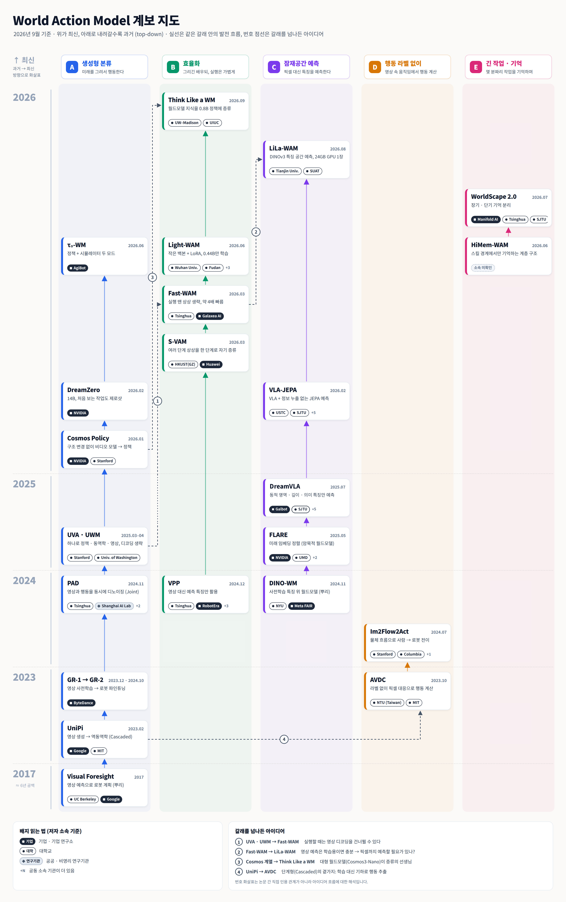

### 두 축 지도: "무엇을 예측하나" × "실행할 때 생성하나"

| | 실행할 때 미래를 생성함 | 실행할 때 생성 안 함 |
|---|---|---|
| **픽셀 / 비디오 잠재값 예측** | UniPi, PAD, Cosmos Policy, DreamZero, τ₀-WM | VPP, UVA, Fast-WAM, S-VAM, Light-WAM |
| **특징 / JEPA 잠재공간 예측** | (거의 없음, 복원할 수 없으므로) | FLARE, DreamVLA*, VLA-JEPA, LiLa-WAM |
| **예측 모델을 아예 버림** | - | Think Like a WM (증류) |

\* DreamVLA는 의미 특징(DINOv2, SAM)과 함께 동적 영역·깊이 같은 픽셀 단위 지도도 예측해서, 픽셀과 특징의 중간에 가깝습니다.

오른쪽 아래로 갈수록 **가볍고 빠르지만, 미래를 눈으로 확인할 수는 없는** 방향입니다. 2026년 연구는 대부분 오른쪽 열로 이동하고 있습니다.

---

## 갈래 A. 생성형 본류: "미래를 그려서 행동한다"

비디오 생성 모델의 힘을 최대한 활용하는 줄기입니다. 규모가 크고 성능이 좋지만 무겁습니다.

### A-1. τ₀-WM (2026.06)
[arXiv 2606.01027](https://arxiv.org/abs/2606.01027)

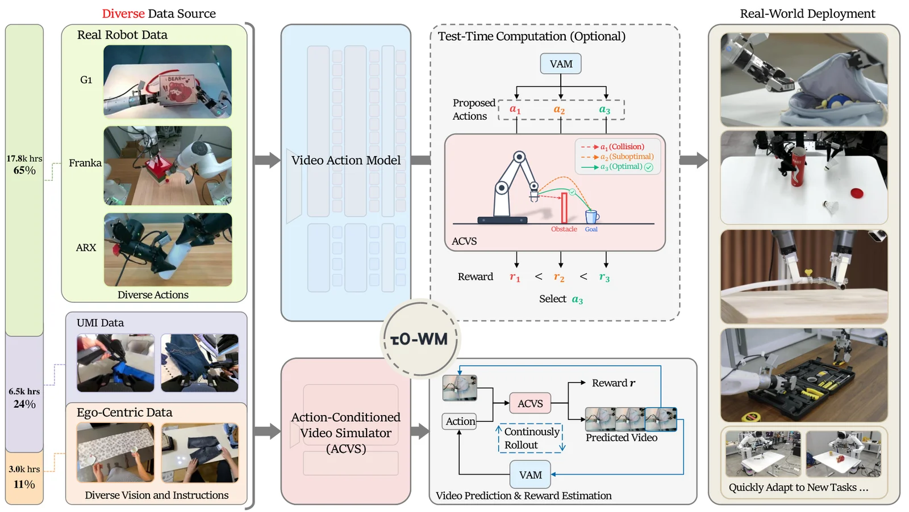
_τ₀-WM 개요: 하나의 백본으로 정책(VAM)과 행동 조건부 시뮬레이터를 함께 제공 (출처: τ₀-WM, Fig. 1)_

- **이전 한계:** WAM은 보통 정책으로만 쓰이거나 시뮬레이터로만 쓰였습니다.
- **해결한 것:** 하나의 비디오 디퓨전 백본으로 **두 가지 모드**를 제공합니다. ① 미래 영상 잠재값과 행동을 함께 생성하는 **정책 모드**, ② 후보 행동을 굴려보고 작업 진행도를 점수로 매기는 **시뮬레이터 모드**. 실행 시점에 연산을 더 써서 행동을 고릅니다.
- **남은 과제:** 실행 시점 연산 비용이 큽니다.

### A-2. DreamZero (2026.02)
NVIDIA 외 · [arXiv 2602.15922](https://arxiv.org/abs/2602.15922)

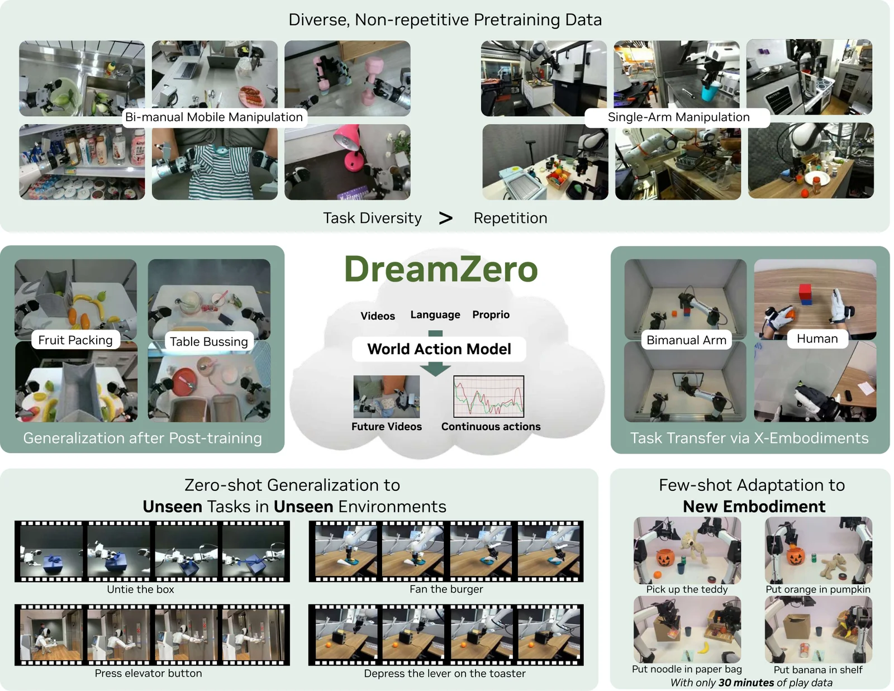
_DreamZero 개요: 영상과 행동을 함께 예측해 처음 보는 작업·환경으로 일반화 (출처: DreamZero, Figure 1)_

- **이전 한계:** VLA는 처음 보는 환경의 새로운 물리적 움직임에 약합니다.
- **해결한 것:** 14B 자기회귀 비디오 디퓨전 모델로 미래 영상과 행동을 함께 예측합니다. 새로운 작업과 환경에서 일반화 성능 **2배 이상**, 다른 로봇이나 사람 영상 10~20분만으로 처음 보는 작업 성능 42% 향상, **7Hz 실시간 제어**.
- **남은 과제:** 14B 규모라 매우 무겁습니다. → 갈래 B의 증류 연구가 이런 거대 모델을 선생님으로 씁니다.

### A-3. Cosmos Policy (2026.01)
NVIDIA, Stanford 외 · [arXiv 2601.16163](https://arxiv.org/abs/2601.16163)

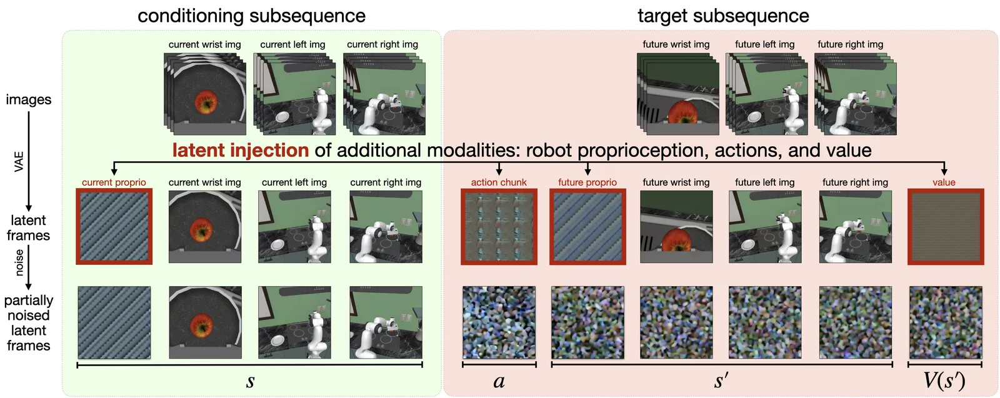
_행동·로봇 상태·가치를 '가짜 영상 프레임'처럼 잠재 시퀀스에 끼워 넣는 latent frame injection (출처: Cosmos Policy, Figure 2)_

- **이전 한계:** 비디오 모델을 정책으로 바꾸려면 여러 단계의 학습과 구조 변경이 필요했습니다.
- **해결한 것:** 행동, 로봇 상태, 가치 추정값을 **"가짜 영상 프레임"처럼** 잠재공간에 끼워 넣어, **구조 변경 없이 한 번의 추가 학습**으로 정책을 만듭니다. LIBERO **98.5%**, RoboCasa 67.1%.
- **남은 과제:** 대형 비디오 모델 전체를 돌려야 합니다.

### A-4. UVA (2025.03) · UWM (2025.04)
[UVA arXiv 2503.00200](https://arxiv.org/abs/2503.00200) (Stanford) · [UWM arXiv 2504.02792](https://arxiv.org/abs/2504.02792) (워싱턴대)

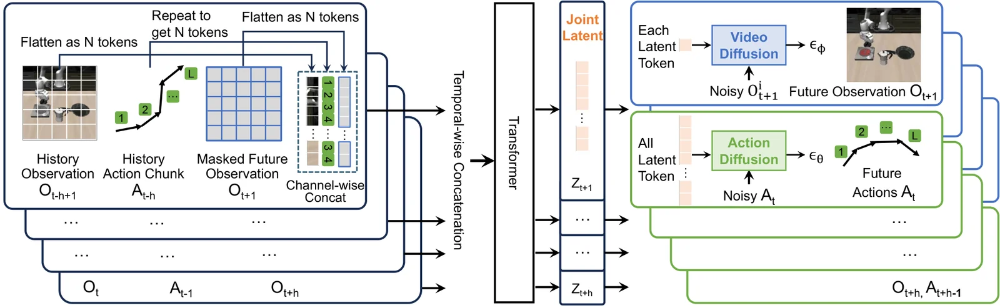
_UVA 구조: 공동 잠재표현에서 영상과 행동을 분리된 디퓨전 헤드로 디코딩 (출처: UVA, Fig. 2)_

- **이전 한계:** 영상과 행동을 함께 생성하면 느리고, 모델 하나가 한 가지 용도로만 쓰였습니다.
- **해결한 것:**
  - **UVA:** 영상과 행동의 공동 잠재표현 + 분리된 디코더. 실행할 때 **영상 디코딩을 건너뛰어** 기존 정책 수준 속도(약 0.23초)를 냅니다. → 갈래 B로 이어지는 핵심 아이디어
  - **UWM:** 영상과 행동에 서로 다른 노이즈 단계를 줘서, 한 모델이 **정책, 순방향 동역학, 역동역학, 영상 예측**을 모두 수행합니다.
- **남은 과제:** 대규모 사전학습 비디오 모델의 지식은 충분히 활용하지 못했습니다.

### A-5. PAD (2024.11)
NeurIPS 2024 · [arXiv 2411.18179](https://arxiv.org/abs/2411.18179)

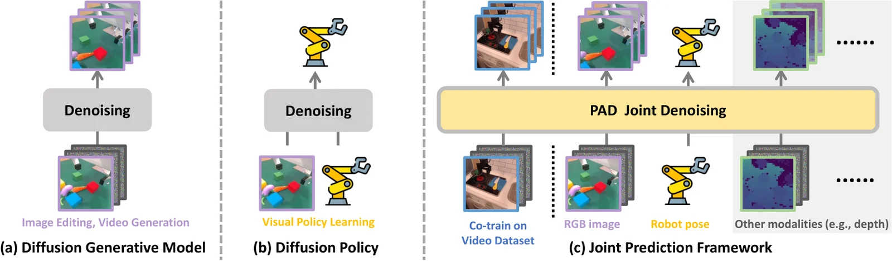
_(a) 영상 생성 디퓨전, (b) 디퓨전 정책, (c) 둘을 합친 PAD의 공동 디노이징 (출처: PAD, Figure 2)_

- **이전 한계:** 영상을 먼저 만들고 행동을 뽑으면 영상 오류가 행동 오류로 이어집니다(오차 전파).
- **해결한 것:** 미래 이미지와 행동을 **하나의 디퓨전 트랜스포머로 동시에 디노이징**합니다. 통합형(Joint) WAM의 초기 모델입니다.

### A-6. GR-1 (2023.12) → GR-2 (2024.10)
ByteDance · [GR-1 arXiv 2312.13139](https://arxiv.org/abs/2312.13139) · [GR-2 arXiv 2410.06158](https://arxiv.org/abs/2410.06158)

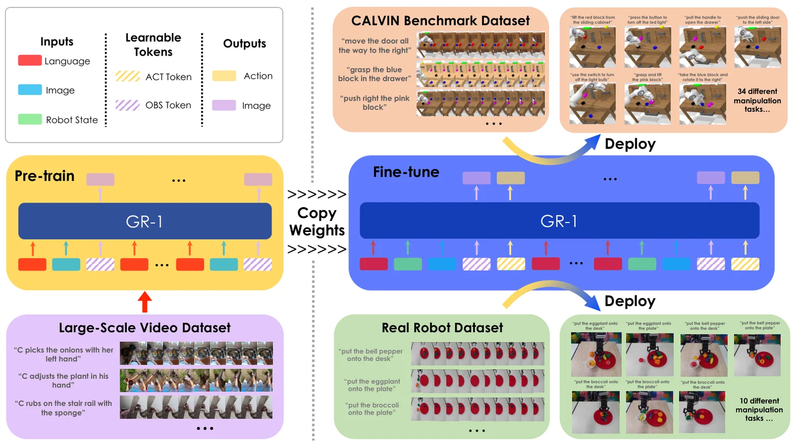
_GR-1: 대규모 영상으로 다음 프레임 예측을 사전학습한 뒤 로봇 데이터로 파인튜닝 (출처: GR-1, Figure 1)_

- **이전 한계:** 로봇 데이터는 비싸고 적습니다.
- **해결한 것:** 대규모 사람 영상으로 **"다음 프레임 예측"을 먼저 사전학습**하고, 로봇 데이터로 행동과 미래 이미지를 함께 예측하도록 파인튜닝합니다. **"영상 사전학습 → 로봇 파인튜닝"** 레시피를 확립했습니다.

### A-7. UniPi (2023.02)
Google, MIT · NeurIPS 2023 · [arXiv 2302.00111](https://arxiv.org/abs/2302.00111)

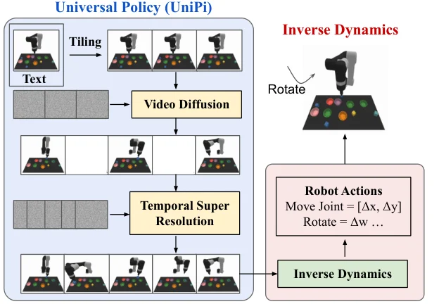
_UniPi: 텍스트로 미래 영상을 생성하고 역동역학 모델로 행동을 추출 (출처: UniPi, Figure 2)_

- **이전 한계:** 로봇 정책은 작업마다, 로봇마다 따로 학습해야 했습니다.
- **해결한 것:** 텍스트로 **미래 영상을 생성**하고 **역동역학 모델**로 행동을 추출합니다. 영상을 범용 인터페이스로 쓰는 단계형(Cascaded) WAM의 시조격입니다.

### A-8. 뿌리: Visual Foresight (2017)
Finn & Levine, ICRA 2017

- 로봇 카메라의 다음 장면을 예측하는 모델로 여러 행동 후보를 굴려보고, **원하는 장면에 가장 가까워지는 행동**을 고릅니다. "영상 예측으로 로봇을 제어한다"는 아이디어의 뿌리입니다.

---

## 갈래 B. 효율화: "그리긴 배우되, 실행할 땐 가볍게"

갈래 A의 가장 큰 약점인 **느린 추론**을 해결하려는 줄기입니다. 2026년에 가장 활발합니다.

### B-1. Think Like a World Model, Act Like a VLA (2026.09)
위스콘신-매디슨대, UIUC · [arXiv 2609.24682](https://arxiv.org/abs/2609.24682)

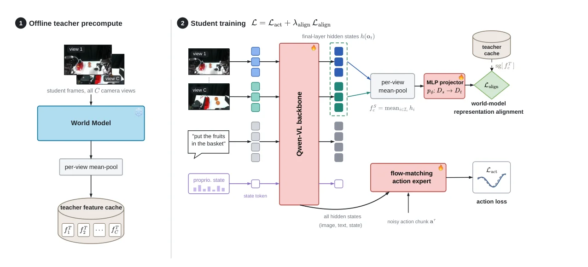
_왼쪽: 고정된 선생님 월드모델의 특징 추출, 오른쪽: 학생 VLA 학습 (출처: Think Like a World Model, Act Like a VLA, Fig. 2)_

- **이전 한계:** 영상 생성을 생략해도 실행할 때 수십억 파라미터 백본은 그대로 돌려야 합니다.
- **해결한 것:** 월드모델(Cosmos3-Nano)의 표현을 **0.8B VLA에 증류**하고, 실행할 때는 월드모델을 버립니다. LIBERO **97.9%**, 실제 로봇에서 4B 정책과 동급, RTX 5090 기준 **32ms, 1.86GB**.
- **핵심 메시지:** "이해는 물려받고, 생성 기계는 두고 온다."
- **참고:** 비슷한 시기에 LLM 분야의 온폴리시 증류를 WAM에 적용한 연구(WAM-OPD)도 나오고 있습니다.

### B-2. Light-WAM (2026.06)
[arXiv 2606.08242](https://arxiv.org/abs/2606.08242) · [코드](https://github.com/L1ziang/Light-WAM)

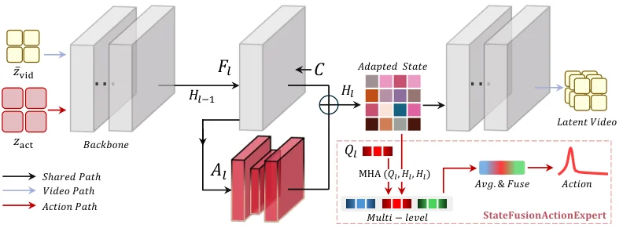
_Light-WAM: 비디오 백본을 영상 공동학습과 행동 예측이 함께 사용 (출처: Light-WAM, Figure 1)_

- **이전 한계:** Fast-WAM은 6B 규모라 학습과 추론이 모두 비쌉니다.
- **해결한 것:** 작은 비디오 모델(Wan2.1 1.3B)을 **고정하고 LoRA로만 조정**합니다. 전체 약 2B 중 **0.44B만 학습**하고, 한 번에 행동을 출력합니다. LIBERO **97.2%**, 추론 **72ms**, 최대 메모리 **4.1GiB**.

### B-3. S-VAM (2026.03)
홍콩과기대(광저우), Huawei · ECCV 2026 · [arXiv 2603.16195](https://arxiv.org/abs/2603.16195)

- **이전 한계:** 비디오 디퓨전 특징을 쓰는 정책(VPP)은 여러 단계 디노이징이 필요하거나, 한 단계만 쓰면 특징이 흐릿합니다.
- **해결한 것:** **자기 증류.** 여러 단계로 생성한 미래에서 뽑은 깊이(기하)와 DINOv2(의미) 특징을 정답으로 삼아, **한 단계 특징만으로 그걸 맞히도록** 학습합니다. CALVIN 평균 연속 성공 길이 **4.16** (VPP 3.58), RTX 3090에서 실시간.

### B-4. Fast-WAM (2026.03)
칭화대, Galaxea AI · [arXiv 2603.16666](https://arxiv.org/abs/2603.16666)

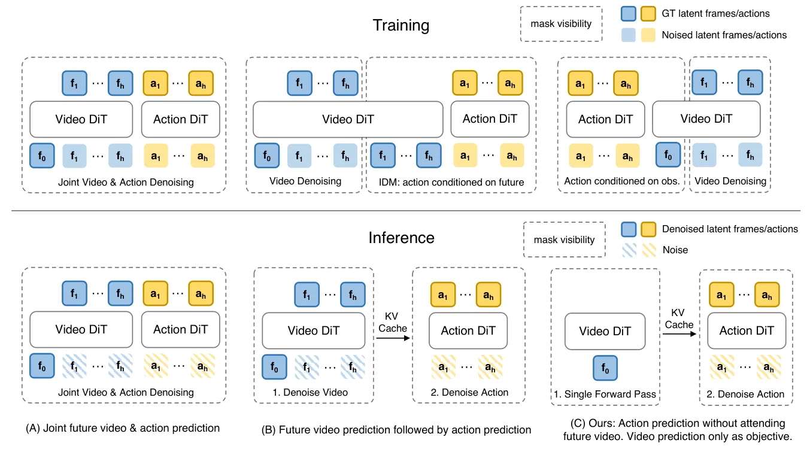
_(A) 영상·행동 동시 디노이징, (B) 영상 생성 후 행동 예측, (C) Fast-WAM: 실행 때 영상 생성 없이 행동만 예측 (출처: Fast-WAM, Figure 1)_

- **이전 한계:** WAM은 실행할 때마다 미래를 상상하느라 느렸는데, 이 상상이 정말 필요한지 검증된 적이 없었습니다.
- **해결한 것:** 공정한 비교 실험으로 답했습니다.
  - 실행 때 상상을 하냐 안 하냐: 차이 **2%p 이내**
  - 학습 때 영상 예측을 하냐 안 하냐: 차이 **8~10%p**
  - 결론: **영상 예측은 학습 때 좋은 표현을 만드는 데 중요하고, 실행 때는 생략해도 된다.** 지연 시간 190ms (상상하는 버전 810ms).
- **의의:** 갈래 B 전체와 갈래 C의 **이론적 근거**가 된 논문입니다.

### B-5. VPP: Video Prediction Policy (2024.12)
ICML 2025 · [arXiv 2412.14803](https://arxiv.org/abs/2412.14803)

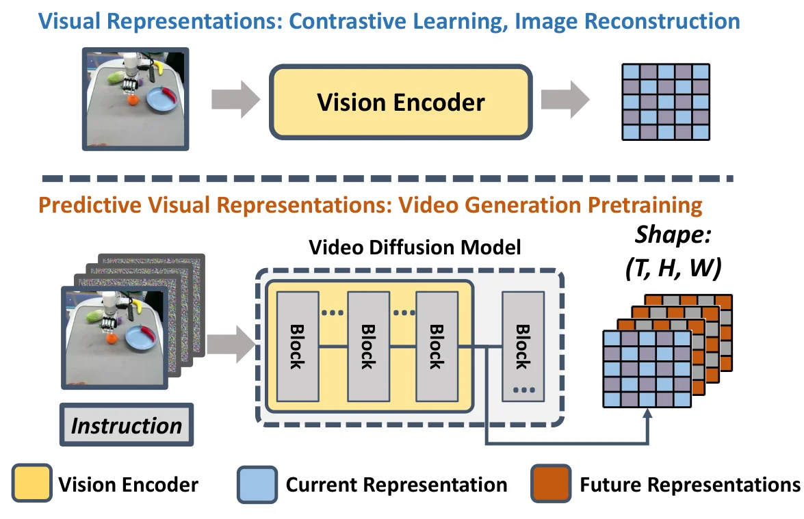
_기존 비전 인코더와 달리 비디오 예측 모델의 내부 표현은 현재와 미래 정보를 함께 담는다 (출처: VPP, Figure 1)_

- **이전 한계:** 영상을 끝까지 생성하는 WAM은 느립니다.
- **해결한 것:** 비디오 디퓨전 모델이 영상을 끝까지 만들지 않고, **중간 특징(예측적 표현)만 꺼내서** 정책에 입력합니다. 갈래 B의 출발점입니다.

---

## 갈래 C. 잠재공간 예측: "아예 그리지 않는다"

**"미래를 픽셀로 그릴 필요 없이, 행동에 필요한 정보만 예측하면 된다"**는 입장입니다. Fast-WAM의 결론과 통하며, JEPA 연구(LeCun 진영)와 맞닿아 있습니다.

### C-1. LiLa-WAM (2026.08)
톈진대 외 · [arXiv 2608.03701](https://arxiv.org/abs/2608.03701) · [코드](https://github.com/teee000/LiLa-WAM) · [**리뷰 글**](/posts/lila-wam/)

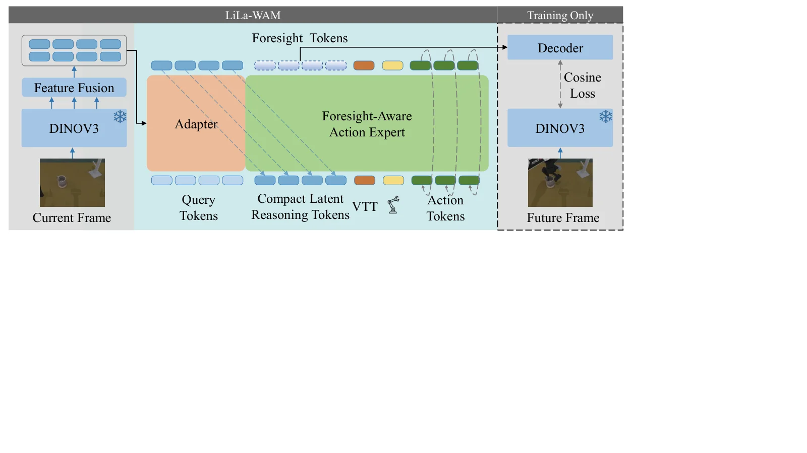
_LiLa-WAM: DINOv3 특징 공간에서 미래를 예측하는 Foresight-Aware Action Expert (출처: LiLa-WAM, Figure 2)_

- **이전 한계:** WAM 대부분이 무거운 비디오 생성 백본에 의존해 개인이 학습하기 어렵습니다.
- **해결한 것:** **고정된 DINOv3 인코더의 특징 공간**에서 미래를 예측하는 "잠재 추론"을 합니다. 태스크도 언어 대신 시각 임베딩의 방향 벡터로 지정합니다. 경쟁 모델(8B) 대비 10~16배 작은데도 RoboTwin 2.0 **90.48%**, LIBERO **97.1%**, 실제 로봇 82%. 24GB GPU 한 장으로 학습 가능.
- **남은 과제:** 사전학습 인코더가 담지 못하는 정보는 예측할 수 없습니다.

### C-2. VLA-JEPA (2026.02)
ECCV 2026 · [arXiv 2602.10098](https://arxiv.org/abs/2602.10098) · [코드](https://github.com/ginwind/VLA-JEPA) · [**리뷰 글**](/posts/vla-jepa/)

- **이전 한계:** 픽셀 변화를 예측하는 방식은 카메라 움직임이나 배경 변화 같은 **행동과 무관한 정보**에 휘둘립니다.
- **해결한 것:** VLA에 **JEPA식 잠재 월드모델**을 붙였습니다. 미래 프레임은 고정된 V-JEPA2 인코더로 잠재표현으로 바꿔 **정답으로만** 쓰고, VLM 백본에는 넣지 않습니다. 그래서 잠재 행동이 현재 관측과 지시문만 보고 계산되며, 미래 정보가 새어 들어가지 않습니다(**"정보 누출 없는 예측"**). 사람 영상으로 사전학습한 뒤 로봇 데이터로 파인튜닝합니다.
- **특징:** 비디오 모델이 아니라 **VLA에서 출발**한다는 점에서, VLA와 WAM의 경계에 있는 모델입니다.

### C-3. DreamVLA (2025.07)
Galbot, 상하이교통대 외 · NeurIPS 2025 · [arXiv 2507.04447](https://arxiv.org/abs/2507.04447) · [프로젝트](https://zhangwenyao1.github.io/DreamVLA/) · [코드](https://github.com/Zhangwenyao1/DreamVLA) · [**리뷰 글**](/posts/dreamvla/)

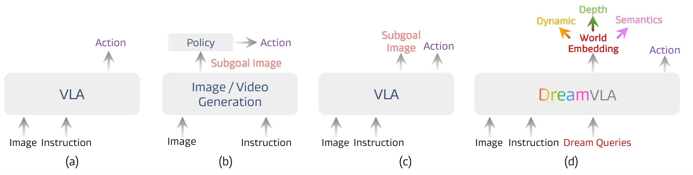
_(a) 일반 VLA, (b) 영상 생성 모델로 목표 이미지를 만든 뒤 정책 실행, (c) VLA가 목표 이미지와 행동을 함께 예측, (d) DreamVLA: 동적 영역·깊이·의미 특징만 예측 (출처: DreamVLA, Figure 1)_

- **이전 한계:** 미래 이미지를 통째로 예측하면 현재 관측과 겹치는 **중복 픽셀**이 많고, 공간(깊이)이나 의미 같은 **고수준 정보**는 빠져 있습니다.
- **해결한 것:** 미래 전체 대신 조작에 필요한 **"세계 지식" 세 가지**만 예측합니다. ① CoTracker로 뽑은 **동적 영역**(곧 움직일 부분), ② **깊이**, ③ **DINOv2·SAM 의미 특징**. 세 예측이 서로 섞이지 않게 block-wise attention으로 막고, 행동은 디퓨전 트랜스포머로 생성합니다. 예측을 복원하는 디코더는 학습 때만 쓰고 실행할 땐 건너뜁니다. CALVIN ABC-D 평균 길이 **4.44**, 실제 로봇 **76.7%**. 세 가지 중 **동적 영역 예측의 효과가 가장 컸다**고 보고합니다.
- **특징:** FLARE, VLA-JEPA처럼 **VLA에 미래 예측을 보조 목표로 붙인** 모델입니다. 실행 때 예측을 생략한다는 점은 갈래 B와도 닿아 있고, 동적 영역과 깊이는 픽셀 단위 지도라서 **"필요한 부분만 골라 그리는"** 중간 형태입니다.

### C-4. FLARE (2025.05)
NVIDIA 외 · [arXiv 2505.15659](https://arxiv.org/abs/2505.15659) · [**리뷰 글**](/posts/flare/)

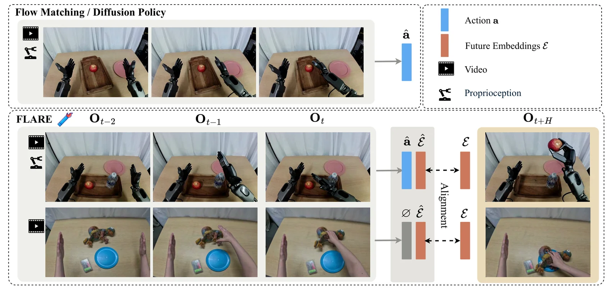
_기존 flow matching 정책(위)과 미래 잠재 정렬을 더한 FLARE(아래) (출처: FLARE, Figure 1)_

- **이전 한계:** 미래 영상을 생성하는 방식은 비싸고, 픽셀 수준 정보는 행동에 과한 경우가 많습니다.
- **해결한 것:** 행동 디노이징 네트워크 안에서 **미래 관측의 압축된 임베딩과 정렬**하도록만 학습합니다. 영상을 생성하지 않는 "암묵적 월드모델링"입니다. 행동 라벨 없는 **사람 1인칭 영상**도 학습에 활용합니다. RoboCasa 24개 태스크 평균 70.1%.

### C-5. 뿌리: DINO-WM (2024.11)
ICML 2025 · [arXiv 2411.04983](https://arxiv.org/abs/2411.04983) · [**리뷰 글**](/posts/dino-wm/)

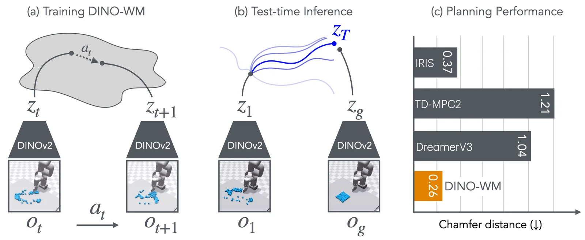
_DINO-WM: DINOv2 특징 위에서 동역학을 학습하고, 목표 특징에 가까워지도록 행동을 최적화 (출처: DINO-WM, Figure 1)_

- WAM은 아니지만 이 갈래의 중요한 뿌리입니다. **이미 학습된 DINOv2 특징을 그대로 잠재공간으로 쓰고**, 그 위에서 동역학만 학습해 계획에 사용했습니다. "좋은 사전학습 특징이면 픽셀을 그릴 필요가 없다"는 걸 보여줬습니다. LiLa-WAM이 이 아이디어를 WAM으로 가져왔습니다.

---

## 갈래 D. 행동 라벨 없이 배우기: "영상 속 움직임에서 행동을 계산한다"

단계형(Cascaded) WAM의 곁가지로, 생성된 영상에서 행동을 뽑을 때 **학습된 모델 대신 기하학적 정보(픽셀 대응, 물체 흐름)**를 씁니다. 인터넷의 행동 라벨 없는 영상을 활용하기 좋습니다.

### D-1. Im2Flow2Act (2024.07)
Stanford 외 · CoRL 2024 · [arXiv 2407.15208](https://arxiv.org/abs/2407.15208)

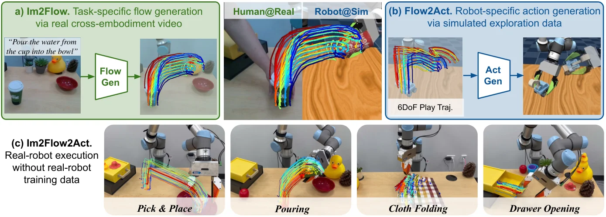
_물체 흐름(flow)을 사람과 로봇, 실제와 시뮬레이션을 잇는 공통 인터페이스로 사용 (출처: Im2Flow2Act, Figure 1)_

- **해결한 것:** 물체가 어떻게 움직여야 하는지를 **물체 흐름(flow)**으로 생성하고, 그 흐름을 따라가는 행동을 만듭니다. 흐름은 로봇 종류와 무관해서 **사람 영상에서 배운 것을 로봇에 옮길 수** 있습니다.

### D-2. AVDC (2023.10)
ICLR 2024 · [arXiv 2310.08576](https://arxiv.org/abs/2310.08576)

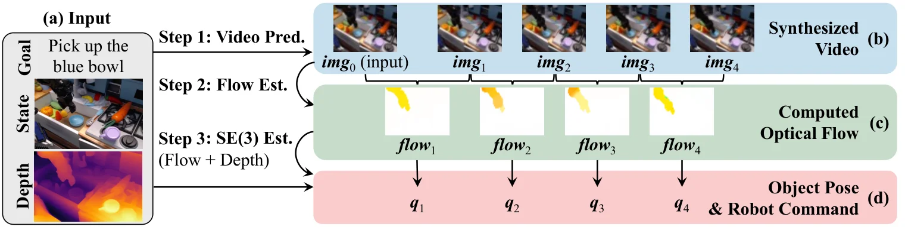
_AVDC: 영상 생성 → 광학 흐름 계산 → 물체 자세와 로봇 명령 계산 (출처: AVDC, Figure 2)_

- **해결한 것:** 미래 영상을 생성한 뒤 **픽셀 간 대응(dense correspondence)**으로 물체의 움직임을 계산해 행동으로 바꿉니다. **행동 라벨이 전혀 없는 영상만으로** 학습할 수 있습니다.

---

## 갈래 E. 긴 작업과 기억: "몇 분짜리 작업을 기억하며 수행한다"

대부분의 WAM은 몇 초 앞만 봅니다. "서랍 열고, 컵 넣고, 서랍 닫기"처럼 긴 작업에는 **짧은 기억과 긴 기억을 따로** 다루는 구조가 필요합니다. LIBERO 같은 기존 벤치마크가 97%대로 포화되면서 주목받는 방향입니다.

### E-1. WorldScape Policy 2.0 (2026.07)
[arXiv 2607.18840](https://arxiv.org/abs/2607.18840)

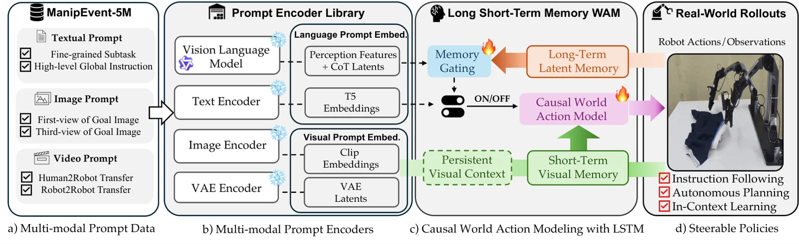
_WorldScape Policy 2.0: 이벤트 단위 데이터와 장기·단기 기억 구조 (출처: WorldScape Policy 2.0, Figure 2)_

- **해결한 것:** **장기 기억**(이벤트 단위로 작업 진행 추적)과 **단기 기억**(최근 프레임)을 분리했습니다. 약 500만 개 이벤트 구간을 담은 데이터셋 ManipEvent-5M을 함께 공개했습니다.

### E-2. HiMem-WAM (2026.06)
[arXiv 2606.10363](https://arxiv.org/abs/2606.10363) · [코드](https://github.com/Agentic-Intelligence-Lab/HiMem-WAM)

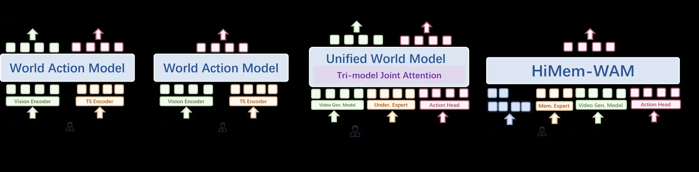
_일반 WAM에 기억 전문가(memory expert)를 더한 HiMem-WAM (출처: HiMem-WAM, Figure 2)_

- **이전 한계:** 모든 과거를 저장하면 무겁고, 저장하지 않으면 긴 작업에서 길을 잃습니다.
- **해결한 것:** **동작 수준**과 **스킬 수준**의 2단 잠재 행동 구조를 만들고, **스킬이 바뀌는 순간에만** 기억을 저장합니다. LIBERO 97.7%, 기억 의존 벤치마크 RMBench 26.3%로 비교 모델을 크게 앞섰고, 실제 로봇에서 π₀.₅ 대비 약 22.5% 향상.

---

## 갈래 사이의 연결: 아이디어가 어떻게 흘러갔나

계보가 입체적인 이유는 **갈래끼리 아이디어를 주고받기 때문**입니다.

| 출발 | 도착 | 전달된 아이디어 |
|---|---|---|
| UVA (A) | Fast-WAM (B) | "실행할 때는 영상 디코딩을 건너뛸 수 있다" |
| Fast-WAM (B) | VLA-JEPA, LiLa-WAM (C) | "영상 예측은 학습용 선생님이면 충분하다" → 그럼 픽셀까지 예측할 필요가 있나? |
| DINO-WM (C 뿌리) | LiLa-WAM (C) | 사전학습된 특징 공간을 그대로 잠재공간으로 사용 |
| DreamZero, Cosmos (A) | Think Like a WM (B) | 거대 월드모델이 **증류의 선생님**이 됨 |
| VPP (B) | S-VAM (B) | 비디오 디퓨전 특징 활용 → 한 단계로 압축 |
| Genie 1의 잠재 행동 (월드모델 분야) | HiMem-WAM (E) | 행동 라벨 없이 영상에서 "잠재 행동"을 발견 |
| LLM의 온폴리시 증류 | WAM-OPD (B) | 다른 분야 기법이 몇 달 뒤 WAM으로 유입 |

---

## 전체 요약표

| 연도 | 모델 | 갈래 | 이전 대비 해결한 것 |
|---|---|---|---|
| 2017 | Visual Foresight | A 뿌리 | 영상 예측으로 로봇 제어 |
| 2023.02 | UniPi | A | 영상을 범용 인터페이스로 (Cascaded) |
| 2023.10 | AVDC | D | 행동 라벨 없이 픽셀 대응으로 행동 계산 |
| 2023.12 | GR-1 | A | 영상 사전학습 → 로봇 파인튜닝 레시피 |
| 2024.07 | Im2Flow2Act | D | 물체 흐름으로 사람→로봇 전이 |
| 2024.10 | GR-2 | A | 사전학습 규모 확대 |
| 2024.11 | PAD | A | 영상과 행동 동시 디노이징 (Joint) |
| 2024.11 | DINO-WM | C 뿌리 | 사전학습 특징 위의 월드모델 |
| 2024.12 | VPP | B | 영상 대신 중간 특징만 활용 |
| 2025.03~04 | UVA, UWM | A | 다용도 통합 모델, 영상 디코딩 생략 |
| 2025.05 | FLARE | C | 미래 임베딩 정렬만으로 암묵적 월드모델 |
| 2025.07 | DreamVLA | C | 동적 영역·깊이·의미 특징만 골라 예측 |
| 2026.01 | Cosmos Policy | A | 구조 변경 없는 한 번의 추가 학습 |
| 2026.02 | DreamZero | A | 처음 보는 작업 제로샷 일반화 |
| 2026.02 | VLA-JEPA | C | VLA + 정보 누출 없는 JEPA 예측 |
| 2026.03 | Fast-WAM | B | 실행 때 상상 생략, 영상 예측의 역할 규명 |
| 2026.03 | S-VAM | B | 여러 단계 상상을 한 단계로 자기 증류 |
| 2026.06 | Light-WAM | B | LoRA 경량화, 0.44B 학습 |
| 2026.06 | τ₀-WM | A | 정책 + 시뮬레이터 두 모드 |
| 2026.06 | HiMem-WAM | E | 스킬 경계 기반 계층 기억 |
| 2026.07 | WorldScape Policy 2.0 | E | 장기·단기 기억 분리 |
| 2026.08 | LiLa-WAM | C | DINOv3 특징 공간 예측, 24GB GPU 한 장으로 학습 |
| 2026.09 | Think Like a WM | B | 월드모델 지식을 0.8B 정책에 증류 |

---

## 지도에서 읽히는 큰 흐름

**1. 그려서 행동하기 → 함께 그리기 → 안 그리기**
처음에는 영상을 다 그리고 행동을 뽑았고(UniPi), 그다음엔 영상과 행동을 함께 생성했고(PAD, Cosmos Policy), 이제는 **실행할 때 영상을 그리지 않거나(갈래 B)** 아예 **픽셀 대신 특징을 예측하는(갈래 C)** 방향으로 이동하고 있습니다.

**2. 영상 예측의 역할: "도구"에서 "선생님"으로**
초기에는 예측한 영상 자체를 행동 결정에 썼지만, Fast-WAM 이후로는 **영상 예측이 학습 때 좋은 표현을 만들어주는 선생님**이라는 관점이 힘을 얻고 있습니다. 증류는 이 관점을 끝까지 밀어붙인 결과입니다.

**3. 두 방향으로 동시에 확장**
한쪽은 **더 크게**(DreamZero 14B) 가서 일반화를 노리고, 다른 쪽은 **더 작게**(0.8B 증류, LiLa-WAM) 가서 실용성을 노립니다. 거대 모델이 작은 모델의 선생님이 되면서 두 방향이 연결됩니다.

**4. 다음 전장은 "긴 작업"**
짧은 조작 벤치마크가 포화되면서, **기억과 계층 구조(갈래 E)**가 다음 핵심 과제로 떠오르고 있습니다.

---

## 입문자 추천 읽기 경로

관심사에 따라 하나를 고르세요. 모두 **최신 → 과거** 순서입니다.

| 관심사 | 읽기 순서 |
|---|---|
| **WAM이 뭔지 한 번에 감 잡기** | Fast-WAM → Cosmos Policy → UVA → GR-1 → UniPi |
| **가볍게 직접 돌려보기** | LiLa-WAM → Light-WAM → Fast-WAM |
| **픽셀 없는 예측 (JEPA 계열)** | LiLa-WAM → VLA-JEPA → DreamVLA → FLARE → DINO-WM |
| **대규모 최신 모델** | DreamZero → Cosmos Policy → GR-2 |
| **증류, 추론 가속** | Think Like a WM → S-VAM → Fast-WAM → VPP |
| **긴 작업, 기억** | WorldScape Policy 2.0 → HiMem-WAM |

읽다가 막히면 보충할 기초 개념은 대체로 이 다섯 가지입니다: **트랜스포머, VAE(토크나이저), 디퓨전/Flow Matching, 자기지도 표현 학습(DINO, JEPA), 역동역학 모델.**

---

## 참고 자료

- [OpenMOSS/Awesome-WAM](https://github.com/OpenMOSS/Awesome-WAM): WAM 논문 모음 (지속 업데이트)
- [NVIDIA 블로그: Pretrained to Imagine, Fine-Tuned to Act](https://developer.nvidia.com/blog/pretrained-to-imagine-fine-tuned-to-act-the-rise-of-world-action-models/): WAM 흐름 개관
- [World Model for Robot Learning: A Comprehensive Survey (2026)](https://arxiv.org/abs/2605.00080)
