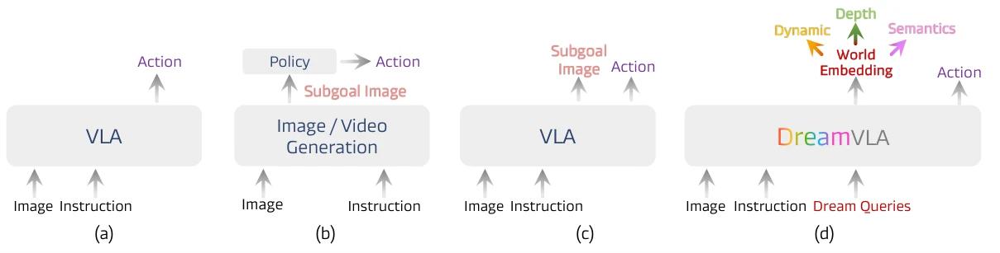
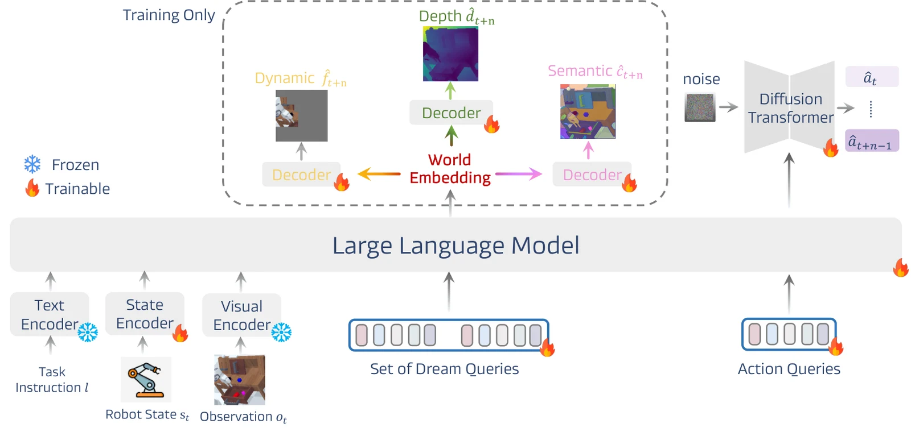
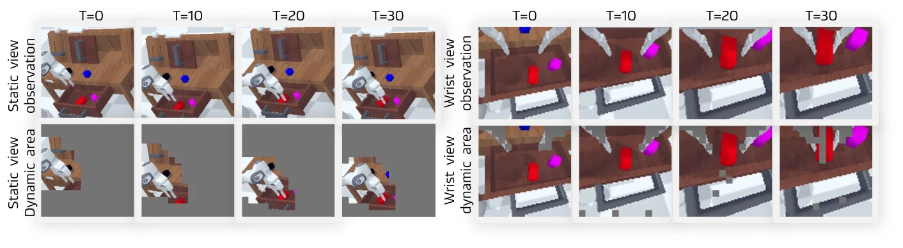
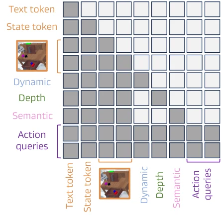
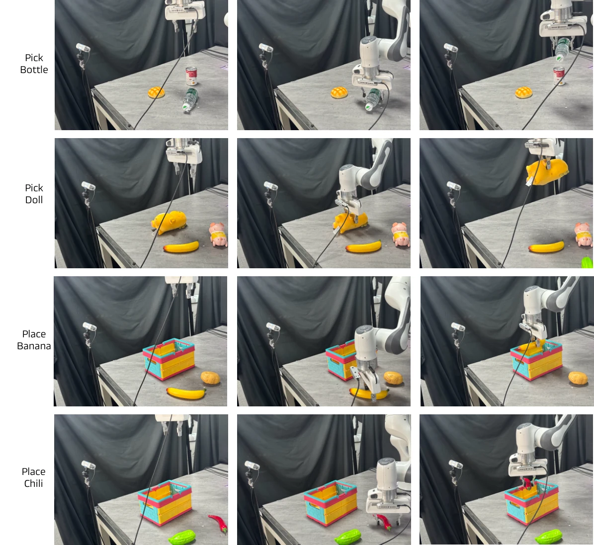
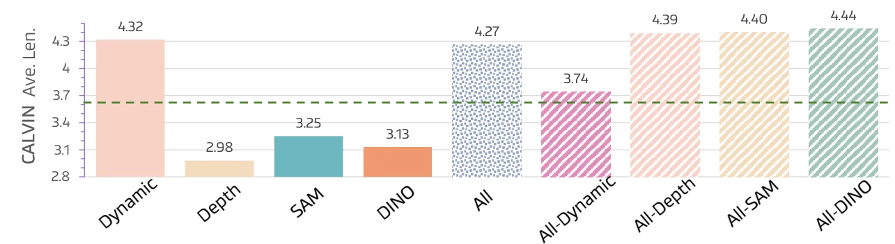
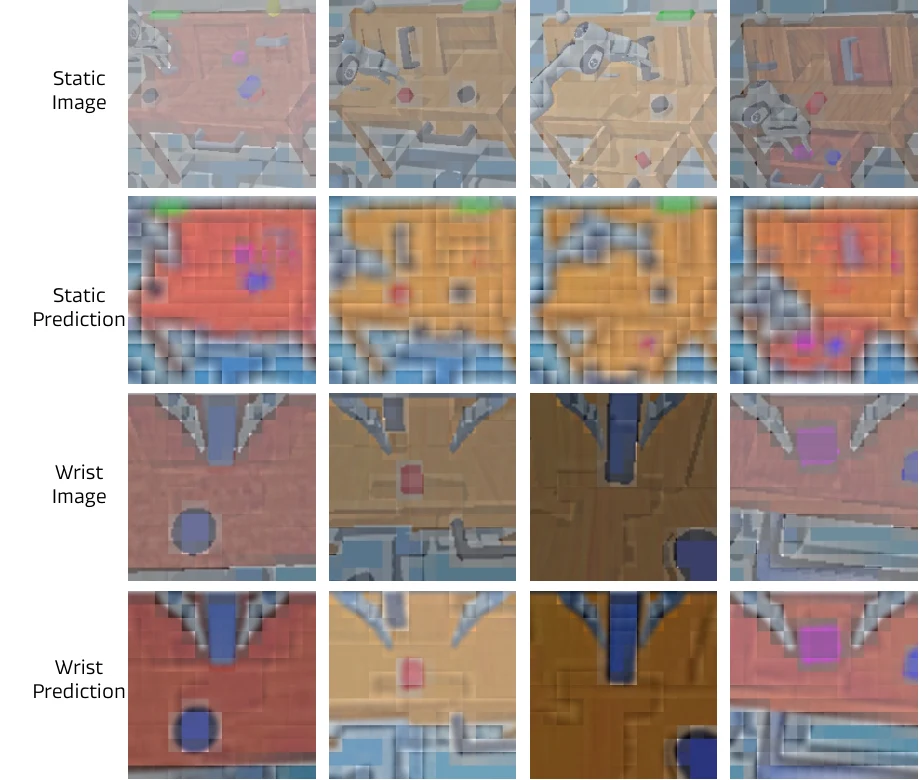

> **한 줄 요약:** DreamVLA는 GPT-2 기반 VLA에 **\<dream\> 쿼리**를 추가해, 미래 프레임 전체 대신 **움직일 영역(dynamic region), 깊이(depth), 의미 특징(SAM/DINOv2)**이라는 세 가지 "세계 지식"만 예측하게 합니다. 세 쿼리는 **블록 단위 구조화 어텐션**으로 서로를 보지 못하게 막고, 행동은 \<action\> 쿼리의 출력을 조건으로 받는 **디퓨전 트랜스포머(DiT)**가 만듭니다. 예측 디코더는 학습 때만 쓰고 추론 때는 건너뜁니다. CALVIN ABC-D 평균 길이 4.44, LIBERO 평균 92.6%, 실제 Franka 실험 평균 성공률 76.7%를 보고합니다.

| 항목 | 내용 |
|---|---|
| 저자 | Wenyao Zhang\*, Hongsi Liu\*, Zekun Qi\*, Yunnan Wang\*, Xinqiang Yu, Jiazhao Zhang, Runpei Dong, Jiawei He, Fan Lu, He Wang, Zhizheng Zhang, Li Yi, Wenjun Zeng, Xin Jin† (\* 공동 1저자, † 교신저자) |
| 소속 | Galbot(기업), UIUC, 중국과학기술대(USTC), Eastern Institute of Technology(EIT), 칭화대(THU), 상하이자오퉁대(SJTU), 베이징대(PKU) (논문 표기 기준) |
| 발표 | 2025.07 arXiv (2507.04447, v3: 2025.08.26), NeurIPS 2025 (코드 저장소 README 표기 기준) |
| 링크 | [arXiv 2507.04447](https://arxiv.org/abs/2507.04447) · [프로젝트 페이지](https://zhangwenyao1.github.io/DreamVLA/) · [코드](https://github.com/Zhangwenyao1/DreamVLA) · [Hugging Face](https://huggingface.co/WenyaoZhang/DreamVLA) |
| 실험 환경 | CALVIN ABC-D(시뮬레이션), LIBERO 4개 스위트(시뮬레이션), 실제 Franka Panda(집기, 놓기, 서랍) |

> **읽는 법:** 본문은 논문에 적힌 내용을 그대로 옮긴 것이고, 가능한 곳에는 근거(섹션, 그림, 표 번호)를 달았습니다. 초록색 **AI 해석** 박스는 논문에 없는 해석, 비유, 평가, 다른 연구와의 연결입니다. "먼저 알아둘 개념"은 논문 밖의 일반 배경 설명입니다.
{: .prompt-info }

> 저자 목록의 Fan Lu는 arXiv v3 본문에는 있지만 프로젝트 페이지 저자 목록에는 없습니다. 교신저자 표시(†)는 프로젝트 페이지 기준이며, 프로젝트 페이지는 저자별 소속을 SJTU, EIT, THU, Galbot, PKU, UIUC, USTC 7곳으로 번호를 매겨 표기합니다.
{: .prompt-warning }

### 이 글에서 쓰는 기호

논문의 기호를 그대로 따릅니다(Sec. 3.1).

| 기호 | 뜻 |
|---|---|
| $$ l $$ | 자연어 지시문 |
| $$ o_t $$ | 시점 $$ t $$의 카메라 관측(정적 카메라 + 손목 카메라) |
| $$ s_t $$ | 로봇 고유 상태(엔드이펙터 위치·회전, 그리퍼 개폐) |
| $$ \mathcal{M} $$ | 입력과 쿼리를 함께 처리하는 통합 모델(GPT-2 Medium 백본) |
| $$ \mathbf{w}_{t+n} $$ | **월드 임베딩**. \<dream\> 쿼리 위치의 출력 |
| $$ \hat{f}_{t+n}, \hat{d}_{t+n}, \hat{c}_{t+n} $$ | 예측한 미래 동적 영역, 깊이, 의미 특징 |
| $$ \mathcal{D} $$ | 행동을 만드는 디퓨전 트랜스포머(DiT) |
| $$ \hat{a}_{t:t+n-1} $$ | 예측한 $$ n $$ 스텝 행동 시퀀스 |

---

## 왜 이 논문을 읽나

[월드 액션 모델 계보 지도](/posts/world-model-survey/)에서 DreamVLA는 **"잠재공간 예측(C 갈래)"**의 C-3 노드이며, 시간순으로 FLARE와 VLA-JEPA 사이에 놓입니다.

| 순서 | 논문 | 한 줄 |
|---|---|---|
| 뿌리 | [DINO-WM](/posts/dino-wm/) (2024.11) | 고정된 DINOv2 특징 위에서 동역학을 학습해 계획 |
| 이전 글 | [FLARE](/posts/flare/) (2025.05) | 행동 디노이징 네트워크 안에서 미래 임베딩과 정렬 |
| **이 글** | **DreamVLA** (2025.07) | VLA가 동적 영역·깊이·의미 특징이라는 "미래 세계 지식"을 예측한 뒤 행동 |
| 다음 글 | [VLA-JEPA](/posts/vla-jepa/) (2026.02) | VLA + 정보 누출 없는 JEPA식 잠재 월드모델 |
| 최신 | [LiLa-WAM](/posts/lila-wam/) | 고정된 DINOv3 특징 공간에서 미래를 추론하는 가벼운 WAM |

논문 스스로는 기존 방법을 세 부류로 나눕니다(Fig. 1). (a) 관측과 지시문을 바로 행동으로 옮기는 일반 VLA, (b) 별도의 이미지/영상 생성 모델이 목표 이미지를 만들고 정책이 그걸 따라가는 방식, (c) VLA가 행동 전에 하위 목표(subgoal) 이미지를 직접 예측하는 방식입니다. DreamVLA는 (d)로, 이미지 대신 **동적 영역, 깊이, 의미 특징**을 예측합니다. 관련 연구 절에서는 FLARE를 "중복 재구성(redundant reconstruction)" 한계를 다룬 연구로 인용합니다(Sec. 2.1).

_(a) 일반 VLA, (b) 별도 생성 모델이 하위 목표 이미지를 만들고 정책이 따르는 방식, (c) VLA가 하위 목표 이미지를 직접 예측하는 방식, (d) DreamVLA는 Dream Queries로 월드 임베딩을 만들어 동적 영역·깊이·의미를 예측하고 행동을 냅니다 (출처: DreamVLA, Figure 1)_

> **AI 해석**  
> DreamVLA는 C 갈래 안에서도 **혼합형**에 가깝다고 봅니다.  
> - **VLA 기반이라는 점**은 FLARE, VLA-JEPA와 같습니다. 언어 백본 위에 학습 가능한 쿼리를 얹고, 그 출력으로 행동 헤드를 조건화합니다.  
> - **예측은 학습 때만, 추론 때는 디코더를 건너뛴다**는 점은 "미래 생성을 보조 학습 신호로만 쓰는" 갈래 B의 설계와 닮았습니다(Sec. 3.2, Fig. 2 점선 상자).  
> - **예측 대상이 섞여 있습니다.** 동적 영역과 깊이는 사실상 **픽셀(패치) 수준 지도**를 복원하는 목표이고, 의미 쪽만 DINOv2/SAM이라는 **사전학습 특징 공간**의 타깃입니다. 순수한 "잠재공간 예측"이라기보다, 픽셀 예측을 "움직이는 곳만, 깊이만"으로 줄이고 특징 예측을 곁들인 절충안입니다.  
> 그래서 이 논문은 "미래를 얼마나 추상적으로 예측해야 하는가"라는 C 갈래의 질문에 대해, 추상화 정도가 서로 다른 타깃을 한 모델에서 비교해 볼 수 있는 좋은 사례이기도 합니다. 실제로 ablation(4-4절)에서 가장 픽셀에 가까운 "동적 영역"이 가장 큰 효과를 내고, 특징 타깃(DINO/SAM)은 단독으로는 오히려 성능을 떨어뜨립니다.
{: .prompt-tip }

> **AI 해석**  
> 저자 구성도 계보를 읽는 단서입니다. DreamVLA의 공동 1저자 Wenyao Zhang, Zekun Qi와 교신저자 Xin Jin은 다음 글인 VLA-JEPA에도 저자로 참여합니다. "VLA 백본 + 학습 가능한 쿼리 + DiT 행동 헤드"라는 뼈대가 이어지고, 예측 타깃이 "여러 종류의 지식 지도"에서 "V-JEPA2 잠재 상태"로 바뀌는 흐름으로 두 논문을 이어 읽을 수 있습니다.
{: .prompt-tip }

---

## 1. 먼저 알아둘 개념

이 절은 논문 밖의 일반 배경 설명입니다.

### 1-1. VLA와 역동역학(inverse dynamics)

**VLA(Vision-Language-Action)** 모델은 카메라 이미지와 자연어 지시문을 입력받아 로봇 행동을 출력합니다. 사전학습된 멀티모달 모델의 이해 능력을 로봇 제어로 옮기려는 시도입니다.

**역동역학 모델**은 "지금 상태 $$ o_t $$와 다음 상태 $$ o_{t+1} $$이 주어졌을 때, 그 사이에 한 행동 $$ a_t $$는 무엇인가"를 맞히는 모델입니다.

$$
\hat{a}_t = \mathrm{IDM}(o_t, o_{t+1})
$$

미래 상태를 모르는 실제 실행에서는 먼저 미래를 **예측**하고, 그 예측을 역동역학의 입력으로 쓰는 방식이 자연스럽습니다. "예측 → 행동" 구조의 VLA들이 이 틀을 씁니다.

### 1-2. 광학 흐름(optical flow)과 점 추적(CoTracker)

**광학 흐름**은 연속된 두 프레임 사이에서 각 픽셀이 어느 방향으로 얼마나 움직였는지를 나타내는 2차원 벡터장입니다. 픽셀마다 $$ (\Delta x, \Delta y) $$가 있습니다.

**점 추적(point tracking)**은 영상의 특정 점들을 여러 프레임에 걸쳐 따라가는 문제입니다. **CoTracker**는 많은 점을 **함께** 추적하면 가려짐이나 빠른 움직임에 더 강해진다는 아이디어로 만든 트랜스포머 기반 추적기입니다. 격자 위의 점들을 추적하면 흐름과 비슷한 정보를 얻을 수 있습니다.

움직임 크기 $$ \sqrt{\Delta x^2 + \Delta y^2} $$에 임계값을 걸면 "움직인 곳 / 안 움직인 곳"을 나누는 **이진 마스크**가 됩니다.

### 1-3. 단안 깊이 추정과 스케일 모호성

**단안 깊이 추정(monocular depth estimation)**은 RGB 이미지 한 장에서 픽셀별 거리를 추정하는 문제입니다. **Depth Anything** 계열은 대규모 비라벨 이미지로 학습한 범용 깊이 추정 모델이라, 깊이 센서가 없을 때 "선생님(teacher)" 역할로 의사(pseudo) 정답을 만드는 데 자주 쓰입니다.

이미지 한 장만으로는 "작은 물체가 가까이 있는지, 큰 물체가 멀리 있는지"를 구분할 수 없어서, 깊이의 **전체 배율(scale)**이 본질적으로 모호합니다. 그래서 예측과 정답의 배율을 먼저 맞춘 뒤 오차를 재는 **스케일 정규화 손실**을 흔히 씁니다.

### 1-4. DINOv2와 SAM 특징

- **DINOv2:** 라벨 없이 자기지도 학습으로 훈련한 ViT입니다. 패치 특징이 물체의 의미와 구조를 잘 담아 로봇·월드모델 연구에서 "고정된 특징 공간"으로 널리 쓰입니다(이 계보의 뿌리인 DINO-WM도 이 특징을 씁니다).
- **SAM(Segment Anything):** 어떤 물체든 분할하도록 학습된 모델입니다. 이미지 인코더 출력은 "어디까지가 한 물체인가"에 민감한 **분할 인지(segmentation-aware) 특징**으로 볼 수 있습니다.

### 1-5. InfoNCE 대조 손실

**InfoNCE**는 "예측 $$ \hat{c} $$가 여러 후보 중 **정답 $$ c^{+} $$**와 가장 비슷해야 한다"는 분류 형태의 손실입니다.

$$
\mathcal{L} = -\log \frac{\exp(\hat{c}^\top c^{+} / \tau)}{\sum_k \exp(\hat{c}^\top c_k / \tau)}
$$

$$ \tau $$는 온도(temperature)로, 작을수록 정답과 오답의 차이를 더 날카롭게 구분합니다. 회귀(MSE)와 달리 "정답에 정확히 일치"보다 "오답보다 정답에 더 가깝게"를 요구합니다.

### 1-6. 어텐션 마스크: 인과적(causal) vs 비인과적

트랜스포머의 self-attention은 모든 토큰이 모든 토큰을 볼 수 있지만, **어텐션 마스크**로 "누가 누구를 볼 수 있는지"를 제한할 수 있습니다.

- **인과적(causal) 마스크:** 각 토큰은 자기보다 앞선 토큰만 봅니다. GPT 같은 언어 모델의 기본 방식입니다.
- **블록 단위(block-wise) 마스크:** 토큰을 그룹으로 묶어 그룹끼리의 가시성을 따로 정합니다. 예를 들어 "쿼리 A와 쿼리 B는 서로를 보지 못하고, 둘 다 공통 입력만 본다"처럼 설계할 수 있습니다.

### 1-7. MAE와 Perceiver Resampler

- **MAE(Masked Autoencoder):** 이미지 패치의 대부분을 가리고 복원하도록 사전학습한 ViT입니다. 인코더와 디코더의 크기가 다른 **비대칭(asymmetric)** 구조가 특징입니다.
- **Perceiver Resampler:** Flamingo에서 쓰인 모듈로, **학습 가능한 소수의 잠재 벡터**가 cross-attention으로 많은 이미지 토큰을 요약해 고정 개수의 토큰으로 줄입니다.

### 1-8. 디퓨전 행동 헤드와 DiT

같은 상황에서도 시연자는 여러 방식으로 움직이므로, 행동 분포는 여러 봉우리를 가진(multimodal) 분포입니다. **디퓨전 정책**은 행동에 가우시안 노이즈를 섞은 뒤, 신경망 $$ \varepsilon_\theta $$가 그 노이즈를 맞히도록 학습합니다.

$$
a^{\tau} = \sqrt{\bar{\alpha}_\tau}\, a + \sqrt{1-\bar{\alpha}_\tau}\, \varepsilon, \quad \varepsilon \sim \mathcal{N}(0, I)
$$

추론 때는 순수 노이즈에서 시작해 여러 단계에 걸쳐 노이즈를 걷어내 행동을 얻습니다. **DiT(Diffusion Transformer)**는 이 노이즈 예측기를 트랜스포머로 만든 구조입니다.

### 1-9. CALVIN의 "평균 길이(Avg. Len.)"

CALVIN은 언어 지시로 **연속된 5개 과제**를 차례로 수행하게 하는 장기(long-horizon) 조작 벤치마크입니다. "1개 연속 성공률, 2개 연속 성공률, …, 5개 연속 성공률"과, 한 번에 평균 몇 개 과제를 연속으로 해냈는지를 나타내는 **평균 길이(최대 5)**를 보고합니다. ABC-D 설정은 환경 A, B, C에서 학습하고 처음 보는 환경 D에서 평가합니다.

---

## 2. 문제 설정과 이전 연구의 한계

논문은 VLA가 관측을 행동으로 **직접** 매핑하기 때문에, 사람이 가진 "미래를 예측하며 행동하는" 닫힌 고리(closed-loop) 예측 능력이 없다고 봅니다(Sec. 1). 그래서 미래 예측을 VLA에 넣으려는 시도가 많았는데, 논문은 이를 두 부류로 정리합니다.

- **보조(copilot) 생성 모델 방식:** 별도의 이미지/영상 생성 모델이 미래 프레임이나 키포인트를 만들고, 정책이 목표 이미지를 조건으로 행동을 냅니다. 추가 생성 모델 때문에 추론 시간과 계산량이 늘어납니다(Sec. 2.1).
- **통합 방식:** 픽셀 수준 이미지 예측과 행동 예측을 한 모델 안에서 함께 합니다(Seer, UP-VLA, CoT-VLA 등). 예측을 LLM의 사고 사슬(chain-of-thought)처럼 **중간 추론 단계**로 봅니다.

논문이 지적하는 통합 방식의 한계는 세 가지입니다(Sec. 1).

1. **중복된 픽셀 정보:** 예측한 미래 이미지와 현재 관측이 대부분 겹쳐서, 예측이 비효율적이고 효과도 떨어집니다.
2. **공간 정보 부족:** 환경에 대한 명시적 3D 지식이 없습니다.
3. **고수준 지식 예측 부족:** 미래 상태의 의미 정보 같은 고수준 이해가 빠져 있습니다.

그래서 DreamVLA는 미래 프레임 전체 대신, 로봇 실행과 관련 깊은 **"세계 지식"**만 골라 예측하자고 제안합니다. 논문은 이것이 사람이 세계와 상호작용할 때 관련된 변화에 집중하는 방식과 맞닿아 있다고 설명합니다.

---

## 3. 방법

### 3-1. 전체 정식화 (Sec. 3.1)

논문은 VLA 추론을 **역동역학 문제**로 정식화하고, 미래 세계 지식 예측을 로봇 제어의 **중간 추론**으로 둡니다.

**1단계: 월드 임베딩.** 지시문 $$ l $$, 관측 $$ o_t $$, 상태 $$ s_t $$에 \<dream\> 쿼리를 이어 붙여 통합 모델 $$ \mathcal{M} $$에 넣습니다 (Eq. 1).

$$
\mathbf{w}_{t+n} = \mathcal{M}\left(l, o_t, s_t \mid \langle \text{dream} \rangle\right)
$$

**2단계: 세계 지식 예측.** 예측기 집합 $$ \mathcal{P} $$가 $$ n $$ 스텝 뒤의 지식을 내놓습니다 (Eq. 2).

$$
\hat{p}_{t+n} = \mathcal{P}(\mathbf{w}_{t+n}) = \left[\hat{f}_{t+n}, \hat{d}_{t+n}, \hat{c}_{t+n}\right]
$$

여기서 $$ \hat{f}_{t+n} $$은 동적 영역, $$ \hat{d}_{t+n} $$은 단안 깊이, $$ \hat{c}_{t+n} $$은 선택적으로 넣는 고수준 의미 특징(DINOv2, SAM)입니다.

**3단계: 행동.** \<action\> 쿼리가 같은 모델 안에서 행동 관련 정보를 모은 **잠재 행동 임베딩**이 되고, 디퓨전 트랜스포머 $$ \mathcal{D} $$가 이를 $$ n $$ 스텝 행동으로 바꿉니다 (Eq. 3).

$$
\hat{a}_{t:t+n-1} = \mathcal{D}\left(\mathcal{M}(l, o_t, s_t, \langle \text{dream} \rangle \mid \langle \text{action} \rangle)\right)
$$

논문은 이것이 학습과 추론에서 **똑같이 동작하는** 인지-예측-행동(perception–prediction–action) 고리를 완성한다고 설명합니다.

### 3-2. 모델 구조 (Sec. 3.2, Appendix A.1)

_DreamVLA 구조. 고정된 텍스트·시각 인코더와 학습 가능한 상태 인코더의 출력에 Dream Queries와 Action Queries를 붙여 LLM에 넣습니다. 월드 임베딩은 세 디코더로 동적 영역·깊이·의미를 예측하고(점선 상자, 학습 때만 사용), 행동 임베딩은 디퓨전 트랜스포머를 조건화해 노이즈에서 n 스텝 행동을 만듭니다 (출처: DreamVLA, Figure 2)_

| 구성 요소 | 내용 (논문 기준) |
|---|---|
| 텍스트 인코더 | CLIP ViT-B/32 텍스트 인코더, **고정** |
| 시각 인코더 | MAE 사전학습 ViT-B, **고정**. 손목(eye-on-hand)과 베이스(eye-on-base) 두 시점, 이미지마다 패치 196개 + [CLS] 1개 |
| 토큰 압축 | Perceiver Resampler로 이미지 토큰을 소수의 잠재 벡터로 요약 |
| 상태 인코더 | 팔 상태(엔드이펙터 위치 + 오일러 각, 6차원)와 그리퍼 상태(이진, 원-핫)를 각각 선형층에 통과시킨 뒤 이어 붙여 선형층으로 상태 토큰 생성. **학습 가능** |
| 학습 가능 쿼리 | \<dream\>(동적·깊이·의미 세 하위 쿼리), \<action\>(길이는 액션 청크 horizon으로 결정) |
| 백본 | **GPT-2 Medium** (24층, 16헤드, 은닉 1,024, 약 3억 4,500만 파라미터) |
| 출력 헤드 | 모달리티별 경량 디코더(은닉 1,024, 2층, 16헤드). 추론 때는 사용하지 않음 |
| 행동 헤드 | **DiT-B** (12층, 12헤드, 토큰 크기 1,024) |

모듈별 크기(Table 10)는 다음과 같습니다.

| 모듈 | 은닉 크기 | 레이어 수 | 헤드 수 |
|---|---|---|---|
| image encoder | 768 | 12 | 12 |
| perceiver resampler | 768 | 3 | 8 |
| LLM | 1024 | 24 | 16 |
| image / depth / DINO / segment decoder | 1024 | 2 | 16 |

**추론 시 디코더 생략.** 논문에 따르면 추론 때는 디코더를 완전히 건너뛰어 계산을 크게 줄입니다. 모델은 픽셀 수준 복원 없이 미래 동역학·깊이·의미에 대한 예측을 담은 월드 임베딩만 만들고, 덕분에 미래 추론의 정확도 이득을 유지하면서 지연을 낮게 유지한다고 설명합니다(Sec. 3.2).

> 출력 헤드의 구현이 본문과 부록에서 다르게 적혀 있습니다. 본문(Sec. 3.2)은 "얕은 합성곱 층(shallow convolutional layers)으로 이루어진 경량 출력 헤드"라고 하고, 부록(Appendix A.1)은 각 헤드가 "경량 ViT 디코더"로, 모달리티 잠재 임베딩과 학습 가능한 마스크 토큰에 사인-코사인 위치 인코딩을 넣어 트랜스포머 층으로 처리한 뒤 선형 투영한다고 설명합니다. Table 10의 디코더 설정(2층, 16헤드)은 부록 쪽 설명과 맞습니다.
{: .prompt-warning }

### 3-3. 포괄적 세계 지식 예측 (Sec. 3.3)

논문의 출발점은 "**다음에 무엇이 중요할지** 예측하는 것이 미래 프레임을 그대로 재현하는 것보다 가치 있다"입니다. 세 가지 지식을 예측합니다.

#### (1) 움직임 중심의 동적 영역 복원

_정적 카메라(왼쪽)와 손목 카메라(오른쪽) 관측, 그리고 CoTracker로 얻은 궤적으로 만든 동적 영역 마스크를 시간(T=0~30)에 따라 보여 줍니다. 배경은 억제되고 움직이는 물체와 엔드이펙터가 강조됩니다 (출처: DreamVLA, Figure 3)_

동적 영역을 예측하면 로봇은 **장면의 어느 부분이 곧 움직일지** 알게 되고, 현재 장면·지시문·그 움직임을 만들 행동 사이의 통계적 연결을 잡을 수 있다고 논문은 설명합니다.

핵심은 **광학 흐름을 예측하지도, 미래 프레임 전체를 합성하지도 않는다**는 점입니다. 먼저 CoTracker로 엔드이펙터나 움직이는 물체와 함께 움직이는 픽셀(동적 영역)을 뽑고, DreamVLA는 **그 영역만** 복원하도록 학습합니다.

**마스크 만드는 법 (Appendix A.2).**

1. 해상도 $$ H \times W $$의 연속 프레임에서 가로·세로 8픽셀마다 점 하나를 균일하게 뽑습니다. 프레임당 $$ N = \lfloor H/8 \rfloor \times \lfloor W/8 \rfloor $$개입니다.
2. CoTracker로 각 점의 인접 프레임 간 변위 $$ (\Delta x, \Delta y) $$를 구하고 속도로 바꿉니다.

$$
s_{ij} = \sqrt{(\Delta x_{ij})^2 + (\Delta y_{ij})^2}
$$

3. 속도 임계값 $$ \tau $$(예: 1 픽셀/프레임)로 이진 움직임 마스크를 만듭니다.
4. 작은 움직임과 공간적 연결성을 위해 한 픽셀 모폴로지 팽창(dilation)으로 각 양성 위치를 8방향 이웃까지 넓힙니다.
5. 마스크를 $$ (B, 1, L) $$ 형태로 바꾸고($$ L = \lfloor H/8 \rfloor \cdot \lfloor W/8 \rfloor $$), 손실 계산 때 **예측 패치 임베딩과 정답 패치 임베딩 양쪽에 원소별로** 곱합니다.

**손실.** 논문은 비대칭 토크나이저로 복원 타깃을 만들면 성능이 더 오른다는 MAE의 관찰을 인용하고, 이산 VAE(dVAE) 관점에서 로그 우도의 ELBO를 최대화하는 문제로 씁니다. $$ x $$는 원본 이미지, $$ \tilde{x} $$는 마스크된 움직임 영역, $$ z $$는 복원 타깃입니다 (Eq. 4).

$$
\sum_{(x_i, \tilde{x}_i) \in \mathcal{D}} \log \mathrm{P}(x_i \mid \tilde{x}_i) \geq \sum_{(x_i, \tilde{x}_i) \in \mathcal{D}} \Big( \mathbb{E}_{z_i \sim \mathrm{Q}_\phi(\mathbf{z} \mid x_i)} \big[ \log \mathrm{P}_\psi(x_i \mid z_i) \big] - D_{\mathrm{KL}}\big[ z, \mathrm{P}_\theta(\mathbf{z} \mid \hat{z}_i) \big] \Big)
$$

- $$ \mathrm{P}_\psi(x \mid z) $$: 원본을 복원하는 토크나이저 디코더
- $$ \hat{z}_i = \mathrm{Q}_\phi(\mathbf{z} \mid \tilde{x}_i) $$: 마스크된 데이터에서 얻은 움직임 영역 토큰
- $$ \mathrm{P}_\theta(z \mid \hat{z}_i) $$: 마스크된 토큰을 오토인코딩 방식으로 복원

논문은 여기서 $$ \mathrm{P}_\theta(z \mid \hat{z}_i) $$ 항을 0으로 두고, 동적 영역 예측 손실을 다음과 같이 씁니다 (Eq. 5).

$$
\mathcal{L}_{\text{dyn}} = \frac{1}{\lvert \mathcal{D} \rvert} \sum_{x_i \in \mathcal{D}} \mathbb{E}_{z \sim Q_\phi(z \mid x_i)} \Big[ -\log \mathrm{P}_\psi\big( (x_i)_{\mathcal{M}} \mid z \big) \Big]
$$

아래첨자 $$ \mathcal{M} $$은 동적 영역 마스크로 읽힙니다.

> **AI 해석**  
> Eq. 4~5의 dVAE/ELBO 설명은 형식이 다소 느슨합니다. Eq. 4 좌변은 $$ (z_i, \tilde{z}_i) $$에 대해, 우변은 $$ (x_i, \tilde{x}_i) $$에 대해 합을 쓰고(원문 기준), Eq. 5에서는 통합 모델을 가리키던 $$ \mathcal{M} $$이 마스크 기호로 다시 쓰입니다. 또 "복원 타깃을 만드는 비대칭 토크나이저"가 정확히 무엇인지(MAE 인코더 특징인지, 픽셀인지)는 본문에 명시되지 않고, 부록 A.2는 "예측 패치 임베딩과 정답 패치 임베딩에 마스크를 곱한다"고만 적습니다. 실용적으로는 **"동적 영역 마스크 안에서만 미래 이미지(또는 그 패치 표현)를 복원하는 마스크 복원 손실"**로 이해하면 충분해 보입니다. 정확한 타깃 공간은 공개 코드로 확인하는 것이 안전합니다.
{: .prompt-tip }

#### (2) 깊이 예측

깊이장이 어떻게 변할지 예측하면 로봇이 **다음에 어디로 움직여야 할지**, 즉 빈 공간 쪽으로 가고 임박한 장애물을 피하는 방향을 알 수 있다고 논문은 설명합니다.

- 깊이 센서가 있으면 실제 깊이 지도로 감독합니다.
- 깊이 센서가 없는 저가 플랫폼에서는 **Depth-Anything** 예측을 자기지도 선생님으로 써서, 전용 깊이 쿼리가 정렬된 미래 깊이 지도 $$ \hat{d}_{t+n} $$을 회귀하게 합니다. 부록은 이때 **Depth-Anything v2**로 의사 정답을 만든다고 적습니다(Appendix A.2).

손실은 스케일 정규화 MSE입니다 (Eq. 6, 7).

$$
\mathcal{L}_{\text{depth}} = \frac{1}{HW} \sum_{i,j} \left( \hat{d}_{t+n}^{(i,j)} - \alpha\, d_{t+n}^{(i,j)} \right)^2, \qquad \alpha = \frac{\sum_{i,j} \hat{d}_{t+n}^{(i,j)} d_{t+n}^{(i,j)}}{\sum_{i,j} \left(d_{t+n}^{(i,j)}\right)^2}
$$

$$ \alpha $$는 단안 방법이 풀 수 없는 전체 배율 모호성을 없앱니다. 논문은 선생님이 계측적으로 그럴듯한 깊이를 주고, 스케일 정규화 항이 **깊이의 순서 관계**를 보존하게 하는데, 이 성질이 파지(grasp) 합성과 충돌 검사에 중요하다고 설명합니다.

#### (3) 대조 학습 기반 의미 예측

미래 의미를 예측하면 **어떤 물체나 영역이 과제에 중요해질지**, 예를 들어 물체 정체성과 어포던스 같은 고수준 맥락을 알 수 있어 목표 선택과 파지 선택에 도움이 된다고 논문은 설명합니다.

DreamVLA는 미래 DINOv2·SAM 특징 $$ \hat{c}_{t+n} $$을 **InfoNCE 손실**로 예측합니다. 정답 특징이 양성이고, **공간적으로 이동된(spatially shifted) 특징**이 음성입니다. 모델은 그럴듯하지만 틀린 미래들 가운데 올바른 물체 의미를 골라야 합니다 (Eq. 8).

$$
\mathcal{L}_{\text{sem}} = -\log \frac{\exp\left(\hat{c}_{t+n}^\top c_{t+n} / \tau\right)}{\sum_k \exp\left(\hat{c}_{t+n}^\top c_k / \tau\right)}
$$

$$ k $$는 공간 방향 토큰 인덱스, $$ \tau $$는 온도입니다. 부록에 따르면 DINOv2는 **마지막 트랜스포머 층**의 특징을, SAM은 **이미지 인코더 출력**을 밀집(dense) 분할 인지 특징으로 씁니다(Appendix A.2).

> **AI 해석**  
> 세 타깃의 손실 형태가 모두 다르다는 점이 흥미롭습니다. 동적 영역은 마스크 복원, 깊이는 스케일 불변 회귀, 의미는 대조 분류입니다. 특히 의미 쪽에서 음성 샘플을 "같은 이미지의 다른 위치 특징"으로 쓰는 것은, 모델에게 "이 위치에 무엇이 올지"를 옆 위치와 구별할 만큼 정확히 맞히라고 요구하는 셈입니다. 특징 공간 전체를 MSE로 맞추게 하는 FLARE(코사인 정렬)나 이후 VLA-JEPA와 비교하면, 타깃 차원이 크고(예: SAM 256×64×64) 손실이 까다로운 편입니다. ablation에서 DINO/SAM 단독 예측이 오히려 성능을 떨어뜨린 것(4-4절)과도 연결되는 지점이라고 봅니다.
{: .prompt-tip }

#### (4) 지식 종류 간 분리를 위한 구조화 어텐션

_블록 단위 구조화 어텐션. 행(query)이 열(key)을 볼 수 있으면 회색입니다. Dynamic, Depth, Semantic 쿼리는 텍스트·상태·이미지 토큰과 자기 자신만 보고 서로는 보지 못하며, Action 쿼리는 앞선 모든 토큰을 봅니다 (출처: DreamVLA, Figure 4)_

\<dream\> 쿼리는 동적·깊이·의미 세 하위 쿼리로 나뉩니다. 논문에 따르면 이들이 서로를 자유롭게 볼 수 있으면 흐름의 고주파 세부가 깊이 추론을 오염시키고 의미 단서가 움직임 특징에 스며들어 잡음 섞인 표현이 생깁니다. 그래서 세 하위 쿼리 사이의 상호 어텐션을 막고, **각 하위 쿼리는 공유된 시각·언어·상태 토큰만** 보게 합니다(Sec. 3.3).

또 \<dream\>과 \<action\> 쿼리 모두 **과거 맥락만 보는 인과적 어텐션**을 써서 시간적 인과성을 지킵니다. 논문은 이 구조가 전문가 혼합(MoE) 네트워크의 전문가 라우팅과 닮았다고 말합니다.

Fig. 4를 읽으면 가시성은 다음과 같습니다(그림에서 읽은 내용).

| 행(보는 쪽) | 볼 수 있는 토큰 |
|---|---|
| 텍스트 | 텍스트 |
| 상태 | 텍스트, 상태 |
| 이미지 | 텍스트, 상태, 이미지(인과적) |
| Dynamic | 텍스트, 상태, 이미지, 자기 자신 |
| Depth | 텍스트, 상태, 이미지, 자기 자신 |
| Semantic | 텍스트, 상태, 이미지, 자기 자신 |
| Action 쿼리 | 텍스트, 상태, 이미지, Dynamic, Depth, Semantic, Action 쿼리 |

> **AI 해석**  
> 이 마스크의 핵심은 "세 전문가는 서로 베끼지 못하지만, 행동 쿼리는 세 전문가의 답안을 모두 볼 수 있다"입니다. 즉 월드 임베딩이 행동 쪽으로 흘러가는 경로는 열려 있고, 지식끼리 섞이는 경로만 막습니다. 이것이 추론 때 디코더를 떼어도 예측의 효과가 남는 이유이기도 합니다. 행동 쿼리가 참조하는 것은 디코더 출력(깊이 지도 등)이 아니라 **디코더에 들어가기 직전의 쿼리 표현**이기 때문입니다.
{: .prompt-tip }

### 3-4. 디퓨전 트랜스포머로 역동역학 (Sec. 3.4)

고전적 역동역학은 두 관측 $$ o_t, o_{t+1} $$ 사이의 행동 $$ \hat{a}_t $$를 추론합니다. DreamVLA는 이를 확장해, 현재 관측 $$ o_t $$와 **미래 잠재 월드 임베딩** $$ \mathbf{w}_{t+n} $$을 조건으로 행동 시퀀스 $$ \hat{a}_{t:t+n-1} $$ 전체를 예측합니다.

먼저 전용 \<action\> 쿼리와 인과적 어텐션으로, 예측된 동역학·깊이·의미가 담긴 월드 임베딩을 압축된 **행동 임베딩**으로 모읍니다. 논문은 월드 임베딩과 행동 임베딩이 **같은 잠재 공간에 있고 통계도 비슷해서**, 단순한 MLP 헤드로는 모달리티별 정보를 분리하거나 교차 상관을 활용하기 어렵다고 봅니다. 그래서 행동 헤드로 DiT를 씁니다.

손실은 표준 노이즈 예측 손실입니다 (Eq. 9).

$$
\mathcal{L}_{\text{DiT}} = \mathbb{E}_{\tau, \varepsilon} \left\lVert \varepsilon - \varepsilon_\theta\left( \sqrt{\bar{\alpha}_\tau}\, a_{t:t+n-1} + \sqrt{1-\bar{\alpha}_\tau}\, \varepsilon,\; \tau,\; \mathbf{c} \right) \right\rVert_2^2
$$

$$ \mathbf{c} $$는 LLM에서 얻은 잠재 행동 임베딩입니다. 추론 때는 가우시안 샘플에서 시작해 학습된 역확산을 돌립니다.

부록의 DiT 설정(Appendix A.1, Table 11)은 다음과 같습니다.

| 항목 | 값 |
|---|---|
| 모델 | DiT-B, 토큰 크기 1024, 12층, 12헤드 |
| 행동 | 7차원(엔드이펙터 자세 변위 6 + 그리퍼 1) |
| 예측 창 | 미래 2스텝($$ K = 2 $$, 현재 포함 3프레임 청크) |
| 과거 행동 맥락 | 0 (과거 행동을 쓰지 않음) |
| 위치 인코딩 | 학습형(시간 1D) |
| 디퓨전 스텝 | 학습 8, 추론 10 |
| 노이즈 스케줄 | Linear |
| 손실 | 디노이징 스코어 매칭(L2) |

### 3-5. 전체 손실과 학습 설정 (Sec. 4.1, Appendix A.3)

전체 손실은 네 손실의 가중합입니다 (Eq. 10).

$$
\mathcal{L} = \lambda_{\text{dyn}} \mathcal{L}_{\text{dyn}} + \lambda_{\text{depth}} \mathcal{L}_{\text{depth}} + \lambda_{\text{sem}} \mathcal{L}_{\text{sem}} + \lambda_{\text{DiT}} \mathcal{L}_{\text{DiT}}
$$

가중치는 $$ \lambda_{\text{dyn}} = 0.1 $$, $$ \lambda_{\text{depth}} = 0.001 $$, $$ \lambda_{\text{sem}} = 0.1 $$, $$ \lambda_{\text{DiT}} = 1 $$입니다.

- **하드웨어:** NVIDIA A800 8장. 주요 병목은 SAM의 256×64×64 같은 큰 공간 특징 텐서를 읽는 메모리 대역폭이라, 기성 모델의 특징을 **미리 계산해 저장**하고 학습 중에 모델을 돌리지 않습니다(Appendix A.3).
- **최적화:** AdamW, 초기 학습률 $$ 10^{-3} $$, 배치 64(GPU당 8), 20 에폭, 검증 성공률이 가장 높은 체크포인트로 평가합니다.
- **쿼리:** 모달리티마다 쿼리 9개, DiT 디퓨전 스텝 10(Sec. 4.1).
- **사전학습:** CALVIN의 언어 없는(language-free) 분할과 DROID 전체로 사전학습합니다. LIBERO는 LIBERO-90으로 사전학습한 뒤 각 트랙에 파인튜닝합니다. 사전학습 단계에서는 저장·계산 부담을 줄이기 위해 **포괄적 지식 대신 프레임 전체를 예측**하고, 파인튜닝 단계에서 포괄적 세계 지식 예측 목표를 씁니다(Sec. 4.1).

> 학습 설정이 본문과 부록 표에서 여러 군데 다르게 적혀 있습니다.  
> - **weight decay:** Sec. 4.1은 $$ 10^{-4} $$, Table 12는 0.01  
> - **학습률 스케줄:** Sec. 4.1은 5% 선형 warm-up + 코사인, Table 12는 Constant + warm-up 1 에폭(선형, 1e-2 × LR)  
> - **노이즈 스케줄:** Sec. 3.4는 코사인, Table 11은 Linear  
> - **디퓨전 스텝:** Sec. 4.1은 10, Table 11은 학습 8 / 추론 10  
> - **\<dream\> 쿼리 개수:** Appendix A.1은 "총 64개, 세 모달리티에 9개씩"이라고 적지만 9 × 3 = 27입니다.  
> - **예측 구간:** Appendix A.1은 미래 2스텝(3프레임)이지만, 실제 로봇 설정(Appendix B.4)은 과거 7스텝을 보고 다음 3스텝의 시각 표현과 행동을 예측한다고 적습니다. 실험마다 다를 수 있으나 논문에 설명은 없습니다.  
> 이 글은 각 수치를 출처와 함께 옮겼고, 어느 쪽이 맞는지는 판단하지 않았습니다.
{: .prompt-warning }

---

## 4. 실험

### 4-1. 시뮬레이션: CALVIN ABC-D (Sec. 4.2, Table 1)

**설정 (Sec. 4.2, Appendix B.1).** CALVIN은 구조는 비슷하지만 외관이 다른 네 환경(A, B, C, D)으로 이루어지며, 각 환경은 병렬 그리퍼를 단 Franka Emika Panda 팔과 미닫이문·서랍·조명 버튼 등이 있는 테이블입니다. 관측은 고정 카메라와 그리퍼 카메라 RGB(224×224로 리사이즈)와 저차원 로봇 상태이고, 행동은 7차원 연속 벡터입니다. 데이터는 약 240만 상호작용 스텝으로, A·B·C에서 학습하고 D에서 평가하며, 34개 과제로 평가합니다. 성공률은 과제마다 1,000번 롤아웃으로 계산합니다.

| 방법 | 1 | 2 | 3 | 4 | 5 | Avg. Len. |
|---|---|---|---|---|---|---|
| Roboflamingo | 82.4 | 61.9 | 46.6 | 33.1 | 23.5 | 2.47 |
| Susie | 87.0 | 69.0 | 49.0 | 38.0 | 26.0 | 2.69 |
| GR-1 | 85.4 | 71.2 | 59.6 | 49.7 | 40.1 | 3.06 |
| 3D Diffusor Actor | 92.2 | 78.7 | 63.9 | 51.2 | 41.2 | 3.27 |
| OpenVLA | 91.3 | 77.8 | 62.0 | 52.1 | 43.5 | 3.27 |
| RoboDual | 94.4 | 82.7 | 72.1 | 62.4 | 54.4 | 3.66 |
| UNIVLA | 95.5 | 85.8 | 75.4 | 66.9 | 56.5 | 3.80 |
| Pi0 | 93.8 | 85.0 | 76.7 | 68.1 | 59.9 | 3.92 |
| CLOVER | 96.0 | 83.5 | 70.8 | 57.5 | 45.4 | 3.53 |
| UP-VLA | 92.8 | 86.5 | 81.5 | 76.9 | 69.9 | 4.08 |
| Robovlm | 98.0 | 93.6 | 85.4 | 77.8 | 70.4 | 4.25 |
| Seer | 96.3 | 91.6 | 86.1 | 80.3 | 74.0 | 4.28 |
| VPP | 95.7 | 91.2 | 86.3 | 81.0 | 75.0 | 4.29 |
| **DreamVLA** | **98.2** | **94.6** | **89.5** | **83.4** | **78.1** | **4.44** |

(1~5는 연속으로 완료한 과제 수별 성공률(%)입니다.)

논문은 결과를 Fig. 1의 패러다임별로 해석합니다(Sec. 4.2).

- **(a) 직접 매핑:** Roboflamingo, 3D Diffusor Actor, OpenVLA, RoboDual, UNIVLA, Robovlm, GR-1보다 높습니다.
- **(b) 보조 모델로 하위 목표 이미지 생성:** Susie, CLOVER보다 "훨씬 정확한 제어"를 보입니다.
- **(c) 하위 목표 이미지를 VLA에 통합:** UP-VLA, Seer, VPP보다 높습니다.

기여 요약에서는 이전 방법보다 **최대 3.5%** 높다고 적습니다(Sec. 1).

> **AI 해석**  
> 가장 가까운 비교 대상은 (c) 부류의 Seer(4.28)와 VPP(4.29)입니다. 특히 Seer는 DreamVLA가 여러 곳에서 따르는 기반입니다. 실제 로봇 사전학습을 "Seer를 따라" DROID로 하고, ablation의 Vanilla VLA 수치도 Seer 논문에서 가져왔습니다(Table 4의 \*). 또 DreamVLA의 사전학습 단계 자체가 "프레임 전체 예측"이라서, 구조적으로는 **Seer식 미래 이미지 예측 사전학습 + 파인튜닝 단계에서 목표를 "세계 지식"으로 교체**한 것으로 볼 수 있습니다. 그렇게 보면 4.28 → 4.44가 세계 지식 예측(+ 구조화 어텐션, DiT 헤드)의 순수 효과에 가까운 비교입니다. 다만 1~2번째 과제의 성공률은 이미 95~98% 대에서 포화돼 있어서, 차이는 주로 4~5개 연속 성공(장기 과제)에서 벌어집니다.
{: .prompt-tip }

### 4-2. 시뮬레이션: LIBERO (Sec. 4.2, Table 2)

LIBERO는 LIBERO-Spatial/-Object/-Goal/-Long 네 스위트로, 스위트마다 과제 10개와 과제당 사람 원격조작 시연 50개가 있습니다.

| 방법 | Spatial | Object | Goal | Long | 평균 |
|---|---|---|---|---|---|
| Diffusion Policy | 78.3 | 92.5 | 68.3 | 50.5 | 72.4 |
| Octo | 78.9 | 85.7 | 84.6 | 51.1 | 75.1 |
| OpenVLA | 84.7 | 88.4 | 79.2 | 53.7 | 76.5 |
| SpatialVLA | 88.2 | 89.9 | 78.6 | 55.5 | 78.1 |
| CoT-VLA | 81.1 | 87.5 | 91.6 | 87.6 | 69.0 |
| **DreamVLA** | **97.5** | **94.0** | 89.5 | **89.5** | **92.6** |

(표는 원문 값을 그대로 옮긴 것입니다.)

논문은 DreamVLA가 모든 트랙에서 이전 방법보다 **좋거나 비슷한** 성능을 낸다고 정리합니다. Goal에서는 CoT-VLA로 적힌 91.6이 DreamVLA의 89.5보다 높습니다.

> 원문 Table 2의 CoT-VLA 행은 네 스위트 값(81.1, 87.5, 91.6, 87.6)과 평균(69.0)이 맞지 않습니다. 네 값의 평균은 약 87.0입니다. 값이 한 칸씩 밀려 적힌 것으로 보이지만(이 경우 Spatial 87.5, Object 91.6, Goal 87.6, Long 69.0, 평균 81.1), 논문 안에서 확인할 수 있는 근거는 없습니다. 만약 밀려 적힌 것이라면 Goal에서도 DreamVLA(89.5)가 CoT-VLA(87.6)보다 높고, Long에서는 차이가 20%p 이상으로 커집니다.
{: .prompt-warning }

### 4-3. 실제 로봇 실험 (Sec. 4.3, Table 3)

**설정.**

- Franka Panda 팔, RealSense D415 카메라 2대(3인칭 1대, 팔 끝 1대) (Fig. 5).
- 과제: **집기(Pick)**(병, 인형), **놓기(Place)**(바나나, 고추를 지정된 바구니에), **서랍 열기/닫기**.
- 사전학습: Seer를 따라 **DROID**(Franka 로봇 궤적 약 76,000개)로 사전학습.
- 파인튜닝: 과제마다 시연 **100개**. 이 시연은 SoFar로 수집했다고 적혀 있습니다(Appendix B.4). Diffusion Policy, Octo-Base, OpenVLA도 같은 데이터로 파인튜닝해 비교합니다.
- 판정: 한 시행(trial)에 최대 20번의 연속 시도를 허용합니다. 집기는 제한 안에 물체를 잡으면 성공, 놓기는 잡기와 바구니에 넣기를 모두 해야 성공, 서랍은 변위가 10 cm를 넘으면 성공입니다.
- 추론은 bfloat16 혼합 정밀도로 가속했고 성능 저하는 없었다고 합니다(Appendix B.4).

| 방법 | Pick: Bottle | Pick: Doll | Pick 평균 | Place: Banana | Place: Chili | Place 평균 | Drawer: Open | Drawer: Close | Drawer 평균 | 전체 평균 |
|---|---|---|---|---|---|---|---|---|---|---|
| Diffusion Policy | 50.0 | 70.0 | 60.0 | 65.0 | 45.0 | 55.0 | 15.0 | 60.0 | 37.5 | 50.8 |
| Octo-Base | 50.0 | 60.0 | 55.0 | 40.0 | 50.0 | 45.0 | 20.0 | 50.0 | 35.0 | 45.0 |
| OpenVLA | 50.0 | 40.0 | 45.0 | 20.0 | 30.0 | 25.0 | 40.0 | 30.0 | 35.0 | 35.0 |
| **DreamVLA** | **85.0** | **80.0** | **82.5** | **80.0** | **80.0** | **80.0** | **70.0** | **65.0** | **67.5** | **76.7** |

_실제 Franka 로봇에서 병·인형 집기(Pick Bottle, Pick Doll)와 바나나·고추를 바구니에 놓기(Place Banana, Place Chili)를 수행하는 장면 (출처: DreamVLA, Figure 10)_

> **AI 해석**  
> 실제 로봇에서 DreamVLA는 모든 하위 과제에서 가장 높고, 평균 76.7%로 두 번째인 Diffusion Policy(50.8%)보다 약 26%p 높습니다. 다만 과제당 시행 횟수가 논문에 명시되어 있지 않고(값이 모두 5% 단위라 과제당 20회 정도로 추정할 수는 있지만 확인되지 않습니다), 베이스라인이 모두 "미래 예측이 없는" 방법이라는 점은 짚어 둘 만합니다. Seer나 VPP처럼 미래 이미지를 예측하는 VLA와의 실제 로봇 비교는 없어서, "세계 지식 예측이 이미지 예측보다 낫다"는 주장은 실제 로봇에서는 직접 검증되지 않았습니다. 또 OpenVLA가 서랍 열기(40%)에서 Diffusion Policy(15%)보다 높은 등 베이스라인 간 순위가 과제마다 크게 흔들려, 평가 분산이 꽤 클 것으로 보입니다.
{: .prompt-tip }

### 4-4. 어블레이션 (Sec. 4.4)

어블레이션은 모두 CALVIN ABC-D에서 평균 길이로 비교합니다.

**Q1. 각 지식의 기여 (Fig. 6, Table 4)**

_지식 종류별 단독 예측(Dynamic, Depth, SAM, DINO)과 모두 사용(All), 하나씩 뺀 조합(All-X)의 CALVIN ABC-D 평균 길이. 초록 점선은 지식 예측이 없는 Vanilla VLA (출처: DreamVLA, Figure 6)_

Fig. 6의 수치를 표로 옮기면 다음과 같습니다(그래프 막대 위에 적힌 값).

| 설정 | Avg. Len. |
|---|---|
| Dynamic만 | 4.32 |
| Depth만 | 2.98 |
| SAM만 | 3.25 |
| DINO만 | 3.13 |
| All (4종 모두) | 4.27 |
| All − Dynamic | 3.74 |
| All − Depth | 4.39 |
| All − SAM | 4.40 |
| All − DINO | **4.44** |

논문의 해석은 다음과 같습니다.

- **동적 영역 예측이 가장 이롭습니다.** 곧 변할 픽셀을 명시적으로 표시하므로 정책의 행동 의미와 거의 완벽하게 맞기 때문이라고 설명합니다.
- **깊이, DINO, SAM을 단독으로 쓰면 도움이 되지 않을 뿐 아니라 성능을 자주 떨어뜨립니다.** 동적 영역 라벨은 행동 헤드를 강화하는 그래디언트를 주지만, 깊이 회귀와 고차원 특징 매칭은 크고 잡음 섞인 손실을 만들어 최적화를 지배하고, 제한된 어텐션 예산에서 과제 관련 특징을 희석해 점선 기준선 아래로 떨어뜨린다고 분석합니다.
- **All에서 동적 영역을 빼면 가장 크게 떨어집니다**(3.74).
- **DINO를 빼면 비슷하거나 더 낫습니다.** 모든 의미 신호가 똑같이 유용하거나 안정적이지는 않다는 뜻이라 보고, **이후 어블레이션에서는 SAM 특징만** 의미 신호로 씁니다.

누적 추가 실험(Table 4)은 다음과 같습니다. Vanilla VLA 수치는 Seer 논문에서 가져온 것입니다.

| 방법 | 1 | 2 | 3 | 4 | 5 | Avg. Len. |
|---|---|---|---|---|---|---|
| Vanilla VLA\* | 93.0 | 82.4 | 72.3 | 62.6 | 53.3 | 3.64 |
| + dynamic region | 97.6 | 92.6 | 87.5 | 80.4 | 73.7 | 4.32 |
| + depth | 98.3 | 94.3 | 88.5 | 82.0 | 77.2 | 4.40 |
| + semantics | 98.2 | 94.6 | 89.5 | 83.4 | 78.1 | 4.44 |

논문은 여기서 뚜렷한 **수확 체감(decreasing return)** 패턴이 보인다고 말합니다. 서론의 요약도 같습니다. 동적 영역이 가장 큰 이득을 주고, 깊이와 의미는 더 작고 비슷한 크기의 이득을 줍니다(Sec. 1).

> 표기상 혼란이 몇 군데 있습니다. (1) Table 4의 캡션은 "광학 흐름과 동적 영역 예측 비교"라고 되어 있지만 실제 내용은 지식을 하나씩 더하는 누적 실험입니다(Table 6과 같은 캡션). (2) 본문은 예측 지식을 "네 가지"라고 쓰고 Fig. 6 캡션은 "All = 다섯 가지 모두"라고 씁니다. (3) 논문은 방법 설명(Sec. 3.3, Fig. 1)에서 DINOv2와 SAM을 모두 의미 타깃으로 소개하지만, 최종 수치 4.44는 Fig. 6의 "All − DINO"와 같고, 본문도 이후 어블레이션에서 SAM만 쓴다고 적습니다. 따라서 Table 1의 4.44 모델이 DINO를 쓰지 않은 설정인지는 논문이 명시하지 않지만, 수치상으로는 그렇게 읽힙니다.
{: .prompt-warning }

> **AI 해석**  
> Fig. 6에서 가장 흥미로운 숫자는 **All(4.27)이 Dynamic만(4.32)보다 낮다**는 점입니다. 지식을 "많이" 넣는 것이 자동으로 좋지 않고, 어떤 조합이냐가 중요하다는 뜻입니다. 또 All에서 Depth를 빼도(4.39), SAM을 빼도(4.40), DINO를 빼도(4.44) 모두 All보다 올라갑니다. 즉 **네 가지 중 무엇이든 하나를 빼면 좋아지는** 구간이 있다는 것인데, 논문의 "경쟁하는 그래디언트" 설명과 맞닿아 있습니다. 반대로 해석하면 DreamVLA 성능의 대부분(3.64 → 4.32)은 **동적 영역 복원 하나**에서 나오고, 깊이와 의미는 올바른 조합일 때만 0.1 안팎을 더합니다. 손실 가중치($$ \lambda_{\text{depth}} = 0.001 $$ 등)를 바꿨을 때 이 결론이 유지되는지는 논문에 실험이 없습니다.  
> 계보 관점에서 보면, 이 결과는 C 갈래의 "특징 공간 예측이 픽셀보다 낫다"는 흐름과 긴장 관계에 있습니다. DreamVLA 설정에서는 사전학습 특징(DINO/SAM)을 타깃으로 한 예측이 단독으로는 기준선보다 나빴고, 가장 효과적인 것은 "움직이는 곳의 픽셀(패치)을 복원"하는 목표였습니다. 다만 이는 특징 타깃을 InfoNCE로, 고차원 그대로 예측한 이 논문의 구현에 대한 결과이지, 특징 공간 예측 일반에 대한 결론으로 넓히기는 어렵습니다.
{: .prompt-tip }

**Q2. 보조 재구성 vs 미래 예측 (Table 5)**

같은 타깃을 **현재** 프레임에 대해 재구성하게 하는 경우(Auxiliary)와 **미래**에 대해 예측하게 하는 경우(Prediction)를 비교합니다.

| 방법 | 1 | 2 | 3 | 4 | 5 | Avg. Len. |
|---|---|---|---|---|---|---|
| Auxiliary (현재 재구성) | 97.7 | 92.3 | 85.6 | 79.5 | 74.2 | 4.14 |
| Prediction (미래 예측) | 98.2 | 94.6 | 89.5 | 83.4 | 78.1 | 4.44 |

논문에 따르면 현재 RGB·깊이·의미·DINOv2 특징을 다시 그리도록만 학습한 VLA는 처음 몇 행동은 처리하지만 곧 일관성을 잃고, 미래를 예측하도록 학습한 네트워크는 궤적 내내 정확도를 유지합니다. 예측은 **다가올 결정을 좌우할 픽셀**로 학습을 이끄는 행동 지향 신호이고, 재구성은 제어 정책에 필요 없는 배경 세부를 다시 볼 뿐이라는 것이 논문의 설명입니다.

**Q3. 광학 흐름을 직접 예측하지 않고 마스크로만 쓰는 이유 (Table 6)**

| 방법 | 1 | 2 | 3 | 4 | 5 | Avg. Len. |
|---|---|---|---|---|---|---|
| Optical (흐름장 직접 예측) | 97.6 | 92.4 | 86.8 | 81.7 | 75.4 | 4.23 |
| Dynamic (동적 영역) | 98.2 | 94.6 | 89.5 | 83.4 | 78.1 | 4.44 |

흐름 예측 설정에서는 모델이 미래 흐름장 전체와 하위 목표 이미지를 함께 예측해야 해서 학습 복잡도가 크게 늘고, 다단계 성공률이 눈에 띄게 낮아진다고 논문은 설명합니다. 동적 영역 방식은 사전학습 흐름 모델을 **이진 마스크를 얻는 데만** 써서 "어디서" 관련 움직임이 일어나는지에 집중하게 합니다.

**Q4. 구조화 어텐션의 효과 (Table 7)**

| 방법 | 1 | 2 | 3 | 4 | 5 | Avg. Len. |
|---|---|---|---|---|---|---|
| Causal (일반 인과적 마스크) | 94.2 | 86.5 | 78.4 | 71.3 | 62.7 | 3.75 |
| Structure (구조화 어텐션) | 98.2 | 94.6 | 89.5 | 83.4 | 78.1 | 4.44 |

일반 인과적 마스크에서는 의미 쿼리를 포함한 모든 \<dream\> 쿼리가 같은 스텝의 흐름·깊이 토큰을 볼 수 있어, 관련 없는 신호가 섞이고 그래디언트 잡음이 늘어 장기 제어가 빠르게 나빠진다고 논문은 설명합니다. 인과적 변형은 Vanilla VLA(3.64) 대비 약간의 향상(3.75)에 그친다고 적습니다.

**Q5. 공유 쿼리 vs 분리 쿼리 (Table 8)**

모달리티별 쿼리 대신, 하나의 공유 쿼리 집합이 모든 신호를 예측하게 하고 각 월드 임베딩 벡터를 **네 개의 같은 크기 부분 공간**으로 나눠 모달리티별로 쓰게 한 실험입니다.

| 방법 | 1 | 2 | 3 | 4 | 5 | Avg. Len. |
|---|---|---|---|---|---|---|
| Shared | 95.5 | 90.1 | 83.8 | 76.9 | 70.4 | 4.17 |
| Separated | 98.2 | 94.6 | 89.5 | 83.4 | 78.1 | 4.44 |

한 쿼리에 모달리티를 섞으면 간섭이 생겨 디퓨전 헤드가 잡음 섞인 특징을 받는다는 것이 논문의 설명입니다.

**Q6. 모달리티당 쿼리 개수 (Table 9)**

| 모달리티당 쿼리 수 $$ K $$ | 1 | 2 | 3 | 4 | 5 | Avg. Len. |
|---|---|---|---|---|---|---|
| 4 | 97.2 | 92.6 | 86.4 | 80.7 | 75.1 | 4.32 |
| **9** | 98.2 | 94.6 | 89.5 | 83.4 | 78.1 | **4.44** |
| 16 | 98.1 | 93.0 | 86.9 | 81.0 | 73.9 | 4.33 |

$$ K = 4 $$는 용량이 부족해 세밀한 움직임·기하·의미를 담지 못하고, $$ K = 16 $$은 중복 토큰이 어텐션을 두고 경쟁하며 GPU 메모리만 늘린다고 논문은 설명합니다.

> 본문의 표 번호 참조가 실제 표와 어긋납니다. Q2 본문은 "Table 6"이 두 학습 방식을 비교한다고 쓰지만 해당 내용은 Table 5이고, Q4 본문은 결과를 "Table 8"에서 보라고 하지만 구조화 어텐션 비교는 Table 7입니다. 이 글은 표의 캡션과 내용 기준으로 번호를 붙였습니다.
{: .prompt-warning }

> **AI 해석**  
> Q2~Q6을 모아 보면, 최종 모델(4.44)에서 한 가지씩만 바꿨을 때의 하락폭은 다음 순서입니다. 구조화 어텐션 → 인과적 마스크(−0.69), 현재 재구성으로 교체(−0.30), 공유 쿼리(−0.27), 흐름장 직접 예측(−0.21), 쿼리 수 변경(−0.11~−0.12). 즉 **"무엇을 예측하느냐"만큼 "예측 토큰들이 서로를 보지 못하게 하는 것"이 중요**하다는 결과입니다. 흥미롭게도 인과적 마스크 설정(3.75)은 지식 예측을 전혀 하지 않는 Vanilla VLA(3.64)와 거의 같습니다. 세 종류의 지식을 예측해도 쿼리끼리 섞이면 이득이 대부분 사라진다는 뜻이라, 논문의 "지식 간 간섭" 주장을 가장 강하게 뒷받침하는 숫자로 보입니다. 한편 모든 어블레이션이 CALVIN 한 벤치마크에서만 이뤄졌다는 점은 한계입니다.
{: .prompt-tip }

### 4-5. 시각화: 동적 영역과 깊이 예측 (Appendix B.3)

_정적 카메라와 손목 카메라의 실제 이미지(1, 3행)와 DreamVLA의 예측(2, 4행). 동적 영역만 감독했는데도 장면 전체가 복원됩니다 (출처: DreamVLA, Figure 8)_

논문에 따르면 감독은 동적 영역에만 걸었는데도 DreamVLA는 **장면 전체**의 의미 있는 표현을 복원합니다. 논문은 두 가지 이유를 듭니다.

1. 장기 조작 시퀀스에서는 로봇 팔이 계속 움직이며 여러 물체와 상호작용하므로, 과제 관련 영역 대부분이 언젠가는 동적 영역이 됩니다.
2. 정적 영역은 명시적으로 감독받지 않지만, 입력 프레임에 배경 구조·물체 외형·공간 배치 같은 전역 맥락이 있어 모델이 빠진 부분을 채울 수 있습니다.

깊이 예측(Fig. 9)은 MAE식 디코더의 패치 단위 복원 때문에 비교적 거칠지만, 여전히 다운스트림에 유용한 길잡이가 된다고 논문은 말합니다.

### 4-6. 추론 지연 (Appendix B.5, Table 13)

카메라 이미지 2장을 처리하는 end-to-end 지연을 RTX 4090에서 5회 평균으로 잰 결과입니다.

| 구간 | 시간 |
|---|---|
| 이미지·텍스트·상태 인코더 | 12 ms |
| 관측 순전파 (dream 쿼리 포함) | 19 ms |
| 관측 순전파 (dream 쿼리 없음) | 16 ms |
| 행동 순전파 (10 스텝) | 60 ms |
| **합계** | **91 ms** (dream 쿼리 없음: 88 ms) |

- 추론 때 이미지 디코딩이 없어 약 **11 Hz**로 동작합니다.
- dream 쿼리의 추가 비용은 **3 ms(3.4%)**입니다.
- 지연은 보조 신호가 아니라 **행동 헤드**(10스텝, 약 60 ms)가 지배합니다. 스텝 수를 줄이거나 더 작은 DiT, 더 빠른 샘플러로 줄일 수 있다고 논문은 말합니다.
- 지연이 중요한 경우 dream 쿼리를 줄이거나(예: 동적 영역만, 또는 동적 + 깊이), 액션 청크를 늘리거나 행동 헤드를 비동기로 돌릴 수 있다고 제안합니다.

> **AI 해석**  
> 3 ms라는 숫자는 "세계 지식 예측이 추론 비용을 거의 늘리지 않는다"는 주장의 근거로 설득력이 있습니다. 디코더를 떼어 내므로 추론 때 남는 비용은 쿼리 토큰 27개(모달리티당 9개 × 3) 정도가 LLM에 더 들어가는 것뿐입니다. 이 점에서 DreamVLA는 별도 영상 생성 모델을 추론 때 돌려야 하는 (b) 부류와 확실히 다릅니다. 반면 **학습 비용**은 다른 이야기입니다. CoTracker, Depth-Anything v2, SAM, DINOv2를 모든 학습 프레임에 미리 돌려 특징을 저장해야 하고, 논문도 SAM 특징(256×64×64) 로딩이 학습의 주요 병목이라고 인정합니다(Appendix A.3).
{: .prompt-tip }

---

## 5. 논문이 밝힌 한계 (Sec. 5, Appendix D)

**Sec. 5 (한계와 향후 과제)**

- 적용 범위가 아직 좁습니다. 주로 **병렬 그리퍼 조작**만 다루고, **RGB 중심 데이터**에 의존하며, 기하·재질 다양성이 제한된 장면에서 학습했습니다.
- 향후 계획: (i) 풍부한 접촉 주석이 있는 다관절 손(dexterous hand) 시연 추가, (ii) 3D 점군, 공간 정보, 촉각을 넣어 부피(volumetric) 세계 상태로 융합, (iii) 데이터 수집 확대와 on-policy 파인튜닝으로 일반화와 장기 강건성 강화.

**Appendix D (추가 논의)**

- **스케일링:** 시각 인코더나 언어 모델 크기를 키웠을 때의 효과(예: 텍스트 인코더를 LLaMA-2나 GPT 계열로 교체)를 아직 보지 않았습니다.
- **다른 베이스라인과의 결합:** RoboVLMs처럼 다양한 VLM 백본을 쓰는 프레임워크와 결합해 보는 것이 과제로 남아 있습니다.
- **다시점 관측의 기여:** 고정 카메라와 손목 카메라 각각의 기여를 정량화하는 어블레이션은 향후 과제입니다.
- **더 복잡한 장기 과제**, **내비게이션과 휴머노이드**로의 확장도 향후 방향으로 제시합니다.

> **AI 해석 (비판적으로 보기)**  
> - **"월드모델"의 범위:** DreamVLA의 "꿈"은 굴려볼 수 있는(rollout 가능한) 동역학 모델이 아니라, 한 스텝 앞($$ t+n $$)의 지식 지도를 예측하는 보조 목표입니다. 여러 스텝을 상상해 계획하거나 행동 후보를 평가하는 용도는 논문 범위 밖입니다. 이 점은 FLARE와 같습니다.  
> - **예측이 행동에 쓰이는 방식:** 추론 때 디코더를 떼므로, 예측한 깊이 지도나 동적 영역을 명시적으로 확인하거나 활용하는 경로는 없습니다. 효과는 쿼리 표현을 통한 간접 효과이며, 예측이 틀렸을 때 행동이 어떻게 달라지는지에 대한 분석은 없습니다.  
> - **타깃 파이프라인 의존:** 동적 영역은 CoTracker 임계값(1 픽셀/프레임)에, 깊이는 Depth-Anything v2에, 의미는 SAM/DINOv2에 의존합니다. 카메라가 움직이는 설정(손목 카메라)에서는 배경 전체가 "움직임"으로 잡힐 수 있는데, Fig. 3의 손목 카메라 마스크가 실제로 정적 카메라보다 훨씬 넓게 잡혀 있습니다. 이런 경우의 처리 방법은 논문에 설명이 없습니다.  
> - **비교의 폭:** CALVIN 결과는 강력하지만 어블레이션이 모두 CALVIN 한 곳에서 이뤄졌고, 실제 로봇 비교는 미래 예측을 하지 않는 베이스라인들뿐입니다.  
> - **보고의 일관성:** 학습 하이퍼파라미터, 쿼리 수, 표 번호, LIBERO의 CoT-VLA 행 등 본문과 부록·표 사이의 불일치가 여러 군데 있어(위 경고 상자들), 재현할 때는 공개 코드를 기준으로 삼는 것이 안전해 보입니다.
{: .prompt-tip }

---

## 6. 정리

- **문제:** 미래 프레임 전체를 예측하는 VLA는 현재 관측과 겹치는 중복 픽셀을 예측하느라 비효율적이고, 3D 공간 정보와 고수준 의미가 빠져 있습니다(Sec. 1).
- **핵심 설계:** GPT-2 Medium 백본에 \<dream\> 쿼리(동적·깊이·의미, 모달리티당 9개)와 \<action\> 쿼리를 붙입니다. \<dream\> 출력(월드 임베딩)은 학습 때만 쓰는 경량 디코더로 **미래 동적 영역**(CoTracker 마스크 안에서의 복원), **미래 깊이**(스케일 정규화 MSE), **미래 SAM/DINOv2 특징**(InfoNCE)을 예측합니다.
- **분리와 행동:** 블록 단위 구조화 어텐션으로 세 지식 쿼리가 서로를 보지 못하게 하고, 행동 쿼리만 모두를 봅니다. 행동은 DiT-B 디퓨전 헤드가 7차원 행동 시퀀스로 만듭니다. 전체 손실은 $$ 0.1\,\mathcal{L}_{\text{dyn}} + 0.001\,\mathcal{L}_{\text{depth}} + 0.1\,\mathcal{L}_{\text{sem}} + \mathcal{L}_{\text{DiT}} $$입니다.
- **결과:** CALVIN ABC-D 평균 길이 4.44(Seer 4.28, VPP 4.29), LIBERO 평균 92.6%, 실제 Franka 6개 하위 과제 평균 76.7%(Diffusion Policy 50.8%)를 보고합니다. dream 쿼리의 추론 추가 비용은 3 ms입니다.
- **어블레이션:** 성능 향상 대부분은 **동적 영역 예측**에서 나오고(3.64 → 4.32), 깊이·의미는 단독으로는 오히려 해롭지만 조합하면 소폭 더합니다. 구조화 어텐션을 일반 인과적 마스크로 바꾸면 3.75까지 떨어집니다.

> **AI 해석**  
> 잠재공간 예측 갈래에서 DreamVLA가 남긴 메시지는 "**무엇을** 예측하느냐와 **예측끼리 섞이지 않게** 하느냐가 둘 다 중요하다"입니다. 미래 프레임 전체 대신 "움직일 곳"만 복원하는 목표가 가장 큰 이득을 줬다는 점은, 픽셀을 버리고 특징 공간으로 간 FLARE와 달리 **픽셀 예측을 좁히는** 쪽에서도 같은 문제(중복된 미래 정보)를 풀 수 있음을 보여 줍니다. 다음 글인 [VLA-JEPA](/posts/vla-jepa/)는 같은 연구진 일부가 이 뼈대(VLA + 학습 가능한 쿼리 + DiT 헤드)를 유지한 채, 예측 타깃을 여러 지식 지도에서 **V-JEPA2 잠재 상태 하나**로 바꾸고 사람 영상까지 활용하는 방향으로 나아간 연구라, 두 글을 이어 읽으면 C 갈래가 어떻게 "특징 공간 예측"으로 수렴해 가는지 볼 수 있습니다.
{: .prompt-tip }

---

## 참고 자료

- Wenyao Zhang, Hongsi Liu, Zekun Qi, Yunnan Wang, et al. *DreamVLA: A Vision-Language-Action Model Dreamed with Comprehensive World Knowledge.* [arXiv 2507.04447](https://arxiv.org/abs/2507.04447), 2025. NeurIPS 2025.
- [프로젝트 페이지](https://zhangwenyao1.github.io/DreamVLA/) · [코드 (Zhangwenyao1/DreamVLA)](https://github.com/Zhangwenyao1/DreamVLA) · [Hugging Face 체크포인트](https://huggingface.co/WenyaoZhang/DreamVLA)
- Tian et al. *Predictive Inverse Dynamics Models are Scalable Learners for Robotic Manipulation (Seer).* ICLR. [arXiv 2412.15109](https://arxiv.org/abs/2412.15109)
- Karaev et al. *CoTracker: It is Better to Track Together.* ECCV 2024. [arXiv 2307.07635](https://arxiv.org/abs/2307.07635)
- Yang et al. *Depth Anything V2.* NeurIPS 2024. [arXiv 2406.09414](https://arxiv.org/abs/2406.09414)
- Oquab et al. *DINOv2: Learning Robust Visual Features without Supervision.* [arXiv 2304.07193](https://arxiv.org/abs/2304.07193)
- Kirillov et al. *Segment Anything.* ICCV 2023. [arXiv 2304.02643](https://arxiv.org/abs/2304.02643)
- Mees et al. *CALVIN: A Benchmark for Language-Conditioned Policy Learning for Long-Horizon Robot Manipulation Tasks.* RA-L 2022.
- Liu et al. *LIBERO: Benchmarking Knowledge Transfer for Lifelong Robot Learning.* NeurIPS 2023.
- 이 블로그의 관련 글: [월드 액션 모델 계보 지도](/posts/world-model-survey/) · [DINO-WM](/posts/dino-wm/) · [FLARE](/posts/flare/) · [VLA-JEPA](/posts/vla-jepa/) · [LiLa-WAM](/posts/lila-wam/)

> 이 글의 그림은 모두 DreamVLA 논문(arXiv 2507.04447)의 그림이며, arXiv HTML 버전의 PNG 원본을 WebP로 변환했습니다.
{: .prompt-info }
